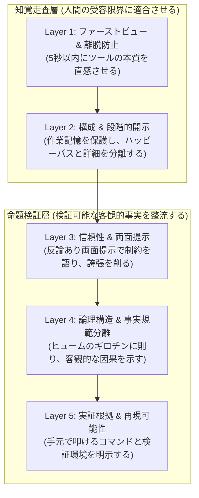

# ドキュメント工学の5層アーキテクチャ解説：認知科学と実証研究でつくる「読まれる技術文書」

本稿では、「ドキュメント論─個人的な自由研究」リポジトリにおいて設計した**「技術文書を診断・改善するための5層アーキテクチャ」**について解説します。

近年の生成AIの普及によって、流暢なドキュメントを一瞬で作れる時代になりました。しかしその一方で、「表層は綺麗だけど中身のない誇張表現が混ざる」「情報が詰め込みすぎて途中で読むのをやめてしまう」「仕様ではなく執筆者のお説教や主観が書かれている」といった、実践的なドキュメント作りの課題に直面することも増えています。

文章の表面的な「てにをは」を整えるツールはたくさんありますが、そもそも「読者がどうドキュメントを読み、どう判断しているのか」を紐解いた設計論はあまり多くありません。
そこで本リポジトリでは、**認知心理学の実験データ、オープンソース大規模リポジトリの実証分析、そして形式論理学の枠組み**をヒントに、技術ドキュメントの品質を整理・診断するための仮説モデルとして5層のアーキテクチャを設計してみました。

なぜこの5層に分けたのか、それぞれの層で何を狙っているのか、その背景にある知見とともに解説します。

---

## 5層アーキテクチャの全体像

本アーキテクチャでは、技術ドキュメント（GitHubのREADME、API仕様書、設計解説書など）の構成要素を、**「知覚走査層（L1〜L2）」**と**「命題検証層（L3〜L5）」**の2つの大きなフェーズ、合計5つのレイヤーに分けてモデル化しています。



読者がドキュメントを開いてから、内容を理解し、実際にツールを採用・実行するまでのプロセスを段階的に分解し、それぞれのステップで生じやすい「認知的負担」や「不信感」を解消していく設計です。

以下、各レイヤーをなぜ設計したのか、その理由とヒントにした先行研究を順に見ていきます。

---

## Layer 1: ファーストビュー & 離脱防止 (Above the Fold)

### 1. なぜファーストビューに着目したのか（設計の理由）
ドキュメントを読んでもらう上で一番最初のハードルになるのが、「そもそも読まれずに閉じられてしまう（即座の離脱）」という問題です。
ウェブページやGitHubのREADMEを開いた読者の視線を追ったアイトラッキング研究などを見ると、閲覧時間の半分以上（約57%）はスクロール前の最上部1画面（Above the Fold / およそ最初の50行以内）に集中するという傾向が報告されています。

つまり、最初の一目で「このツールは何で、自分に関係あるのか」が直感できなければ、どれだけ後半に充実した解説を書いても読者に届きません。そこでLayer 1では、ファーストビューで読者の迷いをなくすための構造を配置することにしました。

### 2. 先行研究から見えてきたヒント

#### 「What」と「Why」の需給ギャップ
Pranaら（2019年）がGitHubの393リポジトリ（4,226セクション）を調査した研究によると、多くのREADMEには使い方（How: 88.5%）や概要（What: 97.0%）が書かれている一方で、「なぜそれを使うのか（Why）」の記載率はわずか25.7%にとどまることがわかりました。

> **(Original)**  
> *"Our findings show that while 'What' and 'How' are commonly included in README files, other categories such as 'Why' and 'When' are frequently missing... This creates an information gap for developers evaluating software."*  
> **(日本語訳)**  
> 「我々の調査結果は、READMEにおいて『What（何であるか）』や『How（使い方）』が一般的に含まれる一方で、『Why（なぜそれを使うか）』や『When（制約やロードマップ）』が頻繁に欠落していることを示している。これはソフトウェアを評価する開発者にとって深刻な情報ギャップを生み出している。」  
> *(出所: Gede Artha Azriadi Prana et al., 2019, `[REF-PRANA2019]`)*

開発者が新しいツールの採用を検討するとき、他の選択肢との違いや設計思想（Why）が冒頭に見当たらないと、自分の用途に合っているかをスムーズに判断できなくなります。

#### 最初のコードはシンプルな構文が好まれる（Level A構文）
ツールの高機能さをアピールしようとして、導入コードに技巧的な構文を詰め込みたくなることがあります。しかし、Sitthithanasakulら（2023年）がPyPIライブラリ1,620件のREADMEを分析したところ、よく読まれているREADMEのコードスニペットの**92%は、単純な変数代入や属性アクセスといった基本的な構文（Level A）**で書かれていました。

> **(Original)**  
> *"92% of the code snippets in Python READMEs consist of Level A (Basic) language constructs, such as simple assignments and attribute accesses. Advanced constructs (Level C) account for only 1%... Code snippets are visual anchors for rapid comprehension, not demonstrations of language mastery."*  
> **(日本語訳)**  
> 「Python README内のコードスニペットの92%は、単純な変数代入や属性アクセスといったLevel A（基本）構文で構成されている。高度な技巧的構文（Level C）はわずか1%にすぎない。コードスニペットは迅速な理解のための視覚的アンカーであり、言語の技巧を誇示する場ではない。」  
> *(出所: Supavas Sitthithanasakul et al., 2023, `[REF-SITTHI2023]`)*

技巧的な構文（Level C）は全体のわずか1%程度です。冒頭のクイックスタートでは、技巧を見せるのではなく、読者の作業記憶に余計な負担をかけないプレーンなコードを置くアプローチが理にかなっています。

### 3. Layer 1 で採用している工夫
- **LSP One-Liner**: `[言語] implementation of [技術] for [目的]` の形式を目安に、主観的な誇張表現を使わずに1行でツールの本質を伝えます。
- **Minimal Quick Start**: 依存関係の少ない自己完結した最小手順を、3行以内の平易な構文で配置します。
- **False Floor（完了の錯覚）の防止**: ファーストビューの境界付近に太い水平線（`---`）を引いてしまうと、読者が「ここで記事が終わった」と錯覚してスクロールを止めてしまうことがあります。次の見出し（H2）を画面下部の境界線に少し跨がせるようなレイアウトを意識して、自然なスクロールを促します。

---

## Layer 2: 構成 & 段階的開示 (Progressive Disclosure)

### 1. なぜ情報の出し入れを整理する必要があるのか（設計の理由）
誠実なドキュメントを作ろうとして、ツールのすべてのオプションや内部仕様を1ページに並べてしまうと、初見の読者は情報量の多さに圧倒されてしまいます。
人間の作業記憶（ワーキングメモリ）には限界があり、一度に大量の並列項目や巨大な設定表を見せられると、脳内で処理しきれずに疲れて離脱してしまいます。

だからといって詳細を削り落としてしまっては、本格的に使いたい人にとって不親切です。そこでLayer 2では、「最短で動かしたい人向けの道筋」と「じっくり調べたい人向けのリファレンス」をうまく切り分ける工夫を取り入れました。

### 2. 先行研究から見えてきたヒント

#### 初見時の作業記憶容量（$4 \pm 1$ / 中央値 4）
短期記憶の容量としてはMiller（1956年）の「$7 \pm 2$」が有名ですが、Cowan（2001年）の実証研究によると、事前の知識を持たない初見情報に対して純粋に注意を向けられる容量は**「$4 \pm 1$（中央値 4項目）」**程度であることが示されています。

> **(Original)**  
> *"A wide variety of evidence indicates that the capacity of the focus of attention in young adults is about 4 items... pure capacity without prior schema is strictly limited to 4."*  
> **(日本語訳)**  
> 「広範な実証証拠は、注意の焦点の純粋な容量が約4項目であることを示している。事前のスキーマを持たない初見時の純粋容量は厳格に4項目に制限される。」  
> *(出所: Nelson Cowan, 2001, `[REF-COWAN2001]`)*

ひとつのセクションに機能一覧や引数が5個以上フラットに並んでいると、読者は一目で全体像を掴みにくくなります。意味のあるグループにまとめたり、階層化したりするアプローチが有効です。

#### 注意分割効果（Split-Attention Effect）
Swellerら（2011年）の認知負荷理論（CLT）では、関連する情報があちこちに散らばっていると、読者が視線を行き来させて頭の中で繋ぎ合わせるための余計な負荷（外生性認知負荷）が増えてしまうと指摘されています。

> **(Original)**  
> *"When multiple sources of information are physically separated in space or time, learners must split their visual attention and mentally integrate them, placing unnecessary extraneous cognitive load on working memory."*  
> **(日本語訳)**  
> 「複数の情報源が空間的または時間的に分離されている場合、学習者は視覚的注意を分割して脳内で統合しなければならず、ワーキングメモリに無用な外生性認知負荷を課すことになる。」  
> *(出所: John Sweller et al., 2011, `[REF-SWEL2011]`)*

コードブロックを見せた後に、遠く離れた別のセクションでそのオプションを解説するような構成は、読者の探す手間を増やしてしまいます。

### 3. Layer 2 で採用している工夫
段階的開示（Progressive Disclosure）は、単なる折りたたみギミックではなく、**「認知心理学のグルーピング」**と**「ソフトウェア工学の関心事の分離（SoC）」**を組み合わせた考え方です。

- **ハッピーパス（Tier 1 / Tier 2）**: 初めて触るユーザーが最短で動作確認をするためのメイン動線。
- **深層リファレンス（Tier 3）**: 全CLIフラグ一覧、環境変数表、内部スキーマ、エッジケースの解説。

この2つは読者の関心空間がはっきり分かれています。Markdownであれば `<details>` タグで必要な人だけが開けるようにし、プレーンテキストなら末尾の付録や別ファイルへ逃がすことで、初動の読みやすさと情報の網羅性を両立させます。また、見出しが4個以上ある長めの文書では、目次（TOC）を置いて目的の場所にすぐジャンプできるようにします（Su et al., 2012, `[REF-SU2012]`）。

---

## Layer 3: 信頼性 & 両面提示 (Two-Sided Signaling)

### 1. なぜ「弱点」を語る必要があるのか（設計の理由）
AIで文章が手軽に作れるようになった現代、Paramithaら（2026年）の調査でも指摘されているように、事実無根の誇張や美辞麗句（「究極」「最高峰」など）で飾られたドキュメントが溢れ、技術者からの信頼を失いやすくなっています。

一方で、ツールの制約やできないことをただ箇条書きで投げ出すだけでは、読者に「じゃあ使うのやめよう」と不採用の口実を与えることになってしまいます。
「嘘をつかずに誠実に弱点を開示しつつ、読者に納得してもらうにはどう書けばいいのか？」という問いへの答えがLayer 3です。

### 2. 先行研究から見えてきたヒント

#### 単なる弱点開示と「反論あり両面提示」の違い
Allen（1991年）やO'Keefe（1999年）の大規模なメタアナリシス研究によると、**単に欠点や制約を並べただけの文章（反論なし両面提示）は、メリットだけを書いた文章（片面提示）よりも説得力を落としてしまう**という興味深いデータが示されています。

> **(Original)**  
> *"Nonrefutational two-sided messages are significantly less persuasive than one-sided messages (r = -.060)... However, refutational two-sided messages—which mention opposing arguments and refute them—are significantly more persuasive (r = .076) and credible."*  
> **(日本語訳)**  
> 「反論のない単なる両面提示（弱点の垂れ流し）は、片面提示よりも有意に説得力が劣る（r = -.060）。しかし、反対意見や制約に言及した上でそれを論駁・解消する『反論あり両面提示』は、有意に高い説得力（r = .076）と信頼性を獲得する。」  
> *(出所: Mike Allen, 1991, `[REF-ALLEN1991]`)*

発信者の「正直さ」は伝わっても、代替案や理由がないと読者は安心して採用できません。説得力と信頼性の両方を高めるアプローチは、**「制約を提示した上で、なぜその設計にしたのかというトレードオフの理由と、どう代替できるかを示す『反論あり両面提示（Refutational Two-Sided）』」**だと考えられます。

### 3. Layer 3 で採用している工夫：制約開示の「3連タプル構文」
制約事項（Limitations）をただ並べるのではなく、以下の3つの要素をセットにして書く工夫をしています。

```markdown
- **[制約事実]**: 大規模な分散クラスタ環境には対応していません。
  - *設計理由（トレードオフ）*: 単一ノードでのディスクI/Oスループットを最優先するため、ネットワーク調停処理を省いた軽量設計にしているためです。
  - *代替策・推奨構成*: 複数マシンを跨ぐTB級のデータ処理にはApache Sparkなどの利用を推奨します。単一マシンで完結する100GB未満のログ解析で最大の効果を発揮します。
```

また、Kaminsら（1989年、`[REF-KAMINS1989]`）の研究にあるように、開示する制約はツールの存在意義そのものを否定する致命傷ではなく、「得意な規模やスコープの特化」といった中程度のトレードオフを選ぶことで、読者にとって納得感のある説明になります。

---

## Layer 4: 論理構造 & 事実規範分離 (Logic & Hume's Guillotine)

### 1. なぜ「〜すべき」という説教をやめるのか（設計の理由）
技術文書に「開発者は常にこのコマンドを使うべきである」「この設計が推奨される」といった表現が増えてくると、ツールの客観的な仕様と著者の主観的な価値観がごちゃまぜになってしまいます。
読者が知りたいのは「この機能を使うと、自分の環境で何が起きるのか」という客観的な事実です。著者の押し付けを減らし、ロジックをクリアにするのがLayer 4の狙いです。

### 2. 先行研究・論理学から見えてきたヒント

#### ヒュームのギロチン（Is-Ought Problem）
哲学者デイヴィッド・ヒュームが1739年に指摘したように、**「〜である（事実: is）」という客観的事実から、正当な導出理由なしに「〜すべきである（規範: ought）」を導くことは論理的にできません**。

> **(Original)**  
> *"In every system of morality, which I have hitherto met with, I have always remark'd, that the author proceeds for some time in the ordinary way of reasoning... when of a sudden I am surpriz'd to find, that instead of the usual copulations of propositions, is, and is not, I meet with no proposition that is not connected with an ought, or an ought not."*  
> **(日本語訳)**  
> 「これまでに私が出会ったあらゆる倫理体系において、著者はしばらくの間は通常の推論法で進めていく……しかし突如として、通常の『〜である（is）』『〜ではない』という命題の結合の代わりに、『〜すべきである（ought）』『〜すべきではない』という結合ばかりが現れることに私は驚かされる。」  
> *(出所: David Hume, 1739, `[REF-HUME1739]`)*

著者の「こうあるべき」という主観を交えず、ツールの客観的な振る舞いだけを伝えることで、論理の飛躍を防ぎます。

#### 見かけ倒しの解説を避ける
Börstler & Paech（2016年、`[REF-BORST2016]`）の実証研究では、コードの構文をそのまま日本語でなぞっただけの説明（例: `getUser() はユーザーを取得する関数です`）は、読者に「読めたつもり」にさせるだけで、実際の仕様理解テストの成績にはほとんど貢献しないことが示されています。

### 3. Layer 4 で採用している工夫：客観的条件付き因果文への書き換え
「〜すべき」という説教調の文を見つけたら、以下のような**客観的条件付き因果文（Conditional Predictive Statement）**へ整流します。

> **「［こういう目的や前提条件］がある場合、［この機能・設定］を使うことで［こういう結果］が得られます」**

前提条件、入力、出力、副作用の因果関係だけをクリアに提示し、実際にそれを使うかどうかの判断は読者の自律性に委ねます（Rahman 2025, `[REF-RAHMAN2025]`）。

---

## Layer 5: 実証根拠 & 再現可能性 (Empirical Grounding)

### 1. なぜ「数字」だけでは不十分なのか（設計の理由）
「従来比10倍高速」「メモリ使用量を80%削減」といった華々しい数字が並んでいても、どんなマシンで、どんなデータを使って測定したのかが書かれていなければ、読者にとっては確かめようのない「浮遊した数字（Numbers are a Mirage / 蜃気楼）」に過ぎません。
技術者が本当に信用できるのは、「自分の手元でも同じように動かして確かめられる」再現性のある情報です。

### 2. 先行研究から見えてきたヒント

#### 再現可能な研究（Reproducible Research）の原則
計算科学の分野でRoger D. Peng（2011年、Science誌）が論じているように、信頼性の根幹は第三者が追試・再現できることにあります。

> **(Original)**  
> *"The replication of findings by other investigators is the gold standard of scientific credibility... In computational sciences, the publication of complete runnable commands and code artifacts alongside claims is essential for verification."*  
> **(日本語訳)**  
> 「他の研究者による結果の追試・再現こそが、科学的信頼性のゴールドスタンダードである。計算科学においては、主張と並んで完全な実行可能コマンドとコード資産を公開することが検証に不可欠である。」  
> *(出所: Roger D. Peng, 2011, `[REF-PENG2011]`)*

読者が自分の手元で検証できない数値は、技術ドキュメントとしての確かな根拠になりません。

### 3. Layer 5 で採用している工夫：NaaM 4要素タプルと単体実行コマンド
性能やベンチマークを記載するときは、以下の**4つの測定条件（NaaM 4要素タプル）**をセットで書くアプローチを採っています。

1. **測定環境（Hardware & Runtime）**: CPUモデル、メモリ容量、OS、ランタイムのバージョン
2. **測定データセット（Workload / Dataset）**: 行数、ファイルサイズ、データの偏り
3. **比較対象（Baseline）**: 比較した他ツール名と正確なバージョン
4. **統計データ（Trials & Variance）**: 試行回数とばらつき（平均値 $\pm$ 標準偏差など）

さらに、読者がターミナルにコピペしてすぐ試せる**「自己完結した実行可能コマンド」**と、実行後に期待される**「標準出力やステータスコード」**を併記することで、読者が自分の手で挙動を確かめられるようにしています。

---

## 5層の対応関係まとめ

| 層 | レイヤー名 | 設計のねらい | 参考にした主な知見 | 主な工夫・ルール |
| :--- | :--- | :--- | :--- | :--- |
| **L1** | ファーストビュー & 離脱防止 | 最初の1画面でツールの本質を伝え、離脱を防ぐ | Prana et al. (2019)<br>Sitthithanasakul et al. (2023) | LSP One-Liner<br>Level A構文による最小Quick Start<br>False Floor防止 |
| **L2** | 構成 & 段階的開示 | 初見読者の作業記憶を守り、メイン導線と詳細を分ける | Cowan (2001)<br>Sweller et al. (2011)<br>Su et al. (2012) | Cowan容量の意識（並列項目 $\le 4$ 個）<br>SoCに基づく `<details>` 分離<br>見出し4個以上での目次設置 |
| **L3** | 信頼性 & 両面提示 | 誇張を削り、制約を理由とセットで語って信頼を得る | Allen (1991)<br>O'Keefe (1999)<br>Paramitha et al. (2026) | 誇張表現の切削<br>反論あり両面提示（3連タプル構文）<br>中程度のトレードオフ開示 |
| **L4** | 論理構造 & 事実規範分離 | 規範的な説教をやめ、客観的な事実と因果関係を示す | David Hume (1739)<br>Börstler & Paech (2016) | ヒューム正規化（条件付き因果文への書き換え）<br>構文なぞり説明の排除 |
| **L5** | 実証根拠 & 再現可能性 | 浮遊した数字を避け、読者が手元で検証できるようにする | Roger D. Peng (2011)<br>NaaM Framework (2026) | NaaM 4要素タプルの開示<br>実行可能コマンドと期待出力の対配置 |

---

## おわりに

技術ドキュメントの改善は、難しい学術用語で着飾ることでも、精神論で「良い文章を書く」ことでもありません。
読者の目線の動きや作業記憶の限界を理解し、書かれている機能や数値に対して客観的な検証可能性を持たせる、実践的な設計プロセスです。

- **人間（設計者）**: なぜそのドキュメントが必要なのか、どういう思想で何を作ったのかという「種」と境界条件を規定する。
- **AI（エージェント）**: ルールに従って、余計な誇張やお説教を削ぎ落とし、読みやすく検証可能な形へと整流する。

この役割分担がうまく機能したとき、書き手にとっても読み手にとっても誠実で、すんなり頭に入ってくるドキュメントが生まれると考えています。

本アーキテクチャの判定ルールを具体化したエージェントスキル `doc-refine` は、本リポジトリの `skills/doc-refine/` に配備されています。また、本稿で紹介した各文献の書誌情報やDOIリンクは [`CITATIONS.md`](./CITATIONS.md) にまとめてあります。気になった方は、ぜひ元論文も覗いてみてください。
