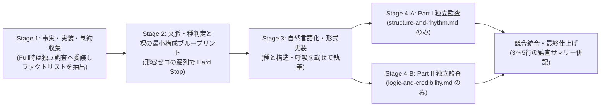

# エージェントスキル `doc-refine` の設計と構造 (ARCHITECTURE)

このドキュメントは、本リポジトリの理論本編である **[`PAPER.md`](./PAPER.md)**（Part I〜III × 読者処理プロセス順5本柱）を、AIエージェントが実際に動かせるスキル **[`skills/doc-refine/`](./skills/doc-refine/)** としてどのように設計・実装したのか（「どの部分が、どの論文や仕様のどういう考え方を利用しているのか」）を解説するアーキテクチャ文書です。

研究を始めたきっかけや問題意識については **[`PHILOSOPHY.md`](./PHILOSOPHY.md)** に、理論そのものの体系については **[`PAPER.md`](./PAPER.md)** に、参考文献の書誌情報については **[`REFERENCES.md`](./REFERENCES.md)** にまとめています。

---

## 目次

- [1. はじめに：なぜスキル本体には論文名が書かれていないのか](#1-はじめになぜスキル本体には論文名が書かれていないのか)
- [2. スキルの骨格：段階的開示の自己適用と4段階パイプライン](#2-スキルの骨格段階的開示の自己適用と4段階パイプライン)
  - [2.1 3段階のコンテキスト設計と1監査パス＝1リファレンス対応](#21-3段階のコンテキスト設計と1監査パス1リファレンス対応)
  - [2.2 「0→1 / 1→10」や固定テンプレートを作らない理由](#22-01--110や固定テンプレートを作らない理由)
  - [2.3 なぜ1パス生成をやめ、4段階パイプラインと2系統独立監査にしたのか](#23-なぜ1パス生成をやめ4段階パイプラインと2系統独立監査にしたのか)
- [3. Part III：文脈適応（`context-adaptation.md`）が利用している理論](#3-part-iii文脈適応context-adaptationmdが利用している理論)
  - [3.1 専門性逆転効果と読者層による分かりやすさ評価の乖離](#31-専門性逆転効果と読者層による分かりやすさ評価の乖離)
  - [3.2 透明性の逆説と控えめな説得（Unobtrusiveness）](#32-透明性の逆説と控えめな説得unobtrusiveness)
  - [3.3 なぜ `context-adaptation.md` に文書種別ごとの絵文字ルールを書かないのか](#33-なぜ-context-adaptationmd-に文書種別ごとの絵文字ルールを書かないのか)
- [4. Part I：知覚・空間構造・文章リズム（`structure-and-rhythm.md`）と先行研究の対応関係](#4-part-i知覚空間構造文章リズムstructure-and-rhythmmdと先行研究の対応関係)
  - [4.1 第1の柱：視線と初動（Attention & Onboarding）](#41-第1の柱視線と初動attention--onboarding)
  - [4.2 第2の柱：空間構造と形式設計（Space, Structure & Format）](#42-第2の柱空間構造と形式設計space-structure--format)
  - [4.3 第3の柱：文章のリズムと呼吸（Rhythm, Breathing & Prose Hygiene）](#43-第3の柱文章のリズムと呼吸rhythm-breathing--prose-hygiene)
- [5. Part II：論理・誠実さ・境界開示（`logic-and-credibility.md`）と先行研究の対応関係](#5-part-ii論理誠実さ境界開示logic-and-credibilitymdと先行研究の対応関係)
  - [5.1 第4の柱：論理と必然性（Logic & Necessity）](#51-第4の柱論理と必然性logic--necessity)
  - [5.2 第5の柱：信頼・誠実さと境界開示（Credibility, Honesty & Boundaries）](#52-第5の柱信頼誠実さと境界開示credibility-honesty--boundaries)
- [6. 任意制御オプション（`emoji-control.md` と `detect_emoji.py`）の設計根拠](#6-任意制御オプションemoji-controlmd-と-detect_emojipyの設計根拠)
- [7. 対応関係一覧表（スキル構成要素 × 理論・文献マトリクス）](#7-対応関係一覧表スキル構成要素--理論文献マトリクス)

---

## 1. はじめに：なぜスキル本体には論文名が書かれていないのか

[`skills/doc-refine/`](./skills/doc-refine/) の中にあるファイル（`SKILL.md` や `references/*.md`）を開くと、そこには学者名も、論文の発表年も、$`p < .05`$ といった統計値も一切登場しません。

これは、**「理論を検証・理解する人間（指示者）」と「目の前の文書を組み立てるAIエージェント（作業者）」とで、必要とする情報の形が異なるため**です。

AIエージェントのスキル定義に論文名や統計データをそのまま書き込むと、限られたコンテキストウィンドウ（トークン予算）を圧迫するだけでなく、AIが生成するREADMEや設計書の本文にまで学術用語や論文調の固い表現がにじみ出てしまいます。かといって、「なぜそうするのか」という理由をすべて削ぎ落として「この見出しの穴埋めテンプレート通りに書け」とだけ指示すると、AIはジョークアプリにも業務仕様書にも同じ見出しを押し付けるようになります。

そこで `doc-refine` では、以下の2層に役割を分けています。

1. **スキル本体（[`skills/doc-refine/`](./skills/doc-refine/)）**:
   学者名や統計値を外す（脱文献化する）代わりに、各原則の要所に **「読者のどのような認知的・論理的摩擦を和らげるための操作なのか」という1〜2文の因果メカニズム（ミニ Why）** だけを埋め込んでいます。これにより、AIは「何のためにそのレンズがあるのか」を理解したうえで、対象の文脈に合わせて柔軟に応用できます。
2. **本ドキュメント（`ARCHITECTURE.md`）**:
   スキル本体から外した「学術的・工学的な裏付け」を人間向けに開示し、スキルのどのパートがどの論文・仕様の考え方を利用しているのかを紐解きます。

---

## 2. スキルの骨格：段階的開示の自己適用と4段階パイプライン

`doc-refine` のディレクトリ構成とファイル分割は、特定ベンダーの独自機能に依存しないオープン標準である **AgentSkills.io 仕様**（`Specification.md` / `Overview.md`）、**Anthropic の Skill Authoring Best Practices**、および **Google Antigravity の Agent Skills ガイド**の3つをベースに設計し、[`PAPER.md`](./PAPER.md) の Part I〜III 構成と1対1で対応させています。

```text
skills/doc-refine/
├── SKILL.md                          # 4段階パイプライン、Full/Liteスケーリング、2系統独立監査・競合統合プロトコル
├── references/
│   ├── context-adaptation.md         # Part III: 文脈・読者層適応、「種」の保護、Before/After具体例
│   ├── structure-and-rhythm.md       # Part I: 視線・初動、空間構造・形式選択、文章のリズムと呼吸（監査パスA用）
│   ├── logic-and-credibility.md      # Part II: 論理・必然性、信頼・誠実さ、API値域境界・動的I/O例（監査パスB用）
│   └── emoji-control.md              # 絵文字を含めない方針・検査依頼時のみ参照するオプトイン手順
└── scripts/
    ├── detect_emoji.py               # 出力内のUnicode絵文字・ショートコード検知ツール（ブラックボックス実行）
    ├── emoji_data.py                 # 同梱Unicode絵文字データ（オフライン実行用）
    └── _generate_emoji_data.py       # メンテナンス時にemoji_data.pyを再生成する補助スクリプト
```

### 2.1 3段階のコンテキスト設計と1監査パス＝1リファレンス対応

[**`PAPER.md` 第3章**](./PAPER.md) で扱っている「段階的開示（Progressive Disclosure：`[REF-NIELSEN2006]` / `[REF-SPRING2020]`）」の考え方を、スキル自身のファイル構造にも自己適用しています。

1. **Stage 1: Discovery（YAML Frontmatter / 約100トークン）**
   エージェントが起動時に常時読み込むメタデータです。`description` は三人称で記述し、内部ワークフローのネタバレを避けつつ、「どのような文書に対して、いつ発動するか（`Use when...`）」というトリガー条件とスコープを明示しています。
2. **Stage 2: Activation（[`SKILL.md`](./skills/doc-refine/SKILL.md) 本体）**
   スキルが呼ばれたときに読み込まれる中核プロトコルです。500行以内というコンテキスト予算の目安を大幅に下回る規模に収め、4段階パイプライン、Full / Lite スケーリング、独立監査の委譲・競合統合ルールを定義しています。
3. **Stage 3: On-Demand References & Scripts（`references/` および `scripts/`）**
   `SKILL.md` から **1階層の相対リンク** で直接参照される詳細リファレンス群と実行スクリプトです。以前の単一ファイル（`principles.md`）を Part I（`structure-and-rhythm.md`）と Part II（`logic-and-credibility.md`）へ分割したことで、**Stage 4 の各監査パスが自分の担当リファレンス1本だけを読む構成（1監査パス＝1リファレンス対応）** を実現しています。各リファレンス冒頭には目次（Contents）を置き、情報採餌の手がかり（`[REF-SU2012]`）を提供しています。
   また、[`references/emoji-control.md`](./skills/doc-refine/references/emoji-control.md) と [`scripts/detect_emoji.py`](./skills/doc-refine/scripts/detect_emoji.py) はオプトイン専用とし、通常時のトークン消費を抑えています。

### 2.2 「0→1 / 1→10」や固定テンプレートを作らない理由

- **使途を限定しない原則のモジュール化**:
  実際のドキュメント作業は「新規作成」と「既存推敲」の二択ではなく、追記・構成整理・仕様監査が連続的に発生します。認知負荷や論理・リズムの原則はどの場面でも共通して働くため、タスク種別ではなく理論の関心事（Part I / II / III）でファイルを分割しています。
- **構造的一致仮説（`[REF-KNIGHT2010]`）と書き手の自律性（`[REF-MYNAMPATY2026]`）**:
  Yin & Knight (2010) の構造的一致仮説が示す通り、ドキュメントの構造は対象ソフトウェアの構造や目的に合わせるほど理解と保守が容易になります。また Mynampaty et al. (2026) も、良いドキュメントの基準はプロジェクトや読者コミュニティによって異なり、書き手の自律性（Authorial Agency）を奪わずに点検を支援する設計が有効であることを示しています。

### 2.3 なぜ1パス生成をやめ、4段階パイプラインと2系統独立監査にしたのか

1回の出力ターンで「空間構造・形式選択」「仕様境界・動的I/O・実装整合」「文章のリズムと呼吸」をすべて同時に満たそうとすると、次の2つの問題が生じます。

1. **流暢な表現による論理・事実欠落の隠蔽**: 最初から自然な文章を書こうとすると、形容詞や丁寧な繋ぎ言葉によって論理の飛躍や値域・境界条件の抜けが覆い隠されやすくなります。
2. **ルール一括投入による検出低下と確証バイアス**: Mynampaty et al. (2026)（`[REF-MYNAMPATY2026]`）の実験では、自由プロンプト（平均 `9.6` 件）に対し、**ルールを一括付与したプロンプトでは問題検出数が平均 `7.25` 件へ低下**した一方、**スタイルと実質を次元別・項目別に分解して評価する方式では平均 `25.4` 件**へ3倍以上に向上しました。さらに執筆直後の同一コンテキストには、自分が生成した文章へのアンカリングが強く残ります。

そこで `doc-refine` では、以下の **4段階パイプライン** と **Full / Lite スケーリング** を採用しています。



- **Stage 1（事実・実装・制約の収集）**: コード整合性、値域・境界挙動、実出力例、周辺スクリプト制約をファクトリストとして分離収集します（Full かつ独立コンテキスト利用可能時は委譲）。
- **Stage 2（裸の最小構成ブループリント ＋ Hard Stop）**: 形容詞や装飾を一切排した「裸の事実・命題・因果鎖・値域境界・動的I/O例・制約3点セット・形式割り当て」の羅列を作り、ユーザーへ提示して承認を待ちます（`[REF-CEMILOGLU2021]` / `[REF-RAHMAN2024]` / `[REF-BENNER2022]` の説明可能な説得・自律性保護）。文章化前に骨格を丸裸にすることで、論理や事実の抜けをユーザーと共有しやすくなります。
- **Stage 3（自然言語化・形式実装）**: 承認済みブループリントとファクトリストを土台に、書き手の「種（Seed）」の温度感・構造化形式・黙読の呼吸を載せてドラフトを執筆します。
- **Stage 4（2系統の次元別独立監査・競合統合・監査サマリー）**:
  - **監査パスA（Part I）** は `structure-and-rhythm.md` のみ、**監査パスB（Part II）** は `logic-and-credibility.md` とファクトリストのみを参照します。Full かつ独立コンテキストが利用できる環境では2系統を別コンテキストへ委譲し、非対応環境や Lite（部分追記・短いメモ・PR説明等）では同一エージェントが観点を明示的に切り替えて順次実行する汎用フォールバックを備えています。
  - パスAとパスBの指摘が競合した場合は、「事実・実装整合・境界条件は削らず構造と呼吸で吸収する」「書き手の種と文脈を保護する」「スキル内部用語や論文名を露出させない」という競合統合ルールでメイン側が統合し、反映点と見送ったトレードオフを3〜5行の監査サマリーとして添えます。

---

## 3. Part III：文脈適応（`context-adaptation.md`）が利用している理論

[`references/context-adaptation.md`](./skills/doc-refine/references/context-adaptation.md) は、「実用CLI・OSSライブラリ」「エンタメ・ジョークアプリ」「内部アーキテクチャ設計書・仕様書」「技術解説記事」「プレーンテキスト（`.txt`）・コード内コメント・PR説明」の文脈ごとに5つの柱の重み付けを変える基準と、9種の Before / After 具体例を定めています。

### 3.1 専門性逆転効果と読者層による分かりやすさ評価の乖離

- **専門性逆転効果（`[REF-KALYUGA2011]`）**: 初心者向けの丁寧な基礎解説は、すでに前提知識を持つ熟達者にとっては外在性認知負荷となり読解を妨げます。
- **読者層・熟練度による評価の乖離（`[REF-TAKAHASHI1995]` / `[REF-MYNAMPATY2026]`）**: 高橋ら（1995）は、操作手順書と概念説明書で評価の安定性が異なること、手慣れた形式への親近度バイアスがあることを示しました。また Mynampaty et al. (2026) は、専門外読者向け（専門用語の抑制）と同僚・保守担当者向け（細粒度の詳細網羅）で適切な詳細水準が反転することを報告しています。

### 3.2 透明性の逆説と控えめな説得（Unobtrusiveness）

Springer & Whittaker (2020)（`[REF-SPRING2020]`）の透明性の逆説と、Nabwire et al. (2026a)（`[REF-NABWIRE2026A]`）の透明性＋控えめさ（Unobtrusiveness）の知見に基づき、エンタメ・ジョークアプリや短い文書に対して過剰な課題論証・3段制約表・不要な折りたたみを押し付けない基準を設けています。

### 3.3 なぜ `context-adaptation.md` に文書種別ごとの絵文字ルールを書かないのか

[**`PAPER.md` 第7.1節**](./PAPER.md) で論じている通り、文書種別ごとの禁止令や固定配置基準をマニュアル化すると、AIエージェントが文脈を見ずに画一的な検閲・削ぎ落としを始めやすくなります。そのため、視覚記号の認知・アクセシビリティ上のトレードオフは [`structure-and-rhythm.md`](./skills/doc-refine/references/structure-and-rhythm.md) に置き、「絵文字を使わない」方針を選んだ場合の抑止と機械検査はオプトイン専用の [`emoji-control.md`](./skills/doc-refine/references/emoji-control.md) へ切り分けています。

---

## 4. Part I：知覚・空間構造・文章リズム（`structure-and-rhythm.md`）と先行研究の対応関係

[`references/structure-and-rhythm.md`](./skills/doc-refine/references/structure-and-rhythm.md) に収録された3つの柱（計13項目）と先行研究の対応関係です。

### 4.1 第1の柱：視線と初動（Attention & Onboarding）

- **§1.1 最初の画面での具体定義、Why / When、読解2段階の使い分け**:
  - 最初の画面への視線集中（57% / 上位2画面74%：`[REF-NIELSEN2018]`）、読解初期1〜2秒の動機づけ効果と読解最中の精緻化効果のトレードオフ（`[REF-SHIMADA2008]`）、What偏重と Why（74.3%欠落）/ When（78.6%欠落）の実態（`[REF-PRANA2019]`）、LSP具体定義と5秒テスト・Jargon排除（`[REF-HELLMAN2023]`, `[REF-DRY2020]`, `[REF-SHAPIRO2020]`）。
- **§1.2 最短動線の単一化と基本構文（Minimal Onboarding）**:
  - 競合選択肢による決定麻痺の回避（`[REF-UNBOUNCE2022]`, `[REF-GAUGHAN2025]`, `[REF-FRONCH2023]`）、PyPI README コードスニペットの92%を占める基本構文（Level A）の優位性（`[REF-SITTHI2023]`, `[REF-DANTAS2023]`）。
- **§1.3 視覚的連続性と「偽の床（False Floor）」の回避**:
  - 折り目直上の視認性73%対直下44%と、冒頭直後の孤立水平線・大余白によるスクロール離脱（`[REF-MULLIN2023]`, `[REF-NIELSEN2018]`）。

### 4.2 第2の柱：空間構造と形式設計（Space, Structure & Format）

- **§2.1 作業記憶の保護（3〜5チャンク）と段階的配列**:
  - 初見情報の注意焦点容量 $`4 \pm 1`$ チャンク（`[REF-COWAN2001]`）と外在性認知負荷の削減（`[REF-DURAN2022]`）、短いテキストから長いテキストへ段階的に並べる配列効果（`[REF-LIU2023]`）。
- **§2.2 空間的近接（注意の分散防止）と非トートロジー解説**:
  - 注意分割効果（Split-Attention Effect：`[REF-SWEL2011]`, `[REF-KALYUGA2011]`）、主観的可読性と客観的理解度の非相関（`[REF-PAECH2016]`）。
- **§2.3 情報を削らない段階的開示（3層分離 × 媒体適応 × 目次）**:
  - 情報深度（High Information Depth）選好と段階的開示（`[REF-ANIK2026]`）、3層選択的透明性（`[REF-MURALI2025]`）、透明性の逆説（`[REF-SPRING2020]`）、README長さと魅力の逆U字関係（`[REF-ABDUL2026]`）、情報採餌と3段階探索（位置特定→精読→境界特定：`[REF-SU2012]`, `[REF-SU2020]`, `[REF-NAGHSHZAN2023]`, `[REF-NIELSEN2006]`, `[REF-HORTON2006]`）。
- **§2.4 構造化形式の使い分け（箇条書き・文見出し・表・グラフ／図解）**:
  - 箇条書きの視線安定・ホットスポット形成と人気README実態（`[REF-SHIMADA2016]`, `[REF-SATO2026]`, `[REF-VENIGALLA2022]`）対、平坦化・因果隠蔽の欠陥と文見出し＋構造的証拠（Assertion-Evidence）による理解向上（`[REF-ALLEY2005]`, `[REF-ALLEY2006]`, `[REF-GARNER2013]`, `[REF-ALSAGER2022]`）。
  - 表（Fact box）の比較理解向上（$`d = 0.39`$）と仮想分母誤認リスク（`[REF-BRICK2020]`）、グラフの記憶定着優位（`[REF-SATO2026]`）。
- **§2.5 説明的図解と装飾的視覚要素・アクセシビリティ摩擦の区別**:
  - 説明的グラフィックス（$`d = 0.79`$）と装飾・魅惑的グラフィックスの乖離（`[REF-SUNG2012]`, `[REF-DANIELSON2012]`, `[REF-SCHNEIDER2017]`）、低WMC読者への注意阻害（`[REF-SANCHEZ2006]`）、結合探索による探索遅延と意味的距離・メタファー干渉（`[REF-BORGO]`, `[REF-LUJIE2024]`, `[REF-SILVEN2025]`, `[REF-ROY2025]`, `[REF-LIU2026]`, `[REF-LI2016]`）、スクリーンリーダーでの記述子反復摩擦（`[REF-TIGWELL2020]`, `[REF-OSU2026]`, `[REF-KERDAR2024]`）、GitHub上の視覚強調実態（`[REF-LU2018]`, `[REF-RONG2023]`）。

### 4.3 第3の柱：文章のリズムと呼吸（Rhythm, Breathing & Prose Hygiene）

- **§3.1 黙読の一呼吸（約1.5〜2秒）と句読点・主語述語の距離**:
  - 音韻ループ（約1〜2秒）と黙読の内声・構音抑制（`[REF-BADDELEY1984]`, `[REF-SAITO1993]`, `[REF-FUJISAWA1998]`, `[REF-KANEDA2007]`, `[REF-LU2007]`, `[REF-ROBINSON2019]`, `[REF-XUTHESIS]`, `[REF-SIMPLY2022]`）、呼気段落（英語平均2.1秒・日本語平均1.6秒：`[REF-TABUCHI2010]`）、黙読流暢性と韻律投影（`[REF-FONCUBIERTA2020]`）。
- **§3.2 係り受け複雑さ・短文化の罠（語彙密度過多）と文長の緩急**:
  - 句読点間距離と文長変動のクラスタ（`[REF-DEC2024]`, `[REF-WANG2024]`）、係り受け距離・ツリー深さ・1文平均述語数（`[REF-ARAI2017]`, `[REF-YAMAZAKI2012]`, `[REF-SHIBASAKI2010]`）、文字数ではなく可読性水準が読解時間を左右する実証（`[REF-ZAINUR2024]`）、厳格な短文化による虚詞省略・語彙密度94%化の罠（`[REF-FANG2023]`）、広さと深さのトレードオフ（`[REF-SUN2020]`）および単一指標（TTR等）依存の危険性（`[REF-BOZDAG]`）。
- **§3.3 並列構文による走査加速と散文での構文ゆらぎの使い分け**:
  - 統語クラスタによる処理時間短縮（統語プライミング：`[REF-XU2024]`）対、散文全体・段落間の統語類似度による品質評価低下（$`\beta = -7.80`$：`[REF-XUE2021]`）および同用法接続詞の連続回避（`[REF-YAMAZAKI2012]`）。
- **§3.4 技術文書に現れる5種のスタイル欠陥（Smells）の点検**:
  - APIドキュメントの5大スメル（`Bloated`, `Excess Structural Information`, `Tangled`, `Fragmented`, `Lazy`）と「短く保つために説明力が落ちる」実務実態（`[REF-KHAN2021]`）。
- **§3.5 問いかけ（挿入質問）の有効範囲と説明文での限界**:
  - 挿入質問の目標設定効果と細かい間隔による一貫性阻害（`[REF-KINJO]`）、高層次質問の優位（`[REF-CHEONG2017]`）、要点外設問の誤誘導（`[REF-YAMADA2018]`）、物語文では有効だが説明文では正の効果が出ない非対称性（`[REF-SUN2024]`）、約100語ごとの高頻度挿入質問による思考中断と自由再生低下（`[REF-LI2024]`）。

---

## 5. Part II：論理・誠実さ・境界開示（`logic-and-credibility.md`）と先行研究の対応関係

[`references/logic-and-credibility.md`](./skills/doc-refine/references/logic-and-credibility.md) に収録された2つの柱（計9項目）と先行研究の対応関係です。

### 5.1 第4の柱：論理と必然性（Logic & Necessity）

- **§1.1 既知から未知への必然性の連鎖と時系列・条件関係の明示**:
  - 新PASONA（Affinity からの導入：`[REF-KANDA2016]`, `[REF-COPYHACKERS2015]`）、FAB連鎖（Feature → Advantage → Benefit：`[REF-USERPILOT2026]`）、前提と結論のギャップ架橋（Intercalation：`[REF-SIEG1998]`）。
- **§1.2 論理の正規化（迂回除去・未定義語彙の点検）と構造的一致**:
  - 自然演繹の正規化定理における迂回（Detour）除去と部分論理式性質（`[REF-VONPLATO2020]`, `[REF-PRAWITZ2018]`）、構造的一致仮説（`[REF-KNIGHT2010]`, `[REF-DANTAS2023]`）。
- **§1.3 背理法（境界条件）・対偶とトレードオフ（結果論証）の峻別**:
  - 背理法（Reductio ad Absurdum：`[REF-JACQUETTE2008]`）と因果的な結果論証（Argument from Consequences：`[REF-JANSEN2007]`）の峻別、および対偶による適用範囲の限定（`PAPER.md` §5.2）。
- **§1.4 規範的説教（ought / should）から仕様事実・条件付き因果（is / If-Then）への転換**:
  - ヒュームのギロチン（`[REF-HUME1739]`）、強迫的ナッジ排除と自律性保護（`[REF-RAHMAN2024]`, `[REF-RAHMAN2025]`, `[REF-BENNER2022]`）、APIドキュメントにおける `should` / `should not` の実害（`[REF-MONPERRUS2012]`）。

### 5.2 第5の柱：信頼・誠実さと境界開示（Credibility, Honesty & Boundaries）

- **§2.1 無根拠な誇張・フォーマット装飾バイアスの排除と比較基準の明示**:
  - レモン市場化とコスト高シグナル（`[REF-PARAM2026]`, `[REF-ASA2026]`, `[REF-TSOY2012]`）、RLHF フォーマットバイアス（`[REF-ZHANG2025]`）、Assurance Case の Caveats（`[REF-RUSHBY2009]`, `[REF-SALESCOPY2026]`, `NaaM`）、絵文字の有能さ評価の文脈依存性と描画・解釈のばらつき（`[REF-GLIKSON2018]`, `[REF-LI2019]`, `[REF-VAREBERG2023]`, `[REF-VRIELINK2025]`, `[REF-HILLBERG2018]`, `[REF-MILLER2017]`）。
- **§2.2 反論あり両面提示と主張の論拠・成立範囲の明示**:
  - 反論あり両面提示の優位と反論なし両面提示の逆効果（`[REF-ALLEN1991]`, `[REF-OKEFE1999]`）、中程度の弱点開示（`[REF-KAMINS1989]`）、Toulmin モデルの Warrant / Backing / Rebuttal と誠実さ（Integrity）知覚（`[REF-RUBIN2023]`, `[REF-REED2005]`, `[REF-AMGOUD2009]`, `[REF-NABWIRE2026B]`）。
- **§2.3 曖昧な制約表記の排除と具体的な値域・境界条件の明示**:
  - APIディレクティブの適用条件欠落（`[REF-MONPERRUS2012]`）、APIドキュメント欠陥の最大要因としての値域制約（Range limitation）の曖昧さと更新漏れ（`[REF-ZHOU2018]`）。
- **§2.4 動的I/O具体例（入力→出力・状態変化・エラー境界）の提示**:
  - 静的パラメータ定義だけでは不足する動的入出力例（Part 3: I/O examples）の補完と探索労力削減（`[REF-JIANG2017]`）。
- **§2.5 実装コードとの整合性照合と追試可能な検証手段**:
  - 計算科学における再現性（`[REF-PENG2011]`）、形式検証における証跡検証（Witness Validation：`[REF-BAIER2024]`）、オンボーディング検証（`[REF-FOUNDJEM]`）。

---

## 6. 任意制御オプション（`emoji-control.md` と `detect_emoji.py`）の設計根拠

[**`PAPER.md` 第6.1節**](./PAPER.md) で触れている通り、RLHFを受けた選好モデルや生成AIには、リスト・太字・絵文字などの特定フォーマットパターンを過剰に差し込みやすい傾向（Format Bias：`[REF-ZHANG2025]`）が見られます。ただし、親しみやすさを重視する文書や書き手が意図して置いた記号までAIが勝手に削ぎ落としては逆効果になります。

そこで `doc-refine` では、設計原則（Part I / II）とAI側のバイアス対策を分離し、書き手が「絵文字を使わない方針」を選んだ場合や検査を求めた場合のみ発動する2段階のオプトイン安全装置として [`references/emoji-control.md`](./skills/doc-refine/references/emoji-control.md) と [`scripts/detect_emoji.py`](./skills/doc-refine/scripts/detect_emoji.py) を配置しています。

- **ソフト制約とハード制約の併用**: 生成時の指示で絵文字・ショートコードの出力を抑えつつ、すり抜けを [`scripts/detect_emoji.py`](./skills/doc-refine/scripts/detect_emoji.py) で機械検出して終了コード `0` になるまで修正します。
- **外部ライブラリ非依存のポータビリティ**: Python標準ライブラリとUnicode公式データに基づく同梱テーブル（`emoji_data.py`）のみでオフライン動作します。
- **スクリプト単体を過信しない運用**: 未収録の最新Unicode文字やMarkdownマスク境界での見逃し・誤検知の余地を考慮し、終了コード `0` の確認後も目視確認と併用します。

---

## 7. 対応関係一覧表（スキル構成要素 × 理論・文献マトリクス）

最後に、`skills/doc-refine/` の各ファイル・各セクションと、[`PAPER.md`](./PAPER.md) および [`REFERENCES.md`](./REFERENCES.md) の文献IDとの対応関係を一覧表にまとめます。

| スキル内のファイル・セクション | スキル内での役割・操作ルール | 利用している主な理論・概念 | 対応する文献ID（詳細は [`REFERENCES.md`](./REFERENCES.md)） |
| :--- | :--- | :--- | :--- |
| **`SKILL.md` Frontmatter & 全体構成** | 3段階の段階的開示、1階層リンク、Full / Lite スケーリング、1監査パス＝1リファレンス対応 | Agent Skills 標準仕様、Progressive Disclosure、情報採餌の手がかり | AgentSkills.io Spec, Anthropic Best Practices, Antigravity Guide, `[REF-NIELSEN2006]`, `[REF-SU2012]` |
| **`SKILL.md` Stage 1 & Stage 2** | 事実・実装・制約調査の分離（Full時独立委譲）、文脈・種判定、ゼロベース診断、形容ゼロの「裸の最小構成ブループリント」提示と Hard Stop | 認知資源分離、アンカリング抑制、説明可能な説得、自律性保護（Authorial Agency）、構造的一致仮説 | `[REF-CEMILOGLU2021]`, `[REF-RAHMAN2024]`, `[REF-BENNER2022]`, `[REF-KNIGHT2010]`, `[REF-MYNAMPATY2026]` |
| **`SKILL.md` Stage 3 & Stage 4** | 自然言語化・形式実装、Part I / Part II の2系統独立監査（非対応環境・Lite時は順次パス）、競合統合ルール、3〜5行の監査サマリー | 次元別・項目別評価の優位（LintMe：25.4件 vs 一括7.25件）、確証バイアス分離、非圧縮原則 | `[REF-MYNAMPATY2026]`, `[REF-ANIK2026]`, `[REF-CEMILOGLU2021]` |
| **`context-adaptation.md`** | 文書種別・読者層ごとの重み付け、「種」保護、9種の Before / After 具体例 | 専門性逆転効果、読者層・熟練度による評価乖離、透明性の逆説、控えめな説得（Unobtrusiveness） | `[REF-KALYUGA2011]`, `[REF-TAKAHASHI1995]`, `[REF-MYNAMPATY2026]`, `[REF-SPRING2020]`, `[REF-NABWIRE2026A]` |
| **`structure-and-rhythm.md` §1.1–1.3** | 最初の画面の具体定義・Why/When・読解2段階、単一最短動線・Level A構文、偽の床回避 | Above the Fold 視線集中、動機づけ vs 精緻化、Why/When欠落、LSP、決定麻痺、Level A 92%、False Floor | `[REF-NIELSEN2018]`, `[REF-SHIMADA2008]`, `[REF-PRANA2019]`, `[REF-HELLMAN2023]`, `[REF-DRY2020]`, `[REF-SHAPIRO2020]`, `[REF-UNBOUNCE2022]`, `[REF-SITTHI2023]`, `[REF-GAUGHAN2025]`, `[REF-FRONCH2023]`, `[REF-DANTAS2023]`, `[REF-MULLIN2023]` |
| **`structure-and-rhythm.md` §2.1–2.3** | 3〜5チャンク・短→長配列、空間近接・非トートロジー、非圧縮3層段階的開示・目次 | ワーキングメモリ $`4 \pm 1`$、段階的配列、注意分割効果、主観的可読性乖離、情報深度と段階的開示、情報採餌 | `[REF-COWAN2001]`, `[REF-DURAN2022]`, `[REF-LIU2023]`, `[REF-SWEL2011]`, `[REF-PAECH2016]`, `[REF-ANIK2026]`, `[REF-MURALI2025]`, `[REF-SPRING2020]`, `[REF-ABDUL2026]`, `[REF-SU2012]`, `[REF-SU2020]`, `[REF-NAGHSHZAN2023]`, `[REF-STOREY1997]`, `[REF-HORTON2006]`, `[REF-PROCTER2001]`, `[REF-MATTYAS2020]` |
| **`structure-and-rhythm.md` §2.4–2.5** | 箇条書き・文見出し＋証拠・表・グラフ／図解の使い分け、装飾視覚要素とアクセシビリティ摩擦の配慮 | Assertion-Evidence、Fact box、グラフ記憶定着、説明的 vs 装飾図解、結合探索、低WMC阻害、スクリーンリーダー摩擦 | `[REF-SHIMADA2016]`, `[REF-SATO2026]`, `[REF-ALLEY2005]`, `[REF-ALLEY2006]`, `[REF-GARNER2013]`, `[REF-ALSAGER2022]`, `[REF-BRICK2020]`, `[REF-VENIGALLA2022]`, `[REF-SUNG2012]`, `[REF-DANIELSON2012]`, `[REF-SCHNEIDER2017]`, `[REF-SANCHEZ2006]`, `[REF-BORGO]`, `[REF-LUJIE2024]`, `[REF-SILVEN2025]`, `[REF-ROY2025]`, `[REF-LIU2026]`, `[REF-LI2016]`, `[REF-HARPER2009]`, `[REF-YADAV2026]`, `[REF-TIGWELL2020]`, `[REF-OSU2026]`, `[REF-KERDAR2024]`, `[REF-LU2018]`, `[REF-RONG2023]` |
| **`structure-and-rhythm.md` §3.1–3.5** | 黙読の一呼吸（約1.5〜2秒）、係り受けと短文化（語彙密度過多）の罠・緩急、並列構文 vs 散文ゆらぎ、5種スタイル欠陥、問いかけ境界 | 音韻ループ・呼気段落・韻律投影、文長変動・係り受け距離・述語数・虚詞省略、統語プライミング vs 統語類似、API Smells、挿入質問の説明文限界 | `[REF-BADDELEY1984]`, `[REF-SAITO1993]`, `[REF-FUJISAWA1998]`, `[REF-KANEDA2007]`, `[REF-LU2007]`, `[REF-ROBINSON2019]`, `[REF-XUTHESIS]`, `[REF-SIMPLY2022]`, `[REF-TABUCHI2010]`, `[REF-FONCUBIERTA2020]`, `[REF-DEC2024]`, `[REF-WANG2024]`, `[REF-ARAI2017]`, `[REF-YAMAZAKI2012]`, `[REF-SHIBASAKI2010]`, `[REF-ZAINUR2024]`, `[REF-FANG2023]`, `[REF-SUN2020]`, `[REF-BOZDAG]`, `[REF-XU2024]`, `[REF-XUE2021]`, `[REF-KHAN2021]`, `[REF-KINJO]`, `[REF-CHEONG2017]`, `[REF-YAMADA2018]`, `[REF-SUN2024]`, `[REF-LI2024]` |
| **`logic-and-credibility.md` §1.1–1.4** | 必然性の連鎖・FAB、迂回除去・未定義語彙・構造的一致、背理法/対偶/トレードオフ峻別、規範語から仕様事実・If-Then転換 | 自然演繹の正規化・間隙架橋、新PASONA、FAB、構造的一致仮説、背理法 vs 結果論証、ヒュームのギロチン | `[REF-KANDA2016]`, `[REF-COPYHACKERS2015]`, `[REF-USERPILOT2026]`, `[REF-SIEG1998]`, `[REF-VONPLATO2020]`, `[REF-PRAWITZ2018]`, `[REF-KNIGHT2010]`, `[REF-DANTAS2023]`, `[REF-JACQUETTE2008]`, `[REF-JANSEN2007]`, `[REF-HUME1739]`, `[REF-RAHMAN2024]`, `[REF-RAHMAN2025]`, `[REF-MONPERRUS2012]` |
| **`logic-and-credibility.md` §2.1–2.5** | 無根拠誇張・装飾バイアス排除と比較基準、反論あり両面提示、曖昧制約排除と値域境界、動的I/O具体例、実装整合・追試コマンド | レモン市場・コスト高シグナル、RLHF形式バイアス、Assurance Case Caveats、両面提示メタ分析、Toulmin Rebuttal、APIディレクティブ・値域制約欠陥、動的I/O例、再現性・証跡検証 | `[REF-PARAM2026]`, `[REF-ASA2026]`, `[REF-TSOY2012]`, `[REF-ZHANG2025]`, `[REF-RUSHBY2009]`, `[REF-SALESCOPY2026]`, `[REF-GLIKSON2018]`, `[REF-LI2019]`, `[REF-VAREBERG2023]`, `[REF-VRIELINK2025]`, `[REF-HILLBERG2018]`, `[REF-MILLER2017]`, `[REF-ALLEN1991]`, `[REF-OKEFE1999]`, `[REF-KAMINS1989]`, `[REF-RUBIN2023]`, `[REF-REED2005]`, `[REF-AMGOUD2009]`, `[REF-NABWIRE2026B]`, `[REF-MONPERRUS2012]`, `[REF-ZHOU2018]`, `[REF-JIANG2017]`, `[REF-PENG2011]`, `[REF-BAIER2024]`, `[REF-FOUNDJEM]`, `NaaM` |
| **`emoji-control.md` & `detect_emoji.py`** | オプトイン合意・検査依頼時のみ発動する生成抑制、ブラックボックス検証ループ、目視確認との併用 | RLHF フォーマットバイアスへの実務的ガード（オプトイン安全装置）、Agent Skills スクリプト実行規約 | `[REF-ZHANG2025]`, AgentSkills.io Spec, Anthropic Best Practices |
