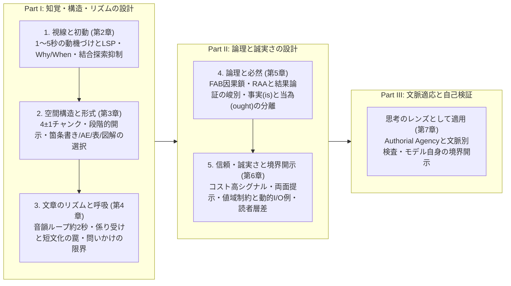

# 良いドキュメントとは何か：論理学・認知科学・広告工学・言語心理学の交差点から紐解く技術文書設計論仮説 (PAPER)

## 要旨 (Abstract)

生成AIの普及によって、流暢な文章を誰でも一瞬で生成できる時代になりました。しかしその一方で、ソフトウェアのREADMEや仕様書、設計解説書などを始めとしたドキュメントにおいて、「表層は綺麗だが根拠のない誇張表現（チープトーク）が混ざる」「情報を詰め込みすぎて読者が途中で読むのをやめてしまう」「客観的な仕様ではなく執筆者の主観的なお説教が書かれている」「文体や形式の単調さ・過密さで読み続けるリズムが途切れる」「静的パラメータ名はあるのに実際の入出力例や制約境界が曖昧で使い方がわからない」といった課題に直面する場面も増えています。

世の中には、日本語の「てにをは」や表面的な体裁を整えるツールやエージェントスキルは数多く存在しますが、「そもそも人間はどうドキュメントを視覚走査・空間整理・音韻保持しながら読み、どのような論理構造に納得し、何によって信頼と適用境界を把握するのか」という情報工学・認知科学的な設計論はあまり見かけません。

本稿（`PAPER.md`）は、「嘘や誇張がなく、かつ読者の頭にスッと入ってくる『良いドキュメント』とは何か」を探るために行った個人的な自由研究の総括レポートです。  
本研究では、以下の領域にまたがる学際的な先行研究（学術論文および実証データ）を横断的に調査しました。

1. **視線・初動と動機づけ**: コピーライティング・ランディングページ（LP）の型、コンバージョン率（CVR）・視線誘導・離脱防止、読解2段階モデル（動機づけと精緻化）、GitHub README・オープンソースソフトウェア（OSS）大規模実証研究
2. **空間構造と視覚認知**: 認知負荷理論・可読性研究、段階的開示・情報設計、構造化形式（箇条書き・文見出し・表・グラフ）の比較、グラフィックス・絵文字の認知およびアクセシビリティ研究
3. **文章のリズムと呼吸（時間的認知）**: 音韻ループ（約2秒）と黙読の内語・呼気段落、文長・句読点変動・係り受け複雑さ・語彙密度、統語プライミングと構文類似による評価低下、APIドキュメントの「臭い（Smells）」、問いかけと物語的展開の有効範囲
4. **形式論理と論証**: 形式論理学・証明論、自然演繹の正規化、論証モデル
5. **信頼性・誠実さと境界開示**: シグナリング理論、説得工学、APIディレクティブ・値域制約欠陥・動的入出力（I/O）振る舞い例、読者層による分かりやすさ評価の乖離

そこから浮かび上がってきたのは、良いドキュメントとは「決まった穴埋めテンプレートに従った文書」ではなく、 **Part I（知覚・空間構造・時間的リズムの設計）で読者のワーキングメモリと探索コストを保護し、Part II（論理と誠実さ・境界開示の設計）で嘘や飛躍と仕様の曖昧さを抑え、Part III（文脈適応と自己検証）で読者と目的に応じて引き出す** 統合仮説モデルではないか、という見立てです。本稿では、Part制モジュール構造と読者の処理プロセス順5本柱のハイブリッド構成により、READMEをはじめとするドキュメント全般に応用可能な仮説モデルを提案します。

## 目次

- [第1章 序論：なぜ技術文書は「盛られ」たり「閉じられ」たりするのか](#第1章-序論なぜ技術文書は盛られたり閉じられたりするのか)
- [Part I：知覚・構造・リズムの設計（読みやすさの基盤）](#part-i知覚構造リズムの設計読みやすさの基盤)
  - [第2章 視線と初動の科学：最初の1〜5秒で何が起きているか](#第2章-視線と初動の科学最初の15秒で何が起きているか)
  - [第3章 空間構造と認知負荷：情報を削らずに整理する形式設計](#第3章-空間構造と認知負荷情報を削らずに整理する形式設計)
  - [第4章 文章のリズムと呼吸：時間制約・文体ゆらぎ・問いかけの境界](#第4章-文章のリズムと呼吸時間制約文体ゆらぎ問いかけの境界)
- [Part II：論理と誠実さの設計（納得と信頼の基盤）](#part-ii論理と誠実さの設計納得と信頼の基盤)
  - [第5章 論理と必然性の骨格：ツッコミどころのない筋道をつくる](#第5章-論理と必然性の骨格ツッコミどころのない筋道をつくる)
  - [第6章 信頼・誠実さと境界開示：疑念を払拭し、振る舞いと前提を明示する構造](#第6章-信頼誠実さと境界開示疑念を払拭し振る舞いと前提を明示する構造)
- [Part III：文脈適応とモデルの限界](#part-iii文脈適応とモデルの限界)
  - [第7章 統合考察と文脈適応：「テンプレート」ではなく「思考のレンズ」として](#第7章-統合考察と文脈適応テンプレートではなく思考のレンズとして)
  - [第8章 結語：未来へまく「種」として](#第8章-結語未来へまく種として)
- [関連ドキュメントへの案内](#関連ドキュメントへの案内)

## 第1章 序論：なぜ技術文書は「盛られ」たり「閉じられ」たりするのか

### 1.1 生成AI時代の「流暢なノイズ」と3つの摩擦
私たちが普段から生成AI（LLM）を使って文章やドキュメントを書かせていると、ある特有のクセにたびたび出くわします。それは、放っておくとすぐに「圧倒的に高速」「究極の柔軟性」「業界標準を凌駕する」といった大袈裟な言葉で文章を盛り始めたり、見出しや箇条書きに装飾的な絵文字や記号を自動的に差し込んだり、実際に動くかどうかの機械的な検証を省略したりする傾向です。

かといって、背景や文脈を削ぎ落とした無味乾燥な箇条書きを出力させると、今度は「なぜこのツールが存在するのか」「どういう場面で役に立つのか」が伝わりにくい味気ない文書になりがちです。また、文の長さを一律に短く切り詰めすぎたり、単調な構文を反復させたり、実際の入力値と出力結果（動的振る舞い）や制約境界を省いたりすることで、「正しくはあるが読解と利用の労力が高い文書」が生まれることもあります。

そもそも、技術ドキュメントの書き手（開発者・設計者）と読み手（利用者・評価者）の間には、以下の **3つの摩擦** が生じやすいと考えられます。

1. **知覚と初動の摩擦（読まれずに閉じられる）**  
   どれほど正確で誠実な仕様を後半に書いていても、ページを開いた最初の数秒で「これは何で、自分にどう関係があるのか」が直感できなければ、読者はスクロールせずにページを閉じてしまう可能性があります。
2. **認知と記憶の摩擦（空間過密・時間超過 vs 削りすぎて足りない）**  
   誠実であろうとして全機能・全オプション・全例外を1ページにズラッと並べたり、1文の中に何重もの修飾節や述語を詰め込んで頭の中の保持容量（音韻ループやワーキングメモリ）を超過させたりすると、初見の読者は処理に疲れて離脱しやすくなります。<br>逆に、読みやすくしようとして情報を要約・削除してしまうと、実詞ばかりが密集してかえって難解になったり、本格的に導入や実装を検討している読者から「必要な仕様や境界条件が書かれていない」と判断されてしまいます。
3. **不信と論理・仕様曖昧さの摩擦（ポジショントークへの警戒とお説教への反発）**  
   技術者は経験上、「どんなツールにも弱点やトレードオフがある」ことを知っています。良いことばかりが書かれた文書や、比較対象のない「高速・軽量」という宣伝文句、あるいは「開発者は〜すべきである」という書き手の主観的なお説教に出会ったとき、読者の側には警戒心（心理的リアクタンス）が生じやすくなります。加えて、値域制約や条件境界を「invalid」や「should」といった曖昧な表現で済ませたり、具体的な入出力例を省いたりすると、利用者は防御的な冗長コードや外部サイトでの再探索を強いられることになります。

### 1.2 論法・広告・読みやすさ研究の交差点としての「README」、そして技術文書全般へ
この3つの摩擦を和らげるにはどうすればいいのでしょうか。
そこで着想したのが、 **「演繹法や背理法を基本とした形式論理の枠組み」** と **「広告業界や認知心理学・言語心理学で磨かれてきた見せ方とリズムのノウハウ」** をハイブリッドに掛け合わせるアプローチです。

とりわけGitHubのREADMEは、ソフトウェアの正確な仕様や使い方を伝える「技術文書」であると同時に、プロジェクトを訪れた人が最初に目にする「顔（看板・ランディングページ）」でもあります。論理の厳密さと広告の視線誘導、そして読み進めるための空間構造と時間的リズムが交差する、わかりやすい実例と言えます。    
そして、この問いを深掘りして先行研究を紐解いていくうちに、この考え方はREADMEだけにとどまらず、API仕様書、アーキテクチャ設計書、技術解説記事、さらにはプレーンテキストのメモに至るまで、 **「他者に技術や仕様を伝えるドキュメント全般」に応用できる情報設計の仮説** になり得ると気づきました。

本稿は、読者がドキュメントを開いてから理解し行動に移すまでの処理プロセスと関心事の分離（Separation of Concerns: SoC）に沿い、以下の3部・5本柱の構成で先行研究と仮説モデルを整理します。

- **Part I（知覚・構造・リズムの設計）**: 第2章で「最初の1〜5秒の視線と動機づけ」、第3章で「空間構造・構造化形式（箇条書き・文見出し・表・図解）と認知負荷」、第4章で「音韻ループ・文体ゆらぎ・問いかけの時間的リズム」を扱います。
- **Part II（論理と誠実さの設計）**: 第5章で「論理と必然性の骨格」、第6章で「信頼・誠実さ・API境界と動的I/O振る舞いの開示・読者層による評価乖離」を扱います。
- **Part III（文脈適応とモデルの限界）**: 第7章で「テンプレート否定と思考のレンズ・文脈別検査・モデル自身の境界条件」、第8章で結語を述べます。

---

## Part I：知覚・構造・リズムの設計（読みやすさの基盤）

Part Iでは、読者がドキュメントを開いた瞬間の視覚走査から、ページ全体の空間的レイアウト・構造化形式の選択、そして1文1文を黙読で追う時間的な呼吸とリズムに至るまで、「人間の認知資源をどう保護し、読み進める動線をどう整えるか」という読みやすさの基盤を扱います。

## 第2章 視線と初動の科学：最初の1〜5秒で何が起きているか

読者がドキュメントを開いた瞬間、論理的な精読が始まる前に、まず「視覚的な走査」と「この文書を熟読する価値があるかの選別」が行われます。ここで生じる摩擦を減らすためのヒントを見ていきます。

### 2.1 アテンションの減衰と読解初期（1〜2秒）の動機づけ効果
「良い内容が書いてあれば、読者は最後までスクロールして読んでくれるはずだ」というのは、書き手が陥りやすい錯覚のひとつです。
Jakob Nielsen（Nielsen Norman Group, 2018）が120名の被験者・数千サイトにおける130,000点以上の視線固着点（Eye Fixations）を解析したアイトラッキング研究では、人間の注意（アテンション）が画面のどこに集中するかについて、興味深い数値が報告されています。

> **(Original)**  
> *"In our most recent study, users spent about 57% of their page-viewing time above the fold. 74% of the viewing time was spent in the first two screenfuls, up to 2160px. ... Content above the fold receives by far the highest share of the viewing time. ... On general websites, more than 42% of the viewing time fell within the top 20% of the page, and more than 65% of the time was spent in the top 40% of the page."*  
> **(日本語訳)**  
> 「我々の最新の調査では、ユーザーはページ閲覧時間の約57%をファーストビュー（Above the Fold: スクロール前の最初の画面）で費やしていた。閲覧時間の74%は最初の2画面分（最大2160px）で費やされた。……ファーストビューのコンテンツは、閲覧時間において非常に大きなシェアを占める。一般的なWebサイトでは、閲覧時間の42%以上がページの上位20%領域に落ち、65%以上が上位40%領域で費やされていた。」  
> *(出所: Jakob Nielsen, 2018, `[REF-NIELSEN2018]`)*

さらに、Shanelle Mullin（CXL, 2023）が引用するGoogleの視認性データでも、折り目（Fold）の直上では視認率が **73%** であるのに対し、折り目の直下では **44%** へと低下し、ファーストビューの内外で情報の扱われ方に平均 **84%** の差が生じることが示されています（`[REF-MULLIN2023]`）。

この最初の1〜2秒に読者の内側で何が起きているかを認知モデルとして整理したのが、島田英昭・北島宗雄（2008）によるマニュアル読解の **「2段階モデル」** です（`[REF-SHIMADA2008]`）。

> **(Original)**  
> *"読解初期は,読解を開始してから1～2秒の間と定義する。この段階では,テキストの高々5単語程度,あるいはタイトルや文章のレイアウトや量,そして挿絵や図など,内容の断片的情報のみを認識している段階である。得られている情報は少ないが,この段階において読者は,その文章からどのような情報が得られそうか,役に立つ情報であるのか,興味が持てる情報であるのかを吟味するはずである。"*  
> *(出所: 島田英昭・北島宗雄, 2008, `[REF-SHIMADA2008]`)*

島田・北島（2008）は、ウェブ版防災マニュアルを用いた実験1（`N = 34`、ページを2秒間だけ提示して動機づけを評定）と実験2（`N = 23`、10分間の閲覧課題で視線計測・テキスト再生・挿絵再認を実施）を通じ、読解には **読解初期の「動機づけ効果」** と **読解最中の「精緻化効果」** という2つの異なる役割があることを示しました。しかも重要な点として、両者の間にはトレードオフが存在します。

> **(Original)**  
> *"マニュアルには,動機づけ効果,精緻化効果がともに十分に認められる挿絵を挿入できることが理想である。しかし,現実にそれは難しく,トレードオフがあると考えられる。どちらを重視するかは,そのマニュアルの目的に依存する。中身を読んでもらうことを重視すれば,動機づけ効果を高めるために,目立ちやすく,直感的な印象のよい挿絵を作成することになる。一方,一定の動機づけのもとに読まれることが前提であれば,精緻化効果を高めるために,形成されるべき心的表象を考慮して表現した挿絵を作成すればよい。"*  
> *(出所: 島田英昭・北島宗雄, 2008, `[REF-SHIMADA2008]`)*

つまり、読むモチベーションがまだ固まっていない読者が最初に接触する入り口では、レイアウトの明快さやタイトル・数単語の断片情報で「自分の役に立ちそうだ」と感じさせる動機づけが重要になり、すでに読む意図が固まっている内部のリファレンスや設計解説では、正確な心的表象（メンタルモデル）の構築を助ける精緻化が重視される、という役割分担が見えてきます。

また、初動のスクロールを促す上で意識しておきたいのが **「偽の床（False Floor）」** と呼ばれる現象です。

> **(Original)**  
> *"Users do scroll, but only if what’s above the fold is promising enough. What is visible on the page without requiring any action is what encourages us to scroll. ... When you have a false bottom, you don’t give visitors a reason to believe there is something below the fold. As a result, they will attempt to scroll less often."*  
> **(日本語訳)**  
> 「ユーザーはスクロールするが、それはファーストビューにある情報が十分に期待を持たせる（promising enough）場合だけである。何の操作も要さずに画面上で見えているものこそが、我々にスクロールを促す。……『偽の底（false bottom / false floor）』があると、訪問者に折り目の下にまだ何かが存在すると信じる理由を与えられない。結果として、彼らがスクロールを試みる頻度は低下する。」  
> *(出所: Shanelle Mullin, 2023, `[REF-MULLIN2023]`)*

ドキュメントの冒頭直後に、大きな余白や孤立した水平線（`---`）を引いてしまうと、読者が「ここで情報がひと区切りついた（終わった）」と錯覚し、スクロールを止めてしまう要因になり得ます。初動の画面下端には、次のセクションの見出しや目次が自然に覗くような視覚的連続性を持たせることで、スクロールの停滞を防ぎやすくなると考えられます。

### 2.2 導入率の方程式と「字義通りの定義」
では、その最初の1画面（最初の5秒間）に何が書かれていれば、読者は「スクロールする価値がある」と感じやすいのでしょうか。

Julian Shapiro（2020）は、ランディングページにおける購入意思決定を `Purchase Rate = Desire - (Labor + Confusion)` という式で表現しています。これを技術ドキュメントの導入（Adoption）に読み替えると、次のように整理できます。

```math
\text{Adoption Rate (導入率)} = \text{Utility (欲求・実効的効用)} - (\text{Labor (探索労力)} + \text{Confusion (混乱)})
```

> **(Original)**  
> *"Generally, the more you detour from the template, the more confused the average visitor becomes. Think of your landing page from the perspective of a visitor's likelihood to purchase: Purchase Rate = Desire - (Labor + Confusion). ... Decrease labor— Reduce the work your visitors have to perform so they don't get tired or annoyed. Be concise and ensure every word and element is of value. Decrease confusion— Don't confuse visitors with obscure or verbose messaging. Ensure every sentence can be easily understood."*  
> **(日本語訳)**  
> 「一般に、基本構造（テンプレート）から寄り道（detour）すればするほど、平均的な訪問者はより混乱するようになる。訪問者の購買可能性という観点からランディングページを考えてみよう。Purchase Rate = Desire - (Labor + Confusion) である。……労力（Labor）を減らすこと——訪問者が疲れや苛立ちを感じないよう、彼らが遂行しなければならない作業を減らせ。簡潔にし、すべての単語と要素に価値があるようにせよ。混乱（Confusion）を減らすこと——曖昧または冗長なメッセージで訪問者を混乱させるな。すべての文が容易に理解できるようにせよ。」  
> *(出所: Julian Shapiro, 2020, `[REF-SHAPIRO2020]`)*

この「これは何か？（What is it?）」を伝える際、作り手がついやってしまいがちなのが、「次世代のオーケストレーション・パラダイム」といった抽象的な専門・業界語（Jargon）や、「超高速・軽量」といった形容詞で飾ってしまうことです。  

コピーライターの Harry Dry（2020）は、そうした抽象語を避け、 **「具体的な名詞と動詞（何を、どうするのか）」** で置き換えるアプローチを提案しています（`[REF-DRY2020]`）。

これはOSSの実証研究とも重なります。Jazlyn Hellmanら（2023）がGitHubの385リポジトリの概要文を分析した調査では、開発者にとって理解しやすく好まれる説明文は、 **LSP（Language: 対象言語や環境、Software technology: ソフトウェア分類・技術、Purpose: 具体的な目的）** の要素を明確に含むものであることが示されました（一方で、実際に3要素を満たしていたリポジトリは全体の **8.3%** にとどまっていました、`[REF-HELLMAN2023]`）。  

このLSPの考え方は、全員が同じ文末の穴埋め構文を使うというよりは、「どの環境で動く、何の種類のツールで、どんな課題を解決するのか」という具体的事実を、抽象的なポエムではなく字義通りの言葉で冒頭に置くと、読者の「混乱（Confusion）」を減らす助けになる、というヒントとして捉えることができます。

### 2.3 OSS実証データが示す「Why / When」の欠落と「Level A構文」
さらに、ドキュメント全体を見渡したとき、書き手が「普段書いている情報」と、読み手が「判断のために求めている情報」の間にはギャップが見られます。
Gede Artha Azriadi Pranaら（2019）がGitHubの393リポジトリ・4,226セクションを手動アノテーションして分類した研究を見てみましょう。

> **(Original)**  
> *"We find that information discussing the ‘What’ and ‘How’ of a repository is very common, while many README files lack information regarding the purpose and status of a repository. ... Based on the consideration of files in our sample (fourth column of Table 3), 97% of the files contain at least one section describing the ‘What’ of the repository and 88.5% offer some ‘How’ content. Other categories, such as ‘Contribution’, ‘Why’, and ‘When’, were much less common."*  
> **(日本語訳)**  
> 「リポジトリの『What（何であるか）』と『How（使い方）』を論じる情報は非常に一般的である一方、多くのREADMEファイルはリポジトリの目的（Why）やステータス・適用時期（When）に関する情報を欠いていることが判明した。……サンプル内のファイルを分析した結果（Table 3の第4列）、97%のファイルがリポジトリの『What』を説明するセクションを少なくとも1つ含み、88.5%が何らかの『How』コンテンツを提供していた。一方、『Contribution』『Why』『When』といった他のカテゴリははるかに少なかった。」  
> *(出所: Gede Artha Azriadi Prana et al., 2019, `[REF-PRANA2019]`)*

同研究のTable 3の実測値では、「Why」を含むREADMEは全体の **25.7%**（全セクション中の **2.7%**）、「When」を含むものは全体の **21.4%**（全セクション中の **4.3%**）にとどまっており、調査されたREADMEの約75%〜80%近くにおいて **「なぜ既存のやり方ではなくこのツールを作ったのか（Why）」** と **「どういう条件・規模なら適していて、どういう場合には向かないのか（When）」** が記載されていませんでした。これらを意識して補うことで、読者が自分の用途に合うかを判断しやすくなると期待できます。

また、「どうやって始めるのか（How / Quick Start）」のコード例にも興味深いデータがあります。Supavas Sitthithanasakulら（2023）がPyPIライブラリ1,620件のREADMEに含まれるコードスニペットを構文解析した結果です。

> **(Original)**  
> *"From our empirical study on 1,620 README files of PyPI libraries, we find that developers mainly present 92% of basic elements in code snippets. ... basic elements (Level ‘A’) are the most used in the README files (92%) while proficient elements (Level ‘C’) are the lowest (1%). ... We therefore (i) encourage developers to mainly present basic code snippets in their README files to attract more newcomers, and (ii) suggest that clients try to understand proficient code snippets if they are adopting libraries from previously mentioned topics."*  
> **(日本語訳)**  
> 「PyPIライブラリの1,620件のREADMEファイルに関する実証研究から、開発者はコードスニペット内で主に基本要素（92%）を提示していることが判明した。……基本要素（Level ‘A’）が最も多く使われ（92%）、熟練要素（Level ‘C’）は最も少なかった（1%）。……したがって我々は、(i) より多くの新規参入者を引きつけるためにREADMEファイル内では主に基本的なコードスニペットを提示することを開発者に勧め、(ii) 前述のトピック（Application Framework, Quality Assurance, User Interface）からライブラリを採用する場合には利用者が熟練コードスニペットの理解を試みることを提案する。」  
> *(出所: Supavas Sitthithanasakul et al., 2023, `[REF-SITTHI2023]`)*

同解析では、Level A（単純代入 86.98%、属性参照 87.22%、基本import 65.06%など）が多用される一方、Level C（内包表記やメタプログラミングなどの高度な構文）はほとんど使われていないことが報告されています。

さらに、Unbounce（2022）のコンバージョン研究が指摘する **「決定麻痺（Decision Paralysis）」** も参考になります（`[REF-UNBOUNCE2022]`）。冒頭の導入手順で「Dockerを使う方法」「ソースからビルドする方法」「パッケージマネージャA・B・C・Dを使う方法」をいきなり並列に5つも6つも並べられると、読者は「どれを叩けばいいのか」で迷い、探索労力（Labor）が増えてしまいます。  

一番最初は「標準的な1つの導入手順と、基本構文（Level A）で動く最小のコード」を提示し、その他のインストール方法や高度なオプションは後ろ（または折りたたみ）へ配置することで、初動のつまずきを抑える効果が期待できます（なお、オンボーディング手順の整備が新規参入者の定着率向上やバグ混入率の低減と関連することも、Foundjem et al. `[REF-FOUNDJEM]` や Fronchetti et al. 2023 `[REF-FRONCH2023]`、Gaughan et al. 2025 `[REF-GAUGHAN2025]` の研究で報告されています）。

### 2.4 視覚的アンカーの狙いと「視覚探索」の代償
ドキュメントのファーストビューや見出し周りで、書き手が「読者の視線を引いて流し読みしやすくしたい」と考えたときによく採られる手段のひとつが、アイコンや絵文字などのグラフィック要素を配置することです。  

実際、GitHub上の大規模実証研究でも、開発者がドキュメントや議論の中で視覚的強調を狙って絵文字を使っている実態が報告されています。Xuan Luら（2018）の調査では、READMEにおける絵文字使用の主な意図は感情表現ではなく **コンテンツの強調（34.25%）** と **階層リスト・チェックリスト（5.50%）** であり（`[REF-LU2018]`）、Shiyue Rong（2023）のマイニング研究でも、プルリクエストの **41.87%**、Issueコメントの **47.12%** が視覚的強調（Visual Enhancement）目的でした（なお、開発者自身は「主に感情表現のために使っている」と認識しており、主観的認識と実態の間にギャップが見られました、`[REF-RONG2023]`）。

しかし、「強調したいから視覚要素を足す」という狙いは、読者の **視覚探索（Visual Search）** において必ずしも期待通りには働かない場合があります。Rita Borgoらの可視化研究は、視覚的メタファーの導入が記憶保持を助け得る一方で、探索速度に負の影響を与え得ることを報告しています。

> **(Original)**  
> *"The results of this study show that visual metaphors can help participants better remember the information depicted in visualization. On the other hand, visual metaphors can have a negative impact on the speed of visual search. ... With metaphoric visualization, participants seem to have used the visual metaphors in addition to or instead of colors and positions, resulting in slower response time. ... This is known as “conjunction search” [41], which typically take longer than single feature searches [44, 41]."*  
> **(日本語訳)**  
> 「本研究の結果は、視覚的メタファーが可視化で描かれた情報を参加者がより良く記憶することを助け得ることを示している。その一方で、視覚的メタファーは視覚的探索の速度に対して負の影響を与え得る。……メタファー的な可視化では、参加者は色と位置に加えて、あるいはその代わりに視覚的メタファーを使用したと見られ、結果として応答時間が遅くなった。……これは『結合探索（conjunction search）』として知られており、単一特徴の探索よりも通常時間を要する。」  
> *(出所: Rita Borgo et al., `[REF-BORGO]`)*

位置や見出し階層といった単一の手がかりだけで高速に絞り込める探索（Guided Search）に対し、意味を解釈しなければならない視覚メタファーが加わることで、脳は複数の特徴を照合する「結合探索」へと移行し、必要な項目を探し当てる速度が落ちやすくなります。

さらに、記号とそれが表す概念との近さを示す **「意味的距離（Semantic Distance）」** と **「具象性（Concreteness）」** の研究でも、次の傾向が示されています。
- プリンター図が印刷を表すように意味的距離が近く具体的なアイコンは認識効率が高い一方、「アップロード」「保護」「共有」のような抽象概念や恣意的な記号は事前学習なしでは誤認されやすくなります（Deng Lujie et al., 2024 `[REF-LUJIE2024]`、Johanna Silvennoinen et al., 2025 `[REF-SILVEN2025]`、Ankita Roy & Hiroyuki Matsuguma, 2025 `[REF-ROY2025]`）。
- Yunguo Liuら（2026, `N = 372`）の実験では、意味的距離に加えて文化的背景も探索効率・認識時間に有意な影響を与え、両者の間に有意な交互作用が確認されました（`[REF-LIU2026]`）。
- Yi-Na Liら（2016）は、視覚的メタファー元が持つ無関係な付随属性（Interfering Attributes）が、読者の論理的推論を予期せぬ方向へ誘導する「逆効果（Backfire Effects）」を指摘しています（`[REF-LI2016]`）。

すなわち、すでに明確なテキスト見出しがある場所に「意味的距離の遠い視覚記号」を添えると、視線を集めるどころか、読者の探索速度や解釈の正確さを損なう方向に働く可能性があります。

---

## 第3章 空間構造と認知負荷：情報を削らずに整理する形式設計

初動の1〜5秒を通過して読者がページ内の構造や本文に目を移したとき、次に関わってくるのが人間のワーキングメモリ容量と、情報をどの形式（見出し・箇条書き・表・図解）で空間配置するかという設計です。ここで「読みやすさ」と「情報の網羅性（深さ）」という一見相反する2つの要求をどう両立させるかを考えます。

### 3.1 ワーキングメモリの「4チャンク限界」と注意分割効果
よく「人間が一度に覚えられる数は `7 ± 2` 個である（Miller, 1956）」と言われますが、認知心理学者の Nelson Cowan（2001）は、数多くの実験を再検討し、 **事前の知識（スキーマ）を持たない初見の情報に対して人間が同時に注意を向けられる純粋な容量は、「`4 ± 1`（平均4チャンク）」程度である** ことを示しました。

> **(Original)**  
> *"Miller (1956) summarized evidence that people can remember about seven chunks in short-term memory tasks ... However, when chunking is prevented or controlled, the capacity of the focus of attention is much smaller: about 4 chunks on average in healthy adults. ... The limit of 4 ± 1 chunks holds across a wide variety of circumstances when rehearsal and grouping strategies are disabled."*  
> **(日本語訳)**  
> 「ミラー（1956）は、人々が短期記憶課題において約7個のチャンクを保持できるという証拠をまとめた。……しかし、チャンキング（既知の知識による塊化）が防止または制御された場合、注意の焦点の容量ははるかに小さく、健常な成人では平均して約4チャンクである。リハーサルやグループ化の戦略が無効化された場合、`4 ± 1` チャンクという限界は多種多様な状況において成立する。」  
> *(出所: Nelson Cowan, 2001, `[REF-COWAN2001]`)*

初めて触れるツールや仕様書を読むとき、読者の頭の中にはまだそのツールに関する「塊（チャンク）」が形成されていません。その状態で、1つの見出しの下に10個も15個もフラットな箇条書きや設定フラグが並んでいると、読者のワーキングメモリに負荷がかかります。項目が多くなる場合は、意味のある3〜4個の上位グループに分ける（構造化する）ことで、認知的な負担を和らげることができます。

また、John Swellerら（2011）や Slava Kalyuga（2011）、Rodrigo Duranら（2022）が体系化した **認知負荷理論（Cognitive Load Theory: CLT）** では、脳の負荷を「対象そのものの難しさ（内包性認知負荷: ICL）」と「見せ方の不手際によって生じる負荷（外在性認知負荷: ECL）」に分けます（`[REF-SWEL2011]`, `[REF-KALYUGA2011]`, `[REF-DURAN2022]`）。  
ドキュメントにおいて外在性認知負荷（ECL）を増やす大きな要因が、 **「注意分割効果（Split-Attention Effect）」** です。

> **(Original)**  
> *"When learners process text and visuals that cannot be understood in isolation, the mental integration of verbal and pictorial representations is required. When text and pictures are not located close to each other or not synchronized in time, integrating these referring representations may increase cognitive load and decrease learning. ... physically integrated or embedded representations were demonstrated to be an effective alternative to 'split-source' instructional format (split-attention effect)."*  
> **(日本語訳)**  
> 「学習者が単独では理解できないテキストと視覚情報を処理する際、言語的表現と視覚的表現の脳内統合が要求される。テキストと図表が互いに近くに配置されていない、あるいは時間的に同期していない場合、これらの参照し合う表現を統合することは認知負荷を増大させ、学習を低下させ得る。……物理的に統合された、あるいは埋め込まれた表現は、『情報源が分離した（split-source）』提示形式に対する有効な代替手段であることが実証されている（注意分割効果：split-attention effect）。」  
> *(出所: Slava Kalyuga, 2011 / John Sweller et al., 2011, `[REF-SWEL2011]`, `[REF-KALYUGA2011]`)*

たとえば、長いコードブロックを貼ったあと、そこから何十行も離れた場所で「上のコードの3行目の引数は〜」と解説したり、コマンド例と実行結果の出力が別々のセクションに離れていたりする構成です。読者は画面を上下にスクロールして視線を往復させることになり、疲れやすくなります。  

相互に関係する情報（コードと注釈、コマンドと期待出力）を同じ視野内に空間的に近づけて配置すると、視線往復の負荷を減らす効果が期待できます（Sharon Oviatt 2006 の研究でも、認知的オーバーヘッドを抑えた構造化提示によりタスク決定的なエラーの最大86%、非流暢性の最大80%が削減された事例が報告されています、`[REF-DURAN2022]` / Oviatt 2006）。

### 3.2 「主観的な読みやすさ」の罠と装飾／説明図解の乖離
ここで、もうひとつ興味深い実験データを紹介します。「文章を平易にしてコメントをたくさん書けば、理解しやすい良いドキュメントになるのか？」という問いに対する、Jürgen Börstler & Barbara Paech（2016）の104名の被験者を用いた実験結果です。

> **(Original)**  
> *"Regarding perceived readability, our results show statistically significant differences between comment variants ... Regarding comprehension, there are no significant differences between method chain or comment variants. ... Our results do not show any significant relationships between perceived readability and the other measures taken in the present study. Perceived readability might therefore be insufficient as the sole measure of software readability or comprehension."*  
> **(日本語訳)**  
> 「主観的可読性（読みやすいと感じるか）に関しては、コメントのバリエーション間で統計的に有意な差が認められた。……しかし実際の理解度（穴埋めテストの成績）に関しては、有意な差は認められなかった。本研究の結果は、主観的可読性と他の理解度測定値との間にいかなる有意な相関も示していない。したがって、主観的可読性はソフトウェアの可読性や理解度の唯一の尺度としては不十分である可能性がある。」  
> *(出所: Jürgen Börstler & Barbara Paech, 2016, `[REF-PAECH2016]`)*

被験者は、コードの字面をそのまま自然言語で繰り返しただけのコメント（例：`getUser() // ユーザーを取得する`、`timeout: 30 // タイムアウトを30秒にする`）がついていても、「コメントがある」ことで「読みやすい（主観的可読性が高い）」と感じる傾向がありました。しかし、実際に仕様を理解できているかを測るテストでは、成績の向上が見られませんでした。

このことから、関数名や設定キーを日本語に直訳しただけの **同義語反復（トートロジー）** は、読者に「読めたつもり」を生むだけで、実質的な理解にはつながりにくいと考えられます。字面の言い換えよりも、 **「どんな前提条件で呼べるのか」「どんな副作用があるのか」「失敗したときに何が起きるのか」** という、コードの字面からは読み取れない因果関係を記述するほうが、実用上の理解を助けると期待されます（Garousi et al. 2015 の産業界調査でも、コードとの対応や実質的情報が欠けたドキュメントは開発者から参照されなくなる傾向が示されています、`[REF-PAECH2016]` / Garousi 2015）。

興味深いことに、これと **まったく同じ「好感度（見た目）と実理解の乖離」** が、グラフィックス・視覚要素の世界でも実験的に観察されています。Eunmo Sung & Richard E. Mayer（2012）は、大学生200名を4群（説明的グラフィックス・魅惑的グラフィックス・装飾的グラフィックス・テキストのみ）に分けて学習効果と満足度を比較しました。

> **(Original)**  
> *"The primary findings are: (1) in comparing the instructive graphics group and the no graphics group, there is a multimedia effect in which adding instructive graphics greatly improves recall test performance (d = 0.79), (2) in comparing the seductive graphics group with the no graphics group, there is a marginal seductive details effect in which adding seductive graphics hurts recall test performance (d =  0.38), and (3) in comparing the decorative graphics group with the no graphics group, recall test performance is not significantly different (d = 0.13). ... These results show that liking (as measured by satisfaction ratings) does not automatically translate into learning (as measured by recall tests)."*  
> **(日本語訳)**  
> 「主要な発見は以下の通りである。(1) 説明的グラフィックス群とグラフィックスなし群の比較において、説明的グラフィックスの追加が想起テスト成績を大幅に向上させるマルチメディア効果が認められた（`d = 0.79`）。(2) 魅惑的グラフィックス群とグラフィックスなし群の比較において、魅惑的グラフィックスの追加が想起テスト成績を損なう傾向的な魅惑的詳細効果が認められた（`d = [−]0.38`）。そして(3) 装飾的グラフィックス群とグラフィックスなし群の比較において、想起テスト成績には有意な差が認められなかった（`d = 0.13`）。……これらの結果は、好感度（満足度評価で測定）が自動的に学習（想起テストで測定）へと結びつくわけではないことを示している。」  
> *(出所: Eunmo Sung & Richard E. Mayer, 2012, `[REF-SUNG2012]`)*

この実験では、3種類すべてのグラフィックス群でテキストのみ群よりも読者の満足度（Liking）が有意に高くなりました（説明的 `d = 1.21`、装飾的 `d = 1.25`、魅惑的 `d = 0.85`、すべて `p < .05`）。しかし、内容の想起テストで有意にプラスの効果を出したのは **「説明目標に直結する図解（Instructive graphics）」だけ** でした。  

テキストと意味的対応を持たない装飾的グラフィックスが学習に貢献しない外在的要素（Extraneous）とみなされる点（Robert William Danielson, 2012 `[REF-DANIELSON2012]`）、テキストとの結合が弱い視覚要素が「両者はどう関係しているのか」という課題無関連な推論要求（外在性認知負荷: ECL）を生む点（Sascha Schneider, 2017 `[REF-SCHNEIDER2017]`）、視覚的複雑性や紛らわしいアイコンが認知的負担の指標や発生源になる点（Simon Harper et al., 2009 `[REF-HARPER2009]`、Anamika Yadav, 2026 `[REF-YADAV2026]`）はいずれも共通した機序を示しています（また第3.5節で述べる通り、箇条書きの文字量の多さに慣れた読者が主観評価で従来形式を高く評価してしまう現象も Garner & Alley, 2013 `[REF-GARNER2013]` で確認されています）。

さらに、こうした無関連な視覚要素による理解阻害は、すべての読者に均等に起きるわけではありません。Christopher A. Sanchez & Jennifer Wiley（2006）の視線計測を含む実験は、その負荷が誰に集中するかを明らかにしています。

> **(Original)**  
> *"The results from the first and second experiments have provided evidence that the seduction effect is limited primarily to those individuals who are low in WMC. ... Rather, it is the inability of certain individuals to control their attention that leads them to be seduced and, thus, causes them to understand less of the relevant, important information."*  
> **(日本語訳)**  
> 「第1および第2実験の結果は、誘惑効果（seduction effect）が主としてワーキングメモリ容量（WMC）の低い個人に限定して生じるという証拠を提供した。……むしろ、特定の個人が注意を制御できないことこそが彼らを誘惑へと導き、その結果、関連性のある重要な情報の理解を低下させる原因となる。」  
> *(出所: Christopher A. Sanchez & Jennifer Wiley, 2006, `[REF-SANCHEZ2006]`)*

背景知識が豊富な熟練者は無関連な装飾を視線で無視できますが、まだドメイン知識の塊（チャンク）を持たない初学者や、エラー対応で疲弊・焦燥している読者は注意を制御しづらく、無関連な視覚要素に視線を奪われて本文全体の構造把握が崩れやすくなります。

もちろんこれらはオンライン学習教材のイラストを用いた実験であり、技術ドキュメントとは媒体や読者行動が異なりますが、「初心者に親しみやすくするために無関連な装飾を足す」という配慮が、かえって初学者の認知リソースを圧迫し得るという仮説的な懸念がうかがえます（同時に、第2.1節で見た島田・北島 2008 `[REF-SHIMADA2008]` のように、まだ読む動機がない初期1〜2秒の動機づけ目的なら直感的な視覚刺激が寄与する場面もあり、フェーズごとの区別が重要になります）。

### 3.3 情報深度（Information Depth）と「透明性の逆説」を解く段階的開示
では、認知負荷を下げるために、細かい仕様やエッジケースの説明は削ってしまえばいいのでしょうか？
先行研究のデータを見ると、単純に削るのは逆効果になる可能性が示唆されています。

Ariful Islam Anik & Andrea Bunt（2026）が32名の被験者を対象に「情報の深さ（Low Depth vs High Depth）」と「段階的開示（Progressive Disclosure の有無）」の影響を調べた実験では、次のような結果が出ています。

> **(Original)**  
> *"Findings from a study with 32 participants show advantages to providing users with comprehensive information on training datasets. Detailed explanations not only enhanced perceived trust, fairness, and understanding, but were also preferred by participants despite the increased cognitive load. While Progressive Disclosure did not effectively mitigate cognitive load, it improved users’ perception of learning. These findings suggest that effective transparency does not come from minimizing detail, but from embracing it, as participants consistently valued clarity and completeness over brevity, even at the cost of higher cognitive load."*  
> **(日本語訳)**  
> 「32名の参加者を対象とした調査の結果は、訓練データセットに関する包括的な情報をユーザーに提供することの利点を示している。詳細な説明は、知覚される信頼、公平性、および理解を高めただけでなく、認知負荷の増大にもかかわらず参加者から選好された。段階的開示（Progressive Disclosure）自体は認知負荷を直接軽減しなかったものの、ユーザーの『学習の知覚』を向上させた。これらの知見は、有効な透明性とは詳細を最小化することから生まれるのではなく、詳細を受け入れることから生まれることを示唆している。参加者は、より高い認知負荷を代償にしてでも、簡潔さより明瞭さと完全性を一貫して重視したからである。」  
> *(出所: Ariful Islam Anik & Andrea Bunt, 2026, `[REF-ANIK2026]`)*

この実験において、段階的開示が学習の知覚に与える効果は統計的に有意（`p < .05`）であったことが報告されています。一方で、Aaron Springer & Steve Whittaker（2019, 2020）の4つの実証実験は、 **「透明性の逆説（Paradox of Transparency）」** という現象を報告しています。

> **(Original)**  
> *"We assess user reactions to transparency feedback in four studies of an emotional analytics system. In Study 1, users anticipated that a transparent system would perform better but unexpectedly retracted this evaluation after experience with the system. Study 2 offers an explanation for this paradox by showing that the benefits of transparency are context dependent. On the one hand, transparency can help users form a model of the underlying algorithm’s operation. On the other hand, positive accuracy perceptions may be undermined when transparency reveals algorithmic errors. ... Results again suggest that users may benefit from initially simplified feedback that hides potential system errors and assists users in building working heuristics about system operation."*  
> **(日本語訳)**  
> 「我々は感情分析システムに関する4つの研究において、透明性フィードバックに対するユーザーの反応を評価した。研究1では、ユーザーは透明性の高いシステムほど優れた性能を発揮すると期待していたが、実際にシステムを体験した後には予想外にもその評価を撤回した。研究2は、透明性の利点が文脈依存であることを示すことで、この逆説（paradox）に対する説明を提供する。一方で、透明性はユーザーが背後にあるアルゴリズムの動作モデルを形成するのを助けることができる。他方で、透明性がアルゴリズムの誤差を露呈させると、肯定的な精度知覚が損なわれる場合がある。……結果は、潜在的なシステム誤差を初期段階では隠し、システム動作に関する実用的なヒューリスティックの構築を支援する『最初は簡略化されたフィードバック（段階的開示）』からユーザーが恩恵を受け得ることを重ねて示唆している。」  
> *(出所: Aaron Springer & Steve Whittaker, 2020, `[REF-SPRING2020]`)*

さらに、Kalyuga（2011）が指摘する **「専門性逆転効果（Expertise Reversal Effect）」** （初心者向けの丁寧な基礎解説が、熟練者にとってはかえって邪魔になる現象、`[REF-KALYUGA2011]`）や、Ashraf Abdulmunim Abdulmajeed（2026）が717リポジトリの機械学習（CatBoost/SHAP）解析で示した「READMEの長さは短すぎても長すぎても新規参入者を遠ざけ、中程度の長さで魅力がピークに達する（静的要因中SHAP値第1位: 0.420）」（`[REF-ABDUL2026]`）というデータも、共通の方向性を示唆しています。

それは、 **「情報を安易に圧縮・削除するのではなく、かといってすべてを同じ平面（フラットな1枚の画面）に並べるのでもなく、階層を分けて配置する」** というアプローチです。

### 3.4 「グルーピング × 関心事の分離（SoC）」と情報採餌の道しるべ
この両立を可能にする仕組みが、Jakob Nielsen（2006, `[REF-NIELSEN2006]`）や Sarah Horton（2006, `[REF-HORTON2006]`）、Deepa Muralidharら（2025, `[REF-MURALI2025]`）が論じる **「段階的開示（Progressive Disclosure）」** です。

実際、AmirHossein Naghshzan & Sylvie Ratté（2023）が Stack Overflow 上の Android 関連質問・回答約370万件（3,698,168投稿）を BERTopic で解析した研究では、公式APIドキュメントは網羅的である反面、長大で複雑かつ時に不完全なため迅速な情報抽出の障壁になり、開発者が Stack Overflow や GitHub へ移行しやすい実態と、1,813トピックのうち質問の約 **75%** が上位 **80** カテゴリに集中する強い偏在が報告されています（`[REF-NAGHSHZAN2023]`）。

利用頻度や関心度が高い主要経路と網羅的な詳細情報とがフラットに混在すると、必要な項目への到達コストが上がってしまいます。

本研究では、段階的開示を単なる「Markdownの `<details>` タグという小技」としてではなく、 **「認知心理学のグルーピング（容量保護）」と「ソフトウェア工学の関心事の分離」のハイブリッド** として位置づけています。

たとえば、ドキュメント内の情報を読者のフェーズ（関心空間）に応じて3つの層に分けて整理します（Muralidhar et al. 2025 の 3-Tier 選択的透明性モデルを参考にした構成、`[REF-MURALI2025]`）：
- **第1層（最短動線 / Happy Path）**: 概要、なぜ使うのか、最小限のクイックスタート。
- **第2層（主要概念と境界）**: 代表的な機能・使い方、メンタルモデル（全体像）、および主要な制約事項。
- **第3層（深層リファレンス / Exhaustive Evidence）**: 全CLIフラグ一覧、網羅的な設定スキーマ、内部アルゴリズムの詳細、エッジケースのトラブルシューティング。

この第3層の情報を、媒体の特性に合わせて視覚的・構造的に切り離します。
- **Markdown / HTML環境**: `<details><summary>...</summary>` によるアコーディオン折りたたみ、または別ファイルへのリンク分離。
- **プレーンテキスト（.txt）やRFC（Request for Comments / 技術仕様提案文書）等の環境**: 本文のメイン動線から切り離し、文書末尾の「付録（Appendix）」セクションや外部ファイルポインタへと分離。

そして、こうして構造化された文書内を、読者が迷わず移動できるようにするための道しるべ（Information Scent: 情報の手がかり）となるのが **目次と見出し階層** です。  

Moon Ting Suら（2012）がソフトウェアアーキテクチャ文書の読解行動を調査した情報採餌（Information Foraging）研究では、実務エンジニアは文書を頭から順番に読むのではなく、目次と見出しを起点に目的の情報パッチへとジャンプしながら探索する傾向が確認されています（`[REF-SU2012]`、Storey et al. 1997 `[REF-STOREY1997]`、Procter & Symonds 2001 `[REF-PROCTER2001]`、Mattyasovszky-Philipp & Molnár 2020 `[REF-MATTYAS2020]`）。さらに、苏立新ら（2020）の機械読解研究で前提として整理されているように、人間が答えを探す際には **「まず関連する文の位置を特定し、次にその文を精読して内容を確定し、最後に答えの境界を特定する」** という段階的探索を行うため（`[REF-SU2020]`）、見出しやアンカーによって文やブロックの位置と境界を明確にしておくことが探索効率を支えます。

また、複数の事例やテキスト・セクションを並べる順序にも認知的配慮が働き得ます。刘伟・李宁（2023）が2013〜2023年の日本語入試読解試験44編を定量分析した結果、単篇テキストの長さは配列順序と正の相関（ケンドールの順位相関係数 `τ = 0.333, p = 0.007 < 0.01`）を示し、短いものから長いものへと段階的に並べる構成が受験者の不安を和らげる方向に働くと論じられています（`[REF-LIU2023]`）。ドキュメントでも、冒頭から重い大作仕様を並べるのではなく、短く見通しの良い導入例から段階的に長い詳細説明へ進む配列が、心理的な負荷の軽減につながる可能性があります。

Cowanの容量限界（4項目）を超える規模の文書（目安としてH2見出しが4個以上並ぶ文書）では、冒頭に構造的な目次を置くことで、読者が現在地を見失う「認知的迷子」を軽減できると考えられます。

### 3.5 構造化形式の選択（箇条書き・文見出し・表・グラフ）と GitHub README の構造特徴
情報を階層化するだけでなく、「その中身を **箇条書き** で書くか、**文見出し＋図解** で書くか、**表（Fact box）** や **グラフ** で書くか」という構造化形式の選択自体にも、はっきりした認知的トレードオフが存在します。

まず、箇条書きがプラスに働く側面から見てみます。島田英昭・平野友朗（2016）が大学生（有効分析17名）に64パターンのビジネスメール文面を読ませて視線計測と主観評価を行った実験では、行間と箇条書きを設けることで主観的理解度が有意に向上し（3質問すべて `p < .001`, 偏イータ二乗 `ηp² = 0.63〜0.90`）、序盤の視線の上下動が抑えられて中盤以降の早い段階から全体を見直すフェーズへ移行できることが示されました（`[REF-SHIMADA2016]`）。同様に、佐藤暁子ら（2026, `N = 20`）のアイトラッカー実験でも、テキストのみのスライド内では上段の散文より下段の箇条書き領域に明確な注視集中（ホットスポット）が生じ、正答率もわずかに上回りました（ただし同実験でテキストのみ群平均36.0%に対し、図解を用いた群は平均55.3%と約1.5倍の記憶定着率を示しています、`[REF-SATO2026]`）。

しかし、**「句見出し（名詞句・トピック見出し）＋箇条書き」を説明の中核に据えすぎることには、構造的な欠陥がある** ことも、Michael Alleyらの **Assertion-Evidence（AE）アプローチ** の研究群から報告されています（`[REF-ALLEY2005]`, `[REF-ALLEY2006]`, `[REF-GARNER2013]`）。

> **(Original)**  
> *"However, the phrase headline violates the principle of signaling in three main ways. First, the phrase at the top of the slide indicates the general topic, but not the relation of the topic to other topics, or the positioning of the topic in the overall sequence of instruction. Second, the bulleted list does not aid in signaling between items and constrains the representation of relationships to one type of relationship at atime [12]. Third, the bullets conceal the connection between informational elements such that the learner must make the appropriate connections, or listen and wait for the speaker to explain them."*  
> **(日本語訳)**  
> 「しかし、句見出しは次の3つの主な点でシグナリングの原則に違反する。第一に、スライド上部の句は一般的なトピックを示すものの、他のトピックとの関係や全体の指導順序におけるそのトピックの位置づけを示さない。第二に、箇条書きリストは項目間のシグナリングを助けず、関係の表現を一度に1種類の関係に制約する[12]。第三に、箇条書きは情報要素間のつながりを隠してしまうため、学習者は適切なつながりを自力で作るか、話し手がそれを説明するのを聞いて待たなければならない。」  
> *(出所: Joanna K. Garner & Michael P. Alley, 2013, `[REF-GARNER2013]`)*

Alley & Neeley（2005）も指摘する通り、箇条書きリストはリスト内の全項目を同等の重みへ **平坦化（階層性の喪失）** し、重要な前提条件や要素間の因果関係を覆い隠してしまいます（`[REF-ALLEY2005]`）。そこで、見出しを単なるトピック名（「特徴」「性能」など）ではなく **1〜2行の主張を表す文見出し（Sentence headline）** にし、本文を箇条書きの羅列ではなく **構造を示す視覚的証拠（図解・実例・数表）** に置き換えた実験では、次のような効果が確認されています。
- バージニア工科大学の地質学コース（`N = 739`）の準実験では、重要主張を箇条書きから文見出しへ移したことで期末試験の平均正答率が **69%** から **79%** へ有意に向上しました（`p < .001`、`[REF-ALLEY2006]`）。
- 工学部生110名を対象としたMRI動作原理のランダム化比較実験（Garner & Alley, 2013）では、従来型スライド群に比べ AE群の方がエッセイ理解度（`t(91.05) = 3.49, p < .001`）と10日後の遅延想起が高く、誤概念が少なく（`p < .01`）、主観的メンタルエフォートも低い（`d = -0.50`）という結果になりました（`[REF-GARNER2013]`）。

興味深いのは、ここにも「慣れと好みのギャップ」がある点です。Garner & Alley（2013）では文字量の適切さに関する主観評価は従来型（箇条書き多用）の方が高く評定され、作成者側の負荷を測った Alsager Alzayed & Alzamel（2022, `N = 108`）でも、AE群は作成時の主観的認知負荷と時間的切迫感が有意に低く、シンプルさも30%高く評価した一方、作成者の **40%** が「整理された形でより多くの説明や箇条書きポイントを好む」等の理由で今後の継続利用を望みませんでした（`[REF-ALSAGER2022]`）。書き手も読み手も「箇条書きをたくさん並べる定番スタイル」に慣れているため、因果関係を明示する文見出しと図解の組み合わせは直感的な親しみやすさとは別の次元で理解を助ける構造と言えます。

次に、**表（Fact boxes）** と **グラフ** の使い分けにも明確な差があります。Cameron Brickら（2020）が英国の一般成人2,305名を対象に実施した事前登録済みランダム化比較試験（6週間後追跡1,666名）では、複数の選択肢の利益と害を比較する際、同じ内容を散文で書くよりもシンプルな表形式（Fact box）のほうが優れていました（`[REF-BRICK2020]`）。

> **(Original)**  
> *"Results: fact boxes—simple tabular messages—led to more comprehension (d = 0.39) and slightly more knowledge recall after six weeks (d = 0.12) compared to the same information in text. These patterns of results were consistent between the two medical topics and across all levels of objective numeracy and education."*  
> **(日本語訳)**  
> 「結果：シンプルな表形式のメッセージであるfact boxは、同じ情報をテキストで提示した場合と比較して、より高い理解度（`d = 0.39`）および6週間後のわずかに高い知識想起（`d = 0.12`）をもたらした。これらの結果パターンは2つの医療トピック間で一貫しており、客観的数値リテラシーおよび教育水準のすべてのレベルにわたって一貫していた。」  
> *(出所: Cameron Brick et al., 2020, `[REF-BRICK2020]`)*

一方で Brickら（2020）は、表の中で「100人中 X 人」のような仮想分母表記を使うと約7.9%の読者が背景研究のサンプルサイズと誤認した点や、科学的出典を説明なしで並べるだけでは一般読者がエビデンスの質を判断できないというリスクも併せて警告しています。また、前述の佐藤ら（2026）が同じ統計データをグラフ形式と表形式で比較した実験では、注視時間配分（75.8% 対 74.3%）にほとんど差がないにもかかわらず、記憶定着率は **グラフ（36.7%）が表（10.0%）を大きく上回り**、表形式はマス目を1つずつ言語的に読み取る「浅い処理」に留まりやすいため数値間の関係や全体傾向の統合が起きにくいと考察されています（`[REF-SATO2026]`）。

さらに、こうした構造要素が実際のGitHub READMEではどう使われているかを10言語・1,950件の公開リポジトリで調べたのが Akhila Sri Manasa Venigalla & Sridhar Chimalakonda（2022）の実証研究です（`[REF-VENIGALLA2022]`）。

> **(Original)**  
> *"We perform the study on 1950 readme files of public GitHub projects, spanning across ten programming languages, and observe that readme files in majority of the popular projects are well organised using lists and images, and comprise links to external sources. Also, repositories with readme files containing contribution guidelines and references were observed to be associated with higher popularity."*  
> **(日本語訳)**  
> 「10のプログラミング言語にわたる公開GitHubプロジェクトの1,950個のREADMEファイルを対象に調査を実施し、人気プロジェクトの大多数のREADMEファイルがリストと画像を用いてよく整理されており、外部情報源へのリンクを含んでいることを観察した。また、貢献ガイドラインと参照情報を含むREADMEファイルを持つリポジトリは、より高い人気度と関連していることが観察された。」  
> *(出所: Akhila Sri Manasa Venigalla & Sridhar Chimalakonda, 2022, `[REF-VENIGALLA2022]`)*

同研究の統計検定（Wilcoxon順位和検定・Cliff’s delta・Random Forest重要度）では、外部リンク（`Links`）、GitHubリンク（`Github`）、画像（`Image`）、インラインコード（`Inline`）が全10言語で人気度と有意に関連し、リスト（`List`）もPHPとTypeScriptを除く8言語で有意に関連していました。その一方で、表（`Table`）、アニメーション画像（`Animated Image`）、動画（`Video`）は大多数のリポジトリに含まれておらず全10言語で有意差が見られませんでした（ただし同論文では `Table` 特徴の抽出識別子が `<table>` ではなく `<center>` に定義されている等の計測上の制約もあるため、表が技術READMEで常に無意味とまでは言えません、`[REF-VENIGALLA2022]`）。

ここまでの構造化形式ごとの長所と制約を整理すると、次の通りになります。

| 構造化形式 | 向いている役割・利点 | 注意点・認知的な限界 | 主な根拠 |
| :--- | :--- | :--- | :--- |
| **箇条書きリスト (`List`)** | 並列的項目の視線安定・ホットスポット形成、人気READMEでの標準的整理手段 | 重要度の階層や項目間の因果関係が平坦化・隠蔽されやすい | `[REF-SHIMADA2016]`, `[REF-SATO2026]`, `[REF-ALLEY2005]`, `[REF-VENIGALLA2022]` |
| **文見出し＋構造的証拠 (AE)** | 見出しだけで論点のつながりと主張を伝え、理解度・遅延想起・誤概念低減に寄与 | 従来の句見出し＋箇条書きに慣れた読者・作成者から抵抗感が出やすい | `[REF-ALLEY2006]`, `[REF-GARNER2013]`, `[REF-ALSAGER2022]` |
| **表 (`Fact box`)** | 複数選択肢の比較・対照項目・仕様対応の理解度と想起を散文より向上 | 数値間の合計や全体傾向の統合は起きにくく、分母表記の誤解リスクあり | `[REF-BRICK2020]`, `[REF-SATO2026]` |
| **グラフ・説明的図解** | 数値全体の傾向やシステム構造・フローの直感的統合と高い記憶定着 | 内容と無関係な装飾・魅惑的図解に傾くと逆効果（低WMC読者で特に顕著） | `[REF-SATO2026]`, `[REF-SUNG2012]`, `[REF-SANCHEZ2006]` |

### 3.6 グラフィックスと絵文字が認知・アクセシビリティに与える摩擦
第3.2節で見たように、グラフィックスは文書に対して一様に良い影響や悪い影響を与えるわけではありません。文字だけでは把握しにくい構造や関係を補う **説明的グラフィックス**（アーキテクチャ図、状態遷移図、フローチャート等）と、雰囲気や見栄えのための **装飾的・魅惑的グラフィックス** とでは、読者の認知負荷や理解への作用がまったく異なります。

この構造を具体的に考えるうえで分かりやすい身近な例が、Markdownや技術文書で頻繁に使われる **絵文字** です。図版や図解を描くのには一定の制作コストがかかるため書き手も必要性を検討しやすい一方、絵文字はUnicode文字としてゼロコストで本文や見出しへ直接差し込めるため、「その視覚要素を置くことで何が得られ、何が失われるか」を吟味しないまま装飾として混入しやすい代表的なケースと言えます。

これまでの認知心理学および視覚探索の知見から、文書における視覚要素の有無による傾向を整理すると、以下のようなトレードオフが見えてきます。

| 観点 | 説明的グラフィックス（構造・関係を図解） | 装飾的グラフィックス・無関連な絵文字 | テキスト・構造化記号中心 |
| :--- | :--- | :--- | :--- |
| **読者の好感度（Liking）** | 高まりやすい（`d = 1.21` `[REF-SUNG2012]`） | 高まりやすい（`d = 0.85–1.25` `[REF-SUNG2012]`） | 相対的に控えめになりやすい |
| **内容の理解・想起（Learning）** | 大幅な向上（`d = 0.79` `[REF-SUNG2012]`） | 向上せず（`d = 0.13`）または低下傾向（`d = -0.38`） | 安定した理解を維持しやすい |
| **視覚探索速度・推論干渉** | 空間統合されていれば補助になる（`[REF-SWEL2011]`） | 結合探索による遅延やメタファー干渉のおそれ（`[REF-BORGO]`, `[REF-LI2016]`） | 単一特徴の走査で高速に探しやすい |
| **低WMC・初学者への負荷** | メンタルモデル構築を補助しやすい | 注意を奪い構造理解を阻害しやすい（`[REF-SANCHEZ2006]`） | 本文処理へ認知資源を集中させやすい |

さらに絵文字のような「テキスト内に直接埋め込まれる記号的グラフィック」には、晴眼者には見えにくい **音声・点字環境（アクセシビリティ）の摩擦** も伴います。

Garreth W. Tigwellら（2020）による視覚障害者58名の調査およびスクリーンリーダー常用者11名へのインタビュー研究は、テキスト中の絵文字が支援技術環境でどのように振る舞うかを報告しています。スクリーンリーダーは絵文字を「視覚的な飾り」として読み飛ばすのではなく、Unicode記述子（ALTテキスト）をそのまま単語列として発声・点字出力します（`[REF-TIGWELL2020]`, `[REF-OSU2026]`）。

> **(Original)**  
> *"Our interview findings with screen reader users demonstrate that screen reading technologies are both an enabler and a barrier, emoji descriptors can hinder communication, and the use of emoji impacts social interaction. These findings show that the use of emoji within textual content has reintroduced accessibility barriers to these users, which had previously been levelled with the use of screen reading technologies."*  
> **(日本語訳)**  
> 「スクリーンリーダー利用者へのインタビュー結果は、スクリーンリーダー技術が支援手段であると同時に障壁にもなっていること、絵文字の記述子がコミュニケーションを阻害しうること、そして絵文字の使用が社会的相互作用に影響を及ぼしていることを実証した。これらの知見は、テキストコンテンツ内での絵文字の使用が、スクリーンリーダー技術によって平坦化されていたアクセシビリティ障壁をこれらの利用者に再び持ち込んでしまったことを示している。」  
> *(出所: Garreth W. Tigwell et al., 2020, `[REF-TIGWELL2020]`)*

具体的には、見出しや箇条書きの行頭記号（Bullet）として絵文字を繰り返すと「白い太いチェックマーク タスク1、白い太いチェックマーク タスク2」のように同一の語彙が反復されて本題への到達を妨げる点や、「感謝」のつもりで置いた絵文字が「合掌する人」と直訳されて意図と記述子が乖離する点が指摘されています（`[REF-OSU2026]`）。

また、Sara Hamideh Kerdarら（2024）のスコーピングレビュー（49文献分析）でも、画像への代替テキスト欠如や標準的なリスト構造からの逸脱が、支援技術利用者のナビゲーションを困難にする要因として挙げられています（`[REF-KERDAR2024]`）。

もし装飾的な絵文字を使う場合であっても、Tigwellら（2020）やオレゴン州立大学のガイドライン（2026）は、繰り返しを避けること、文頭・文中や箇条書きの行頭ではなく文末・コンテンツ末尾へ配置すること、重要な情報を絵文字だけに依存させず周囲のテキストでも表すことといった配慮ポイントを挙げています。

また、CLIツールの `--help` 出力やプレーンテキスト環境のように本来文字情報だけで完結する媒体では、ターミナルやフォントの対応状況によって絵文字が崩れたり表示が乱れたりする可能性もあります。グラフィックや絵文字を置く際には、「これによって視認性や親しみやすさが得られる一方で、探索速度や低WMC読者・支援技術利用者・表示環境の体験を損ねていないか（そもそもその図解や記号が必要か）」を立ち止まって確認する視点が役立ちます。

---

## 第4章 文章のリズムと呼吸：時間制約・文体ゆらぎ・問いかけの境界

第3章までで「ページの画面上の配置（空間的構造）」を見てきましたが、読者が実際に文章を目で追うときには、もうひとつの次元である **「時間軸上の認知処理（文章のリズムと呼吸）」** が働きます。本章では、人間の作業記憶における約2秒の時間制約、文長や構文のゆらぎと短文化の罠、そして問いかけや物語的展開の有効範囲を検証します。

### 4.1 音韻ループと「約2秒の呼吸」：時間的容量制約と呼気段落
私たちが文字を声に出さず黙読しているとき、脳は文字をそのまま画像として処理しているだけではありません。Alan Baddeley（1984）や藤沢佳充（1998）、Simply Psychology（2022）で解説されているワーキングメモリモデルでは、文字情報は「構音リハーサル過程（頭の中の声＝内語 / inner voice）」によって音韻コードに変換され、一時保持装置である「音韻ストア（内なる耳）」に登録されます（`[REF-BADDELEY1984]`, `[REF-FUJISAWA1998]`, `[REF-SIMPLY2022]`）。齊藤智（1993）の実験でも、黙読中に無関係な発声（構音抑制）を課すと音韻的類似性効果が消失することが確認されており、黙読においても内的構音過程が機能していることが示されています（`[REF-SAITO1993]`）。また金田みずき・苧阪直行（2007）は、音韻ループと音韻的長期記憶（LTM）が実行系機能に依存せず自動的に相互作用する一方、意味的処理や再統合には実行系機能が関与することを実験で示しています（`[REF-KANEDA2007]`）。

この音韻ストアには、第3章で見た「項目数の容量（`4 ± 1` チャンク）」とは別軸の、 **「約1〜2秒という極めて短い時間的保持制約」** が存在します。リハーサルによる更新が追いつかないほど発話時間が長い語句や複雑な文では、記憶痕跡が減衰し、語順や依存関係の保持が崩れやすくなります（Baddeley, 1984 `[REF-BADDELEY1984]`; 鲁忠义・张亚静, 2007 `[REF-LU2007]`; Melissa Fetterer Robinson, 2019 `[REF-ROBINSON2019]`; 徐暢 `[REF-XUTHESIS]`）。

> **(Original)**  
> *"Other results indicated that articulatory suppression had no detectable influence on the processing of brief and simple sentences for which the error rate was universally low, but had a marked effect on the accuracy but not the speed of performing more complex comprehension tasks. This suggests that being free to subvocalize may be important for complex comprehension tasks."*  
> **(日本語訳)**  
> 「他の結果からは、構音抑制は誤答率が一貫して低い短く単純な文の処理には検出可能な影響を与えなかったものの、より複雑な理解課題の遂行においては速度ではなく正確性に対して顕著な影響を及ぼすことが示された。このことは、自由に内語（subvocalize）できることが複雑な理解課題にとって重要である可能性を示唆している。」  
> *(出所: Alan Baddeley, 1984, `[REF-BADDELEY1984]`)*

さらに興味深いことに、音声発話の最小単位である「呼気段落（Breath Group）」の実測データも、この音韻ループの約2秒という時間制約と符合しています。田淵龍二・湯舟英一（2010）が英語教材音声47,260個の呼気段落と日本語発話データベース（`n = 765`）を解析した結果では、男女の平均肺活量差（3,500ml 対 2,500ml）や話す速さに関係なく、英語呼気段落の平均は **2.1秒**（最頻値1.5秒、84%が3秒以下）、日本語でも平均 **1.6秒**（98%が3秒以内）に収束していました（`[REF-TABUCHI2010]`）。

> **(Original)**  
> *"上記の分析結果は、英語話者の発話生成の際に呼気段落が概ね２秒以内で完結しようとする傾向を捉えており（実際の観察値では84%が３秒以内）、同時に、Baddeley の音韻ループの時間制限を支持している。すなわち、発話の最小単位である呼気段落の生成が、話者の内語リハーサルおよび聴者の内声を保持する音韻ストアが２秒で消失することに関係している可能性を示している。"*  
> *(出所: 田淵龍二・湯舟英一, 2010, `[REF-TABUCHI2010]`)*

また、José Manuel Foncubiertaら（2020）が大学生117名に対して行った構造方程式モデリング（SEM）研究でも、黙読の流暢性（空白なしテキスト分割課題）が聴覚的ワーキングメモリ（`γ = 0.734`）や音楽的適性（`β = 0.914`）と強く結びついていることが示されています（`[REF-FONCUBIERTA2020]`）。

> **(Original)**  
> *"Research on silent reading has shown that readers use their inner voice to project prosodic elements (intonation, tone, stress, and rhythm) on written symbols in order to disambiguate confusing sentences, create phonic chunks and predict lexical items (Kadota, 1987; Fodor, 2002; Ashby, 2016)."*  
> **(日本語訳)**  
> 「黙読に関する研究は、読者が紛らわしい文の曖昧さを解消し、音韻チャンクを形成し、語彙項目を予測するために、内声（inner voice）を用いて文字記号に韻律的要素（イントネーション、声調、強勢、リズム）を投影していることを示している（Kadota, 1987; Fodor, 2002; Ashby, 2016）。」  
> *(出所: José Manuel Foncubierta et al., 2020, `[REF-FONCUBIERTA2020]`)*

読者は黙読しながら頭の中で「一息（約1.5〜2秒、長くて3秒以内）」のリズムと韻律を補って文を区切り、意味の塊を作っています。そのため、句読点（読点・句点・括弧など）の区切りなしに何十文字も修飾句が連続する文や、主語と述語が離れすぎて一息で構音リハーサルできない文は、第3章の視覚的負荷とは別経路で「リズムの息切れ」を引き起こし、誤読や読み直しを増やす一因になり得ます。

### 4.2 文長・句読点のゆらぎ、係り受け複雑さ、および短文化・単一指標の罠
では、「頭の中の1呼吸（約2秒）」を意識するなら、すべての文を機械的に「40字以内」や「1文10語」に短く揃えればよいのでしょうか？ 先行研究は、そのような **単純な数値ルール（マジックナンバー化）がかえって文書を壊す危険性** をはっきりと示しています。

まず、文章全体のゆらぎと区切りの構造から見てみましょう。Jakub Decら（2024）は小説のスペイン語・英語・ポーランド語版を対象に文長変動（SLV）と句読点間距離（PMDV）を時系列解析し、自然な文章では句読点間の語数が離散ワイブル分布（形状パラメータ `β > 1`、前の句読点から距離が延びるほど次の句読点が出現しやすくなる）に従う一方、文長はすべて同じ長さではなく、解説・描写の長い文クラスタとテンポの速い短い文クラスタが文脈に応じて共存していることを報告しています（`[REF-DEC2024]`）。

> **(Original)**  
> *"Punctuation is the main factor introducing correlations in natural language written texts and it crucially impacts their overall effectiveness, expressiveness, and readability. Punctuation marks at the end of sentences are of particular importance as their distribution can determine various complexity features of written natural language."*  
> **(日本語訳)**  
> 「句読点は書かれた自然言語テキストに相関を導入する主要な要因であり、全体的な効果、表現力、および可読性に決定的な影響を与える。文末の句読点は特に重要であり、その分布は書かれた自然言語のさまざまな複雑性特徴を決定し得る。」  
> *(出所: Jakub Dec et al., 2024, `[REF-DEC2024]`)*

同様に、Jianning Wangら（2024, `N = 62`）のアクションリサーチでも、書き言葉の流暢性（Fluency）は「文長の変化（sentence length variation）」と「接続語の適切な使用」および「単調な文型や口語的接続語（“and”, “but”, “so” 等）の過剰使用の回避」と結びつけて評価されています（`[REF-WANG2024]`）。

次に、文章が「読みにくくなる本当の要因」は単なる文字数ではなく、 **「構文の複雑さ（係り受け距離・述語数）」と「可読性水準」** にあります。
- **係り受け距離とツリー深さ**: 新井庭子ら（2017）が小5〜中2の理科教科書（4,750文）を計量分析した結果、小6から中1への難易度上昇に伴い平均文長だけでなく、係り受けの数（7.229 → 9.238）、係り受け平均距離（1.677 → 1.981）、ツリー構造の深さ（3.267 → 3.821）が有意に増加していました（すべて `p < .001`、`[REF-ARAI2017]`）。山崎高弘・常盤欣一朗（2012）のWeb文書800件解析でも、修飾節と被修飾節が離れて入れ子構造を作ることや、1文中の述語数が多くなることが読みやすさを下げ、表層指標よりも文構造の特徴が読みやすさ判定に効くことが示されています（`[REF-YAMAZAKI2012]`）。また柴崎秀子・玉岡賀津雄（2010）が国語教科書205テキストを分析した重回帰式（決定係数 `R² = 0.791`）でも、文章難易度を説明するのは「平仮名の割合」と「1文の平均述語数（命題数）」でした（`[REF-SHIBASAKI2010]`）。
- **文字数ではなく可読性水準が読解時間を左右する実例**: Zainurrahmanら（2024, `N = 24`）の実験では、テキスト長ではなく可読性指標（FKGL）の違いが読解得点と読解時間に有意な差をもたらしました（`[REF-ZAINUR2024]`）。

> **(Original)**  
> *"Our findings indicate that text readability level, rather than length, impacts reading time, with shorter texts requiring more time to read compared to longer texts. For example, a 224-word text (text 3) took an average of 115.50 seconds to read, while a 259-word text (text 8) only took 83 seconds."*  
> **(日本語訳)**  
> 「我々の知見は、長さではなくテキストの可読性水準が読解時間に影響することを示しており、より長いテキストに比べて短いテキストの方が読解に多くの時間を要する場合がある。例えば、224語のテキスト（text 3, FKGL 16.55）は平均115.50秒を要したのに対し、259語のテキスト（text 8, FKGL 7.57）はわずか83秒しかかからなかった。」  
> *(出所: Zainurrahman et al., 2024, `[REF-ZAINUR2024]`)*

さらに決定的であるのが、 **「1文を短くしようとして接続詞や機能語（虚詞）を削ると、かえって難解になる」** という現象です。Xia Fang（2023）が『千字文』の2つの英訳を比較したコーパス研究は、1句4語という厳格な長さ制約を優先した訳本で何が起きたかを具体的に示しています（`[REF-FANG2023]`）。

> **(Original)**  
> *"为了保留四字一句的形式，赵译本省略了语法上用来连接逻辑和句法的虚词，句法活跃，且语言文字信息浓缩精炼。这一切导致赵译本实词和难词居多，平均词长较长，信息负载量过大，可读性较低，且实词和虚词比例严重失调，文本缺乏连接逻辑和句法的虚词，语言艰深难懂，不利于儿童理解。"*  
> **(日本語訳)**  
> 「1句4語という形式を保つため、趙訳本は文法上論理や統語を接続するための虚詞を省略しており、統語が凝縮されて言語情報が圧縮されている。この結果、趙訳本では実詞と難語が多く、平均語長が長くなり、情報負荷が過大となって可読性が低下し（Flesch Reading Ease: 69.00、語彙密度: 94%）、実詞と虚詞の比率が著しく不均衡となった。テキストに論理や統語をつなぐ虚詞が欠けているため難解であり、児童の理解に不利である。」  
> *(出所: Xia Fang, 2023, `[REF-FANG2023]`)*

対照的に、論理をつなぐ機能語を適切に保ち8音節・4音歩の明確なリズムを整えたもう一方の訳本は、Flesch Reading Ease が 90.90（語彙密度 70%）と高い可読性を保っていました。さらに、Haimei Sun（2020）は「総語数を固定すると、トピックの広さを増やすほど1つあたりの精述の深さが削られ、その逆も成り立つ」という広さと深さのトレードオフを示しており（`[REF-SUN2020]`）、Fatih Ünal Bozdağ & Abdurrahman Kilimci も10万名超（406,062テキスト）の大規模コーパス分析から、TTR（異なり語比）などの単一指標への過度な依存はテキスト長や読者熟達度によって逆転や破綻を起こすため控えることが推奨されると報告しています（`[REF-BOZDAG]`）。

すなわち、「1文を何文字以内にする」「TTRをいくつ以上にする」といった単一の数値基準（マジックナンバー）を追うのではなく、 **「1文内の述語数を増やしすぎず修飾と被修飾の距離を近づける」「論理をつなぐ接続語や助詞を不用意に削らない」「文長に緩急のクラスタを持たせる」** というバランスが鍵になります。

### 4.3 統語プライミング対構文類似による評価低下、および API ドキュメントの「臭い（Smells）」
文と文のつながり、すなわち「同じ文型・構文を連続して繰り返すのか、それとも変化をつけるのか」という問題にも、認知心理学と文章評価の両面から興味深い二面性が報告されています。

一方では、 **「統語プライミング（Syntactic Priming）」による処理速度の向上** があります。Kexin Xu & Tao Zeng（2024, `N = 140`）が自己ペース読文実験で調べたところ、読者は同じ統語構造が固まって（クラスタとして）現れる環境に置かれると、その構文の出現を合理的に予測して後続文の読解時間を有意に短縮することが確認されました（中国語→英語で `β = -13.84, t = -2.34`、英語→中国語で `β = -7.92, t = -2.07`、`[REF-XU2024]`）。

> **(Original)**  
> *"The results showed that participants exposed to clusters of SC structures subsequently processed repetitions of this structure more rapidly (i.e., larger priming effects) than those exposed to the same number of SC structures but spaced in time, despite the prime and target being in two different languages (Chinese and English)."*  
> **(日本語訳)**  
> 「結果は、SC構造のクラスタにさらされた参加者が、同じ数のSC構造に時間間隔を空けてさらされた参加者よりも、その後この構造の反復をより速く処理したこと（すなわち、より大きなプライミング効果）を示した。これはプライムとターゲットが2つの異なる言語（中国語と英語）で提示されたにもかかわらず生じた。」  
> *(出所: Kexin Xu & Tao Zeng, 2024, `[REF-XU2024]`)*

ところが他方では、 **「構文の過度な反復による文章全体の評価低下」** が報告されています。Jin Xueら（2021, `N = 144`）が人間の文章品質評価と Coh-Metrix の統語指標を比較した回帰分析では、全体的品質評価を予測する5指標のうち、全文および段落間の統語構造類似度（`Synsimiall`）が高いほど人間の総合評価が **有意に低下する** 強い負の相関・回帰係数（`β = -7.80, p = 0.04`）を示し、受動態や時間接続詞などの構文変換が品質を弁別していました（`[REF-XUE2021]`）。山崎・常盤（2012）の日本語Web文書解析でも、同じ用法の接続詞が連続して出現すると論理展開が把握しにくくなると指摘されています（`[REF-YAMAZAKI2012]`）。

> **(Original)**  
> *"Moreover, linear and logistic regressions revealed that syntactic simplicity, words before main verb, syntactic structure similarity in all sentences and across paragraphs, incidence of passive voice and temporal connectives were five valid indices that can consistently differentiate writing quality indexed by human ratings."*  
> **(日本語訳)**  
> 「さらに、線形回帰およびロジスティック回帰により、統語的単純さ（Synsimp）、主動詞前の語数（WBMV）、全文および段落間の統語構造類似度（Synsimiall）、受動態の出現頻度（Passive）、時間接続詞（TC）が、人間の評定による文章品質を一貫して弁別できる5つの有効な指標であることが明らかになった。」  
> *(出所: Jin Xue et al., 2021, `[REF-XUE2021]`)*

この二面性を統合すると、APIリファレンスやコマンド一覧のように「比較や一括走査の速さ」が求められる部分では並列構文を揃えて統語プライミングを活かすのが有利な一方、背景説明や設計論のように「全体を通読して意味と論理を組み立てる散文」では、文末表現や構文パターンにバリエーションを持たせて単調さと接続詞重複を避ける方が、人間の理解と品質評価を損ないにくいと考えられます。

さらに、ソフトウェア技術文書そのものにおいて、こうした文体・構成の不備が実務でどう現れているかを検証したのが、Junaed Younus Khanら（2021, SANER）による **「5種のAPIドキュメントスメル（API Documentation Smells）」** です（`[REF-KHAN2021]`）。Khanらは、記述内容が誤っているわけではないのに理解や利用を困難にするスタイル問題を以下の5種に体系化し、Java SE 7公式APIドキュメント1,000件の約 **78%**（778件）に少なくとも1種のスメルが存在すること、現役開発者21名の **95.2%**（20名）が生産性低下を経験していることを報告しました。

1. **`Bloated`（肥大化）**: 説明が過度に長く冗長である。
2. **`Excess Structural Information`（過剰な構造情報）**: 本文中に不要なクラス名・パッケージ名・メソッド参照が多すぎる。
3. **`Tangled`（絡み合い）**: 対象要素の説明に他メソッド情報などが混在し、文脈が絡み合って可読性を下げている。
4. **`Fragmented`（断片化）**: 関連情報が複数ページ・外部URLへ分散しすぎている。
5. **`Lazy`（怠惰）**: メソッド名や引数名の字面をなぞるだけで実質的な説明を欠く（ベンチマーク最多275件、過去3ヶ月遭遇率90%・重大度90%）。

とりわけ本研究の第3.2節（トートロジー批判）や第4.2節（短文化の罠）と強く響き合うのが、Khanら（2021）の以下の指摘です。

> **(Original)**  
> *"This study reveals that API documentation is becoming less explicable, more complex, and unnecessarily structured to keep the documentation short. To solve this problem, API documentation needs to be more understandable and elaborated to explain the API functionality."*  
> **(日本語訳)**  
> 「本研究は、ドキュメントを短く保つために、APIドキュメントがより説明力に乏しく、より複雑で、不必要に構造化されたものになりつつあることを明らかにした。この問題を解決するには、API機能を説明するために、APIドキュメントがより理解しやすく十分に詳述されたものになる必要がある。」  
> *(出所: Junaed Younus Khan et al., 2021, `[REF-KHAN2021]`)*

また同研究の自動検出実験では、浅層・深層学習モデル（BERT F1 `0.75〜0.97`）が単一ルール指標を上回っており、ドキュメントの悪臭（Smell）は「文長」や「Flesch可読性」のような単一のしきい値ではなく、専門用語数・URL数・構造情報数・メソッド定義との編集距離（レーベンシュタイン距離）といった複数指標と文脈の組み合わせによって決まることが裏付けられています（`[REF-KHAN2021]`）。

### 4.4 問いかけ（挿入質問）と物語的展開の有効範囲および説明文での限界
読者の注意を引き込み、受動的な読みから能動的な理解へつなげる技法として、「本文の途中に『なぜこうなるのでしょうか？』と問いかけを挟む（挿入質問：Adjunct Questions）」や「物語的な展開で読ませる」手法がよく語られます。しかし、実験データを詳しく見ると、 **問いかけは万能策ではなく、とりわけ説明文中心の技術ドキュメントでは条件を誤ると逆効果になる** ことが明らかになっています。

まず、問いかけがプラスに働く側面を見ると、金城尚美（`N = 150`）が日本語エッセイ読解で挿入質問を調べた実験では、無質問群より事後テスト得点が高くなり、肯定した学習者の多くが「どんなことを理解しながら読み進めばよいかという目標になった（52名）」と回答しました。一方で、否定した学習者（25名）では「答えを探しながら読むので文章全体の意味がわからなくなる（12名）」「思考の邪魔になる（7名）」という声が挙がり、金城は質問間隔が細かすぎるとテキストの意味のまとまりや一貫性を壊す可能性を指摘しています（`[REF-KINJO]`）。

また鍾竹梅・廖先・祝新华 / Cheongら（2017, 実験班169名・対照班163名）の中学授業実験でも、事実再生（複述）のような低層次質問よりも、情報統合や拡張・評価を求める高層次質問（重整・伸展等）のほうが読解成績の向上や生徒選好と結びつく傾向が示されています（`[REF-CHEONG2017]`）。さらに、山田裕美子（2018, `N = 20`）の実験では、読解前に設問を置く場合、文章の要点に関わる設問は理解を助け得る一方、 **要点から外れた印象的な細部を問うと、読み手の記憶がそちらに引きずられて要点外れの誤誘導が起きる** ことが確認されました（`[REF-YAMADA2018]`）。

そして決定的な制約を示すのが、 **テキストの類型（物語文 vs 説明文）** と **挿入頻度** の実験結果です。Yunmei Sunら（2024, `N = 144`）は、説明文（T1）と物語文（T2）に「質問なし / `what` 質問 / `why` 質問」を挿入する 2×3 実験を行い、テキスト類型と質問タイプの交互作用（`F(2, 138) = 5.78, p = 0.00`）を検証しました（`[REF-SUN2024]`）。

> **(Original)**  
> *"Positive effects on the learners’ reading comprehension were only found in the texts inserted with why questions (F(1, 138) = 17.21, p = 0.00). This might imply that inserting why questions into different types of reading helps enhance the L2 reading comprehension. However, Table 5 showed that inserting questions into expository texts did not have any positive effects on the learners’ reading comprehension (p > 0.05). Thus, we could conclude that the positive effects only occur when inserting why questions into narrative texts."*  
> **(日本語訳)**  
> 「学習者の読解に対する正の効果は、why 質問が挿入されたテキストにおいてのみ見られた（`F(1, 138) = 17.21, p = 0.00`）。これは異なる種類の読み物に why 質問を挿入することがL2読解の向上に役立つことを示唆し得る。しかし、表5は説明文への質問挿入が学習者の読解にいかなる正の効果も持たなかったことを示した（`p > 0.05`）。したがって、正の効果は物語文に why 質問を挿入した場合にのみ生じると結論付けることができる。」  
> *(出所: Yunmei Sun et al., 2024, `[REF-SUN2024]`)*

Sunら（2024）は Material Appropriate Processing（MAP）の観点から、物語文では出来事同士のつながり（関係的情報）が自然に処理されるため `why` 質問が個別項目の処理を補う一方、 **説明文ではそもそも本文自体に説明や個別情報が明示されているため、挿入質問の効果が相殺されやすい** と考察しています。

さらに、Yixiong Liら（2024, 本調査 `N = 100`）が2編の説明文に約100語ごと・計5問の戦略的挿入質問（解答を記述させる形式）を配置した実験では、文完成（SC）と多肢選択（MC）で統制群と有意差が出なかっただけでなく、文章全体の構造理解を測る **自由筆記再生（FR）の成績が有意に低下（平均差 -1.38）** しました（`[REF-LI2024]`）。

> **(Original)**  
> *"Additionally, several participants pointed out that their train of thought was interrupted by the AQs. This is not surprising as answering higher-order questions is an effortful and demanding process that requires extra attention (Ozgungor & Guthrie, 2004). Participants were required to answer one higher-order question for approximately every 100 running words. This may overload readers’ WMC."*  
> **(日本語訳)**  
> 「さらに、複数の参加者が挿入質問（AQs）によって思考の流れが中断されたと指摘した。高次質問への解答は余分な注意を要する負荷の高い要求的なプロセスであるため、これは驚くべきことではない（Ozgungor & Guthrie, 2004）。参加者はおおよそ100語ごとに1つの高次質問に答えることを求められた。これが読み手のワーキングメモリ容量（WMC）に過負荷をかけた可能性がある。」  
> *(出所: Yixiong Li et al., 2024, `[REF-LI2024]`)*

もちろん、読者に思考停止で流し読みさせないために節の冒頭で要点に直結する1つの論点を問いかける導入法には一定の意義が考えられますが、説明文中心の技術ドキュメントで「約100語ごと」のように高い頻度で問いかけを乱発したり、要点から外れた細部を問うたりすると、思考の中断とWMC過負荷、あるいは局所的な「答え探し」による全体理解の低下を招くおそれがあるという境界条件を押さえておく必要があります。

---

## Part II：論理と誠実さの設計（納得と信頼の基盤）

Part Iで「視線・空間構造・時間リズムという受け皿（読みやすさの基盤）」が整ったら、Part IIではその器の中に注ぐ中身――「論理的な筋道にツッコミどころがないか（第5章）」および「都合の良い宣伝文句や曖昧な仕様表記ではなく、検証可能な根拠・動的振る舞い・制約境界まで誠実に開示しているか（第6章）」という納得と信頼の設計を扱います。

## 第5章 論理と必然性の骨格：ツッコミどころのない筋道をつくる

AIが書きがちな大袈裟なポエムや論理の飛躍を抑え、前提から結論へと筋の通った説明を作るための考え方を見ていきます。

### 5.1 必然性の連鎖（Chain of Necessity）：前提の不便から設計を導く
第2章で見たように、多くのドキュメントには「機能の一覧（What）」しか書かれておらず、「なぜその機能や構造にしたのか（Why）」が抜け落ちがちです。
ここで言う「なぜ作ったのか」を書くというのは、開発者の苦労話を長々と綴ることではなく、 **「読者と共有できる前提の課題（公理）」から出発し、「だからこの機能が必要になり」「それを実現するためにこの設計を選んだ」という演繹的な必然性の鎖（Chain of Necessity）を示すこと** です。

たとえば、日常使っている「トイレットペーパー」を説明する場面を想像してみてください。

単に「①パルプ製、②ロール型構造、③ミシン目入り」とスペックだけを箇条書きにされても、それを知らない人には何のための設計なのか伝わりにくいかもしれません。  
しかし、「排便後に衛生を保つため拭き取る紙が必要になる（前提の課題 A）。必要な紙の長さは人や状況によって毎回異なる（境界条件 B）。使う人自身が長さを自由に調整できるようにするため、1枚のシートではなく連続して引き出せるロール型を採用している（設計の理由 C）」と説明されると、機能と構造のつながりが一本の筋道として理解しやすくなります。

この「前提の不便への共感から解決策へ繋ぐ」構造は、マーケティングやコピーライティングの分野で語られている知見とも重なります。  
神田昌典（2016）が提唱した **「新・PASONAの法則」** では、旧来のマーケティングのように読者の恐怖や不安を煽り立てる（Agitation）のではなく、読者が現場で直面している課題への **「親近感・文脈の共感（Affinity）」** を示した上で、根本原因の解決策（Solution）を提示する構成が採られています（BtoBサイトにおいて課題解決型構成が平均の約2.8倍の転換率を示した事例が紹介されています、`[REF-KANDA2016]`、Joanna Wiebe 2015 `[REF-COPYHACKERS2015]`）。  
さらに、Userpilot（2026）が解説する **「FABモデル（Feature → Advantage → Benefit）」** は、機能説明の論理的な鎖を次のように定義しています。

> **(Original)**  
> *"Create a cohesive chain between feature (what the product does) to advantage (how it changes daily work) to benefit (its impact/outcomes) ... When a decision-maker reads a subsequent benefit claim, the foundational advantage is what makes it credible by explaining the mechanism rather than just asserting the outcome."*  
> **(日本語訳)**  
> 「機能（製品が何をするか）から優位性（日々の作業がどう変わるかという動作機序）、そして便益（その影響と成果）への結束力ある因果鎖を構築せよ。……意思決定者が便益の主張を読むとき、単に結果を断定するのではなくメカニズム（動作の仕組み）を説明する基盤となる優位性こそが、その主張に信憑性を与えるのである。」  
> *(出所: Userpilot, 2026, `[REF-USERPILOT2026]`)*

「どんな不便（前提）があり、どんな仕組み（Feature / Advantage）によって、どんな利点（Benefit）が生まれるのか」を順序立ててつなぐことで、煽り文句に頼らずとも納得感を持ってもらいやすくなると考えられます（Wilfried Sieg & John Byrnes 1998 が自然演繹の証明探索で示した「前提と結論のギャップを戦略的に架橋する Intercalation」の考え方とも通じるものがあります、`[REF-SIEG1998]`）。

### 5.2 背理法（RAA）と結果論証（トレードオフ）の峻別
自身の設計やツールの特徴を論理的に説明する際、「もしこの方式を採らなかったら（従来の方式のままだったら）、こういう矛盾や不都合が生じる。だからこの方式を採用している」という **背理法（Reductio ad Absurdum: RAA）** 的なアプローチは、設計意図を伝える上で役に立ちます（Dale Jacquette 2008, `[REF-JACQUETTE2008]`）。

ただ、技術文書でこの論法を使う際に気をつけたいポイントがあります。論理学者の Henrike Jansen（2007）は、本来の「背理法（RAA）」と、単なる「結果論証（Argument from Consequences）」の違いを次のように区別しています。

> **(Original)**  
> *"The difference between the Argument from Consequences and the RAA concerns the kind of consequences that are being appealed to: causally induced consequences in the Argument from Consequences and logically implied consequences in the RAA. ... First, this definition leaves room for types of arguments by which an appeal is made to undesirable consequences that are causally induced. ... Second, the definition covers arguments that appeal to a logical relationship between the attacked viewpoint and its supposed consequences ... creates an impossibility (a Reductio ad Absurdum)."*  
> **(日本語訳)**  
> 「結果論証（Argument from Consequences）と背理法（RAA）の相違は、訴求される帰結の性質に関するものである。すなわち、結果論証においては『因果的に引き起こされる（望ましくない）帰結』であり、背理法においては『論理的に含意される帰結（不可能性・矛盾）』である。」  
> *(出所: Henrike Jansen, 2007, `[REF-JANSEN2007]`)*

ソフトウェア工学における設計判断の多くは、「メモリを多く使う代わりに速度を上げる」「設定ファイルが増える代わりに型安全性を得る」といった **因果的なトレードオフ（結果論証）** です。

それにもかかわらず、自分のツールを良く見せようとして、他方式のトレードオフを「従来方式ではシステムが破綻する」「動作不可能になる」といった **論理的不可能性（背理法）であるかのように誇張して語る** と、論理的な飛躍（ツッコミどころ）が生まれてしまいます。論理的に矛盾すること（例：排他制御なしで共有メモリに同時書き込みすればデータ競合のリスクが生じる）と、単なるトレードオフ（例：メモリ消費量が増える）を混同せず、淡々と書き分ける姿勢が信頼につながると考えられます。

また、「条件 A を満たせば特性 B を得る」という主張に対して、その **対偶** にあたる「特性 B が不要な（あるいは成り立たない）状況であれば条件 A を採る理由はない」という裏側の境界をあわせて確認しておくと、適用範囲を過度に広げてしまう等の余地を減らす結果につながる可能性があります。

### 5.3 自然演繹の「迂回（Detour）除去」と構造的一致
また、文章の論理展開から回りくどさを減らす上で、証明論（Proof Theory）におけるゲオルク・ゲンツェン（Gerhard Gentzen）とダグ・プラヴィッツ（Dag Prawitz）の **「正規化定理（Normalization Theorem）」** がひとつのヒントになります（Dag Prawitz 2018 `[REF-PRAWITZ2018]`、Jan von Plato 2020 `[REF-VONPLATO2020]`）。

> **(Original)**  
> *"By this time, he had noticed that if an introduction, say a derivation of A & B from A and B separately, is followed by the corresponding elimination, say a derivation of A, the formula A & B constitutes a local maximum, a 'hillock', that can be eliminated. He also called such hillocks 'detours', and what is now called a detour conversion removes such unnecessary pairs of introduction-elimination steps. The result of the steps of 'normalization' is a derivation in 'normal form'."*  
> **(日本語訳)**  
> 「この時までに彼（ゲンツェン）は、例えば `A` と `B` から別個に `A ∧ B` を導出する導入規則の後に、対応する除去規則（例えば `A` の導出）が続く場合、論理式 `A ∧ B` は除去可能な局所的極大、すなわち『小丘（hillock）』を構成することに気づいていた。彼はまたそのような小丘を『迂回（detours）』と呼び、現在デツアート変換と呼ばれる操作が、このような不必要な導入・除去ステップのペアを除去する。この『正規化』のステップの結果が、『正規形（normal form）』の導出である。」  
> *(出所: Jan von Plato, 2020, `[REF-VONPLATO2020]`)*

これをドキュメントの文章になぞらえると、次の2つの「読みにくさの要因」が見えてきます。
1. **不要な迂回（Detour）**: 本題の結論や手順に入る前に、その場限りの専門用語や概念をわざわざ定義（導入）しておきながら、直後の文でそれをただ言い換えて消費（除去）するだけの回りくどい前置き。これらを整理し、前提から結論へ素直につなぐことで、見通しの良い（「正規形」に近い）文章になると考えられます。
2. **未定義語彙の唐突な出現（部分論理式性質の破綻）**: 正規化された証明では、結論や前提に含まれない未知の概念が途中に突然現れないという性質（Subformula Property）があります。ドキュメントでも、冒頭や前提で説明していない独自の略語や内部用語が、手順の途中でいきなり説明なしに出てくると、読者が文脈を追いにくくなります。

さらに、NASAの形式手法研究で Xiang Yin & John Knight（2010）が提唱した **「構造的一致仮説（Structural Matching Hypothesis）」** が示唆するように、仕様書やドキュメントの見出し構造が、実際のソフトウェアのモジュール構造やディレクトリ構造と対応（相似：Isomorphic）していると、理解や保守の手間を減らす効果が期待できます（`[REF-KNIGHT2010]`、Dantas et al. 2023 `[REF-DANTAS2023]`）。

### 5.4 ヒュームのギロチン：事実（is）から当為（ought）を導かない
そして、本研究の論理構造において特に重視しているのが、哲学者デイヴィッド・ヒュームが『人間本性論』（1739年）で提示した **「ヒュームのギロチン（Hume's Guillotine / Is-Ought Problem）」** です。

> **(Original)**  
> *"In every system of morality, which I have hitherto met with, I have always remark'd, that the author proceeds for some time in the ordinary way of reasoning... when of a sudden I am surpriz'd to find, that instead of the usual copulations of propositions, is, and is not, I meet with no proposition that is not connected with an ought, or an ought not. This change is imperceptible; but is, however, of the last consequence. For as this ought, or ought not, expresses some new relation or affirmation, 'tis necessary that it shou'd be observ'd and explain'd; and at the same time that a reason should be given, for what seems altogether inconceivable, how this new relation can be a deduction from others, which are entirely different from it."*  
> **(日本語訳)**  
> 「これまでに私が出会ったあらゆる道徳体系において、著者はしばらくの間は通常の推論法で進めていく……しかし突如として、通常の『〜である（is）』『〜ではない（is not）』という命題の結合の代わりに、『〜すべきである（ought）』『〜すべきではない（ought not）』という結合ばかりが現れることに私は驚かされる。この変化は気づかれにくいが、重大な結果をもたらす。なぜなら、この『べきである』『べきではない』はある新しい関係や断定を表しているため、それが観察され説明される必要があり、同時に、それとは異なる他の命題からいかにしてこの新しい関係が演繹され得るのかという、考えにくい事柄に対する理由が与えられなければならないからである。」  
> *(出所: David Hume, 1739, `[REF-HUME1739]`)*

技術文書や設計書を読んでいると、「開発者は〇〇を設定すべきである」「本番環境では△△を使うべきだ」といった「べき論（ought）」がしばしば登場します。  
しかし、「こういう仕様になっている（is）」という事実単体から、「だからあなたはこう行動すべきである（ought）」という当為命題は、読者自身の目的や前提条件が定まらない限り、論理的に導き出すことはできません。

それにもかかわらず書き手が「〜すべき」と述べてしまうと、読み手には「価値観の押し付け（お説教）」と受け取られ、反発を生むきっかけになり得ます。さらに第6.4節で見る通り、実際のAPIドキュメント大規模調査（Monperrus et al., 2011/2012 `[REF-MONPERRUS2012]`）でも、`“should”` / `“should not”` という曖昧な規範的表現が正確な契約をぼかし、開発者の疑問と不要な防御的コードを増やす実害が観察されています。

ヒュームのギロチンを意識して、ドキュメントから「べきである（ought / should）」という表現を外してみると、文章は次のような **「客観的な仕様事実（is）」と「条件付き因果文（If-Then）」** に整理されます。

- **規範文の例**: 「データベースの接続プールサイズは10以上に設定すべきです。」
- **条件付き因果文の例**: 「デフォルトの接続プールサイズは5です（仕様事実）。秒間100リクエストを超えるバースト通信時に接続待ちタイムアウトの発生を抑えたい場合は、プールサイズを10以上に設定する方法があります（目的条件と因果関係）。」

「どの条件のときに、何をすると、どういう結果になりやすいか」という事実と因果関係だけを提示し、どう行動するかの選択は読者の自律性（Autonomy）に委ねる。この書き方を採ることで、お説教臭さと論理の飛躍を同時に抑えられるのではないかと考えられます。

---

## 第6章 信頼・誠実さと境界開示：疑念を払拭し、振る舞いと前提を明示する構造

第5章までのアプローチで、筋道が通っていて読みやすい構成が見えてきました。しかし、現代の情報空間にはもうひとつ課題があります。それは **「書いてあることが本当なのかどうか、そして自分の環境・入力で実際にどう振る舞うのかが読者に判断できない」** という点です。この疑念を和らげ、信頼と仕様の明確さを築くための知見を見ていきます。

### 6.1 レモン市場化する情報空間と「コスト高シグナル（Costly Signals）」
経済学者ジョージ・アカロフが提唱した「レモン市場（Market for Lemons：情報の非対称性によって粗悪品と良質品の区別がつかなくなり、市場全体の信頼が低下する現象）」は、ソフトウェアとドキュメントの世界でも議論されています。

Ranindya Paramitha, Christian Kästner, Laurie Williams（2026）は、252件の検索ソースと870件のRedditスレッドを調査したマルチボーカル・レビューにおいて、オープンソースにおける「安価な信頼シグナル（Cheap Trust Signals）」の揺らぎを次のように報告しています。

> **(Original)**  
> *"Practitioners evaluating open-source dependencies rely on cheap trust signals, e.g., stars, download counts, and contributor activity, as substitutes for direct code inspection ... we find that cheap trust signals collapse under three simultaneous forces: adversarial manipulation, gaming techniques indistinguishable from legitimate behavior, and non-adversarial AI-driven inflation ... The gap between known remedy and actual practice points toward a market for lemons: when faking signals costs less than earning them, good and bad dependencies become indistinguishable"*  
> **(日本語訳)**  
> 「オープンソースの依存関係を評価する実務者は、直接的なコード検査の代替として、スター数、ダウンロード数、コントリビューター活動といった安価な信頼シグナルに依存している。……我々は、安価な信頼シグナルが3つの同時的な力（敵対的操作、正規の行動と区別がつかないゲーミング技術、および非敵対的なAI主導のインフレ）によって崩壊していることを見出した。……シグナルを偽装するコストがそれを獲得するコストを下回るとき、良質なものと悪質なものは区別がつかなくなり、『レモン市場』へと向かう。」  
> *(出所: Ranindya Paramitha et al., 2026, `[REF-PARAM2026]`)*

生成AIの普及によって、「綺麗で流暢な褒め言葉」や「整った長文の解説」を作るコストは大きく下がりました。これは語彙だけでなく、フォーマットや視覚装飾の側でも同じです。Xuanchang Zhangら（2025）は、RLHF（人間からのフィードバックによる強化学習）の選好モデルにおけるフォーマット・バイアスを調査し、内容の正確さよりも表面的な装飾が優先される「選好の反転（Preference Flipping）」が起き得ることを実証しています。

> **(Original)**  
> *"We observe that many widely-used preference models—including human evaluators, GPT-4, and top-ranking models on the RewardBench benchmark—exhibit strong biases towards specific format patterns, such as lists, links, bold text, and emojis. ... We show that introducing less than 1% biased data into a debiased preference dataset can cause the resulting reward model to develop significant format biases."*  
> **(日本語訳)**  
> 「人間の評価者、GPT-4、およびRewardBenchベンチマークの上位モデルを含む、広く使用されている多くの選好モデルが、リスト、リンク、太字テキスト、絵文字といった特定のフォーマットパターンに対して強いバイアスを示すことを我々は観察した。……バイアスを除去した選好データセットに1%未満のバイアスデータを導入するだけで、結果として得られる報酬モデルが顕著なフォーマット・バイアスを発達させることを我々は示す。」  
> *(出所: Xuanchang Zhang et al., 2025, `[REF-ZHANG2025]`)*

実際、SNSマーケティングの「エンゲージメントや流し読み向上」の言説が個人ブログや技術記事を通じてREADME文化へ流入するだけでなく、LLMチャット由来のリンク痕跡を残したまま絵文字付きREADMEテンプレートがWeb記事として公開・模倣される循環も観察されています[^web-obs]。シグナリング理論（Asa & Nautwima 2026 `[REF-ASA2026]`、Tsoy & Staples `[REF-TSOY2012]`）が示唆するように、 **誰でも低コストで量産できる言葉や視覚フォーマットの装飾（Cheap Talk：「超高速」「高品質」といった自称や、見栄えのための定型絵文字）だけでは、特に課題解決や技術評価が重視される場面において読み手の信頼形成に結びつきにくくなっている傾向が見られます** （なお、これらはモデルの進化や、システムプロンプトなどによる明示的な禁止などによっても変化する部分でもあります）。

では、表面的な言葉の装飾だけでは模倣しにくい **「コスト高シグナル（Costly Signals：裏付けを作るのに相応のコストや実装が伴う証拠）」** にはどのようなものがあるでしょうか。技術ドキュメントにおいては、以下の3つが有効な候補になると考えられます（4Pの法則における「Proof（証拠）」の考え方とも重なります、`[REF-SALESCOPY2026]`）。

1. **比較対象（Baseline）と測定環境が明記されたデータ**  
   単に「高速に動作します」「処理時間を80%削減」とだけ書かれた数字は、文脈がなければ検証しにくいものです。「何（どのツールのどのバージョン）と比べての結果なのか」「どのCPU・OS・データセットで計測したのか」という前提条件と、環境によって変動する旨の但し書き（Caveats: John Rushby 2009 が Assurance Case で指摘した「過度な全称主張の限定と前提の明示」、`[REF-RUSHBY2009]`）を添えることで、数字の客観性が高まります[^naam]。
2. **読者の手元で追試できる「再現コマンドと証跡（Witness）」**  
   計算科学における再現性研究（Roger D. Peng 2011, Science誌 `[REF-PENG2011]`）およびソフトウェア形式検証における「証跡検証（Witness Validation）」（Daniel Baier, Dirk Beyer et al. 2024, CPAchecker 3.0 `[REF-BAIER2024]`）が示すように、強い説得力を持つのは「ローカル環境でこのコマンドを実行すれば、テストや計測を追試できる」という具体的な検証手順です。
3. **自らの「弱点・制約・できないこと」の具体的開示**  
   そして3つ目のコスト高シグナルが、次に紹介する「トゥールミンモデルに基づく例外の開示」「反論あり両面提示」、そして「APIの制約・動的I/O振る舞いの明示」です。

### 6.2 トゥールミン論証モデルと「誠実さ（Integrity）」の知覚
「自分のツールの弱点や限界を書いたら、信用を失って使ってもらえなくなるのではないか？」と懸念する作り手は少なくありません。  
これに対し、Eran Rubin & Izak Benbasat（2023, ACM TMIS）がスティーヴン・トゥールミンの論証モデル（Claim: 主張、Data: データ、Warrant: 論拠、Backing: 裏付け、Qualifier: 限定、Rebuttal: 例外・反論）を用いて行った3つの実験研究は、示唆に富む結果を報告しています（`[REF-RUBIN2023]`、Reed & Rowe 2005 `[REF-REED2005]`、Amgoud / Rahwan & Simari 2009 `[REF-AMGOUD2009]`）。

> **(Original)**  
> *"Based on three experimental studies ... we show evidence for the different roles Toulmin's statement-types play in enhancing various trusting-beliefs ... (1) Warrants enhance competence beliefs (t = 2.36, p < 0.05). (2) Backings are associated with higher levels of both competence and benevolence beliefs, supporting H2 (t = 4.86, p < 0.01) and H3 (t = 4.03, p < 0.01), respectively. (3) Rebuttals are associated with higher levels of integrity belief supporting H4 (t = 1.99, p < 0.05). Integrity does not imply benevolence or competence ... (4) Data enhances competence, integrity, and benevolence beliefs."*  
> **(日本語訳)**  
> 「3つの実験研究に基づき、我々はトゥールミンの命題タイプが多様な信頼信念を高める上で果たす異なる役割の証拠を示す。  
> (1) 論拠（Warrants）は、能力への信頼を高める（`t = 2.36, p < .05`）。  
> (2) 裏付け（Backings）は、それぞれ仮説H2（`t = 4.86, p < .01`）とH3（`t = 4.03, p < .01`）を支持し、能力への信頼と好意性への信頼の両方の高さと関連している。  
> (3) 反論・例外（Rebuttals）は、仮説H4（`t = 1.99, p < .05`）を支持し、誠実さへの信頼（Integrity belief）の高さと関連している。誠実さは好意性や能力を意味しない……。  
> (4) データ（Data）は、能力・誠実さ・好意性の信頼を高める。」  
> *(出所: Eran Rubin & Izak Benbasat, 2023, `[REF-RUBIN2023]`)*

読者がシステムや情報発信者に寄せる「信頼」は単一ではなく、 **「能力（Competence：性能や技術力があるか）」「好意性（Benevolence：利用者の利益を考えているか）」「誠実さ（Integrity：嘘や隠し事をしていないか）」** の3つの側面に分けて分析されます。

客観的データ（Data）やなぜそう言えるかの論拠（Warrant）、理論・実証の裏付け（Backing）を示すことで「能力への信頼」は高まりますが、それだけでは「都合のいいことだけ言っているのではないか？」という疑念が残る場合があります。

Chris Reed & Glenn Rowe（2005）が整理したように、トゥールミンモデルにおける Rebuttal（「〜でない限り：unless」という例外条件）は、主張そのものを否定するのではなく、「その推論が成立する境界線を明確にする（Pollockの Undercutter）」働きをします（`[REF-REED2005]`）。

あらかじめ「この条件では動きません」「この規模を超えると処理時間が伸びます」という境界線（Rebuttal）を開示しておくことで、読者からの「誠実さ（Integrity）への信頼」が高まる効果が期待できます。

また、説得システム設計（PSD）の実証研究である Sharon Nabwireら（2026a, 2026b）の偏最小二乗構造方程式モデリング（PLS-SEM）分析でも、 **「透明性（Transparency）」が信頼性支援の分散の 57.8%（`R² = 0.578`）を説明し、控えめさ（Unobtrusiveness：押し付けがましさの抑制）と合わせて知覚された説得力の 65.6%〜69.9% を説明する** という結果が示されています（`[REF-NABWIRE2026A]`, `[REF-NABWIRE2026B]`）。  

Parinda Rahman（2024, 2025）や Dennis Bennerら（2022）、Deniz Cemiloglu & Raian Ali（2021）の研究でも、人気Webサイトの95%に見られるようなダークパターン（強引な誘導）を避け、透明な説明とユーザーの自律性（Autonomy）を保つことが信頼形成において重視されています（`[REF-RAHMAN2024]`, `[REF-RAHMAN2025]`, `[REF-BENNER2022]`, `[REF-CEMILOGLU2021]`）。

### 6.3 反論あり両面提示（Refutational Two-Sided Message）の知見
さらに、弱点や制約を開示する方法について、コミュニケーション学の大規模メタ分析（Mike Allen 1991: 被験者 `N = 7,547` 名 `[REF-ALLEN1991]`、および Daniel J. O'Keefe 1999: 107研究・被験者 `N = 20,111` 名 `[REF-OKEFE1999]`）から非常に重要な知見が得られています。それが **「反論あり両面提示 vs 反論なし両面提示」** の違いです。

> **(Original)**  
> *"The results demonstrate that a two-sided message with refutation is more persuasive than a one-sided message while a one-sided message is more persuasive than a two-sided message without refutation. ... The difference between the correlations observed here (-.060 or .076), improved the effectiveness of the message by about 20%."*  
> **(日本語訳)**  
> 「結果は、反論（Refutation）を伴う両面提示メッセージは片面提示メッセージよりも説得力がある一方で、片面提示メッセージのほうが反論を伴わない両面提示メッセージよりも説得力があることを実証している。……ここで観察された相関の差（`-.060` 対 `.076`）は、メッセージの有効性を約20%向上させた。」  
> *(出所: Mike Allen, 1991, `[REF-ALLEN1991]`)*

> **(Original)**  
> *"Compared with one-sided messages, refutational two-sided messages on nonadvertising topics enjoy significantly greater credibility and persuasiveness, nonrefutational two-sided messages on nonadvertising topics are not significantly different in credibility and are significantly less persuasive"*  
> **(日本語訳)**  
> 「片面提示メッセージと比較して、非広告トピックにおける反論あり両面提示メッセージ（refutational two-sided messages）は有意に高い信頼性（credibility）と説得力（persuasiveness）を享受する一方、非広告トピックにおける反論なし両面提示メッセージ（nonrefutational two-sided messages）は信頼性において有意差がなく、説得力は有意に低い。」  
> *(出所: Daniel J. O'Keefe, 1999, `[REF-OKEFE1999]`)*

O'Keefe（1999）の分析では、非広告分野における反論あり両面提示の相関係数は信頼性で平均 `r = .117`、説得力で `r = .081`（全体 `r = .08`）であった一方、反論なし両面提示の説得力は `r = -.069`（全体 `r = -.05`）に低下していました。このメタ分析の結果を技術ドキュメントに当てはめてみると、なぜ単なる「制限事項の箇条書き」がうまくいかないのかが見えてきます。

ドキュメントにただ「・Windowsには対応していません」「・10万件以上のデータではメモリ不足になります」とだけ弱点を並べること（ **反論なし両面提示：Non-refutational** ）は、読者に不採用の理由だけを渡すことになり、良いことしか書かない場合（片面提示）よりもかえって説得力を下げてしまうリスクがあります。

これに対し、信頼性と説得力の双方を高める効果が報告されている **「反論あり両面提示（Refutational Two-Sided）」** を技術文書で応用する場合、弱点（事実）を単体で置くのではなく、以下の3つの要素を組み合わせて記述するアプローチが考えられます。

1. **制約事実（What-Not / Fact）**: 何ができないのか、どの境界条件で限界に達するのか（なお Kamins et al. 1989 `[REF-KAMINS1989]` の実験では、ツールの核となる価値そのものを否定する致命的欠陥ではなく、「対象規模の特化」や「対応環境の限定」といった中程度の制限を開示した際に、信頼性と利用意図が有意に高まることが示されています：`t = 3.27, p < .005`）。
2. **設計上の理由（Why / Trade-off Rationale）**: なぜその仕様（トレードオフ）を選んだのかという背景（例：「単一プロセスでの起動速度を優先するため、分散ロック機構を省いています」）。
3. **代替手段・回避策（Workaround / Alternative）**: その制限に該当する場合に読者が採り得る選択肢（例：「WSL経由で実行するか、大規模分散環境では〇〇などのツールが適しています」）。

「できないこと」に「なぜそう設計したのか（何を優先した結果なのか）」と「どう代替・回避できるのか」が添えられることで、読者は安心して導入の適否を判断できるようになると期待されます。

### 6.4 APIディレクティブ・値域制約欠陥と動的I/O振る舞い例の開示
ここまで扱ってきた「境界条件を誠実に開示する」という考え方を、ソフトウェア工学のAPIドキュメントや仕様書の実装レベルまで掘り下げると、 **「契約と境界の曖昧さ」および「動的入出力（I/O）振る舞い例の欠如」** という実務上の課題が浮かび上がります。

Martin Monperrusら（2011/2012）は、Java 3ライブラリ（JDK・Eclipse JFace・Apache Commons Collections）からサンプリングした4,561 API要素の人手分類により、APIの利用制約やガイドラインを述べる自然言語記述（ **APIディレクティブ** ）を23種類に体系化し、分析要素の **66.5%**（4,253件）にディレクティブが含まれていること、また戻り値契約の明示によりクライアント側の不要な防御的コード（not-nullチェック等）を大幅に削減できることを示しました（`[REF-MONPERRUS2012]`）。

一方で同研究は、条件付き制約における適用条件（`if ...` 等）の欠落、ビットフラグ境界外入力のように未定義動作のまま放置された境界による将来の後方互換破壊、そして第5.4節のヒュームのギロチンとも呼応する「曖昧な規範語（`should`）」の弊害を次のように指摘しています。

> **(Original)**  
> *"It is very important to always clearly state under which conditions a directive applies. Otherwise, developers must either guess them or will just ignore the directive. ... In general, during our case-study, we found that when the syntactic patterns “should” and “should not” are used, they raise more questions than they clarify correct usage."*  
> **(日本語訳)**  
> 「どのような条件下でディレクティブが適用されるかを常に明確に述べることが極めて重要である。そうでなければ、開発者はその条件を推測するか、あるいはそのディレクティブを単に無視することになる。……一般に、今回のケーススタディを通じて、構文パターン `should` および `should not` が用いられる場合、正しい使い方を明確にする以上に多くの疑問を引き起こすことが見出された。」  
> *(出所: Martin Monperrus et al., 2011/2012, `[REF-MONPERRUS2012]`)*

さらに Yu Zhouら（2018）は、JDK 1.8 と Android 7.0 のAPIドキュメント（計約240万LoC規模、34,874 Javadocタグ）を対象に自動欠陥検出・修復推奨を行い、主要プロバイダであっても実装変更に追随できない更新漏れによって **1,291件の実欠陥**（報告1,689件中）が発生していたことを報告しています（`[REF-ZHOU2018]`）。その分析によれば、欠陥の中で最大割合を占めたのは null許容性や型よりも **値域制約（Range limitation）** であり、実務では値域の境界が曖昧な表現で書かれがちでした。また `@NonNull` / `@Nullable` のような単一アノテーション依存でも、495個のnull関連パラメータのうち付与されていたのは **69個** にとどまり、ドキュメント本文との不整合も確認されています。

> **(Original)**  
> *"API documents need to express the assumptions and constraints of these APIs, i.e., the usage context, so that the clients can follow these guidelines and avoid pitfalls when using them [7]. ... Range limitation category takes up the largest portion of defective documentation in the selected dataset. ... for the range limitation, most false positives are attributed to some vague descriptions of the parameter range."*  
> **(日本語訳)**  
> 「APIドキュメントは、利用者がガイドラインに従って使用時の落とし穴を避けられるよう、APIの前提条件と制約、すなわち使用文脈（usage context）を表現する必要がある [7]。……選定されたデータセットにおいて、値域制約（Range limitation）のカテゴリが欠陥ドキュメントの最大割合を占めている。……値域制約に関しては、偽陽性の大部分がパラメータ範囲に関する曖昧な記述に起因していた。」  
> *(出所: Yu Zhou et al., 2018, `[REF-ZHOU2018]`)*

つまり、「有効範囲外の値（`invalid` / `out of range`）はエラーになります」という曖昧な表現や「〜は避けるべきです（`should not`）」というぼかした表現は、境界開示として不十分になりやすく、「`0` 以上 `65535` 以下の整数を受け取り、`0` 未満では `ValueError` を送出し、境界値 `0` は未指定扱いになる」といった具体的な値域・境界の挙動まで書くことで初めて、利用者が安全に呼び出せる契約になります。

そして、この静的仕様や境界条件と並んで欠かせないのが **「実際の入力値に対する出力値の変化（動的I/O具体例）」** の提示です。Siyuan Jiangら（2017/2018）は、DoxygenやJavaDocなどの自動生成ツールが関数の引数名や型といった静的情報（Part 1）と高レベルな機能要約（Part 2）は生成できる一方、具体的な入力値によってどのフィールドがどう変わるかという動的情報（Part 3: I/O examples）を欠いていると指摘しています（`[REF-JIANG2017]`）。

> **(Original)**  
> *"When there is little help from API documents, programmers (the users of API libraries) often try a variety of approaches to get input/output examples [8]–[10]. For instance, programmers 1) search or ask a question online (e.g., stackoverflow.com), 2) look for existing code that use the API (e.g., open source repositories), or 3) write code to do experiments about the API."*  
> **(日本語訳)**  
> 「APIドキュメントからほとんど助けが得られないとき、プログラマ（APIライブラリの利用者）はI/O具体例を得るためにしばしば多様な手段を試みる [8]–[10]。例えば、プログラマは 1) オンライン（例えば stackoverflow.com）で検索または質問する、2) そのAPIを使用している既存コード（例えばオープンソースリポジトリ）を探す、あるいは 3) そのAPIについて実験するためのコードを書く。」  
> *(出所: Siyuan Jiang et al., 2017/2018, `[REF-JIANG2017]`)*

Jiangらは `ffmpeg`・`libssh`・`protobuf-c` のテストスイートから計402関数のI/O例（例：`nb_channels = -1` といった特殊値や `bp->str` が `""` から `"stereo"` へ変化する出力先）を表形式で抽出するほか、記録された全入力値と戻り値の関係を棒グラフで対話的に連動可視化する試作も報告しています。ただし同論文自身が明記しているように、自動生成率は既存テスト網羅率に依存し（`ffmpeg` ではドキュメント掲載625関数中191関数＝30%）、失敗テストの無効値を除外する処理や、I/O具体例の有無が実際の作業成績をどれだけ高めるかという人間被験者での定量実験（Future Work）は未実施です（`[REF-JIANG2017]`）。

それでも、静的パラメータの羅列や「何を出力するか」という抽象説明だけでなく、「この具体値を渡すとこの出力・エラーになる」という **振る舞いベース記述と境界例のセット** を添えることは、利用者の外部探索労力（Labor）を減らす上で筋の通った補強策と言えます。

### 6.5 視覚要素が「有能さ・信頼性」と解釈の一貫性に与える影響
第6.2節で触れた「能力（Competence）への信頼」は、文章の内容だけでなく、そこに添えられる絵文字やスマイリーなどの視覚記号と、読者側の関係性規範（業務上のタスクや取引を中心とする **交換規範** か、親密な人間関係を前提とする **共同体規範** か）によっても変化することが報告されています。

Ella Gliksonら（2018）は、初対面の業務・公的メールを模した3つの実験を通じて、笑顔の絵文字（スマイリー）が印象と情報共有行動に与える影響を検証しました。

> **(Original)**  
> *"Smileys reduced assessments of competence and had no impact on perceived warmth in a formal setting. However, smileys had positive effects on perceptions of warmth and no effect on perceived competence in an informal setting. These effects were partially mediated by perceptions of (in)appropriateness."*  
> **(日本語訳)**  
> 「フォーマルな設定において、スマイリーは有能さの評価を低下させ、温かさの知覚には何の影響も与えなかった。しかし、インフォーマルな設定においては、スマイリーは温かさの知覚に肯定的な影響を与え、有能さの知覚には影響を与えなかった。これらの効果は、メッセージの（不）適切性の知覚によって部分的に媒介されていた。」  
> *(出所: Ella Glikson et al., 2018, `[REF-GLIKSON2018]`)*

同様のトレードオフは、オンライン接客研究（Xueni Li et al., 2019: タスク志向・交換規範の読者では有能さ評価低下を媒介して満足度が下がる `[REF-LI2019]`）や、大学教員のメール評価実験（Kyle R. Vareberg et al., 2023, `N = 368`, ANOVA `F(3, 356) = 34.59, p < .001`: 思いやりや親近感は上がる一方で、知覚される有能さと信頼性が低下 `[REF-VAREBERG2023]`）でも確認されています。

一方で、ここは文脈やチャネルの変化にも注意が必要です。Esmee Vrielink（2025）が職場の3チャネル（Email, Microsoft Teams, WhatsApp）を対象に行った追試では、異なる結果も報告されています。

> **(Original)**  
> *"Results show that emoji use significantly increase perceptions of warmth, regardless of channel, but has no effect on perceived competence or appropriateness."*  
> **(日本語訳)**  
> 「結果は、絵文字の使用がチャネルにかかわらず温かさの知覚を有意に向上させる一方で、知覚される有能さや適切性には何の影響も与えないことを示している。」  
> *(出所: Esmee Vrielink, 2025, `[REF-VRIELINK2025]`)*

つまり「絵文字を使えば必ず有能さが下がる」わけではなく、すでに日常的な関係性が前提の職場チャット等では温かさの利点だけが出やすい一方、課題解決や初見の技術評価（交換規範）が前面に出る場面では「文脈からの逸脱」と受け取られて専門性評価が下がるリスクがある、という関係性や文脈に依存した条件付きの傾向として捉えることができます。

さらに、記号による誤解と「見えないズレ」の問題もあります。Unicodeは文字コード番号と名前を定義しているだけでグラフィック形状を統一していないため、OSやベンダーによって絵文字の見た目（表情やニュアンス）が異なります。Hannah Miller Hillbergら（2018）がアクティブユーザー710名を対象に行った調査では、差異の認識と後悔が次のように報告されています。

> **(Original)**  
> *"Additionally, after being shown how one of their tweets rendered across platforms, 20% of respondents reported that they would have edited or not sent the tweet. These statistics reflect millions of potentially regretful tweets shared per day because people cannot see emoji rendering differences across platforms."*  
> **(日本語訳)**  
> 「さらに、自らのツイートが他プラットフォーム上でどのように描画されるかを提示された後、回答者の20%が『ツイートを編集したか、あるいは送信しなかっただろう』と報告した。これらの統計は、人々がプラットフォーム間の絵文字レンダリング差異を視認できないことによって、日々何百万件もの後悔を伴うツイートが共有されている可能性を反映している。」  
> *(出所: Hannah Miller Hillberg et al., 2018, `[REF-HILLBERG2018]`)*

同調査では少なくとも25%がOS間の見え方の違い自体を知らず、しかも「前後の文章があれば意味は一意に定まるはずだ」という仮説も、Hannah Millerら（2017）による2,482名規模の実験で否定的な結果が出ています。

> **(Original)**  
> *"After comparing the variability of emoji interpretation in each condition, we found that our results do not support the hypothesis in prior work: when emoji are interpreted in textual contexts, the potential for miscommunication appears to be roughly the same."*  
> **(日本語訳)**  
> 「各条件における絵文字解釈のばらつきを比較した結果、我々の研究結果は先行研究の仮説を支持しないことが明らかになった。すなわち、絵文字がテキスト文脈の中で解釈される場合であっても、ミスコミュニケーションの潜在的リスクは（単独提示の場合と）ほぼ同等である。」  
> *(出所: Hannah Miller et al., 2017, `[REF-MILLER2017]`)*

自分の画面で見えているニュアンスが相手にも同じように届いているとは限らず、テキスト文脈を添えても解釈のばらつきは完全には消えません。技術仕様や重要な境界条件を伝える場面では、こうした非言語記号に意味の伝達を委ねすぎない配慮が、誤解を減らす上で意味を持ちます。

### 6.6 対象読者・熟練度による「分かりやすさ評価」の乖離
最後に、「分かりやすい良いドキュメント」の評価は書き手が想像するほど一様ではなく、 **文書の類型** と **読者の背景・経験・熟練度** によって大きく揺らぐという事実を確認しておきます。

高橋善文・矢野尚・田崎武信（1995）は、6分野のサンプル文書32編（計14,876文）を対象に、テクニカルライター18名と工学系大学院生31名による分かりやすさ評価の偏りを多変量解析で調べました（`[REF-TAKAHASHI1995]`）。その結果、次の4つの顕著な差異が導出されています。

> **(Original)**  
> *"テクニカルライターはマニュアルを評価するための指導書をもっているために、読みやすさ．探しやすさという観点から，使い方や操作手順について書かれたマニュアル（使用手引書や操作手引書）に対する評価は安定している．ただし，指導書があっても内容についてより専門的な知識を必要とする概念や論理を伝えるマニュアル（論理説明書や解説書）の評価は安定していない．"*  
> *(出所: 高橋善文・矢野尚・田崎武信, 1995, `[REF-TAKAHASHI1995]`)*

さらに同研究は、以下の傾向も報告しています（総括仮説2・3・10）。
- **評価基準と定型性の影響**: 操作手順書のようにシナリオが明確な文書では評価が安定しやすい一方、概念・論理を扱う抽象度の高い文書は難易度が高く、評価基準（指導書）を持たない一般読者（大学院生）では種別を問わず評価が不安定になりやすい。
- **親近度バイアス**: テクニカルライターはマニュアルを、大学院生は論文を高く評価するなど、読み手が手慣れている文書形式ほど評点が甘くなる傾向がある。
- **熟練者の厳格評価**: 制作経験が長い熟練ライターほど、技術文書に対して厳しい評価を下しやすい。

同様の読者層依存のトレードオフは、最新のGitHub README研究である Hima Mynampatyら（2026, CHI '26）の実務者インタビューでも鮮明に観察されています（`[REF-MYNAMPATY2026]`）。自身の専門領域外の読者へ共有する場合には専門用語の抑制とわかりやすい説明が重視される一方、同僚や将来の保守担当者を対象とする場合には引き継ぎに必要な細粒度の詳細網羅が求められるなど、誰に向けた文書なのかによって適切な語彙密度と詳細水準は反転します。

第3章の専門性逆転効果（Kalyuga, 2011 `[REF-KALYUGA2011]`）とも重ね合わせると、「すべての読者にとって一様にわかりやすい単一の書き方」は存在せず、想定読者の熟練度と利用目的を先に定めた上で構造を分ける設計が必要になります。

---

## Part III：文脈適応とモデルの限界

Part I・IIで整理した知見は、あくまで個別研究から得られた設計上のレンズです。Part IIIでは、それらを「画一的なチェックリストやテンプレート」として機械的に押し付ける失敗を避け、文脈に応じて書き手が自律的に選び取る考え方（第7章・第8章）をまとめます。

## 第7章 統合考察と文脈適応：「テンプレート」ではなく「思考のレンズ」として

ここまで、5本柱の学際知見から得られた考察を、視線と初動（第2章）、空間構造と形式設計（第3章）、文章のリズムと問いかけの境界（第4章）、論理と必然性（第5章）、信頼・境界開示と読者層差（第6章）という処理プロセスに沿って整理してきました。



ここで、この自由研究の仮説を実際の文書作成に応用する上での重要な論点について考察します。

### 7.1 なぜ「画一的な穴埋めテンプレート」はうまく機能しないのか――文脈別検査と書き手の自律性
こうした設計原則を整理すると、つい採りたくなるのが「『①1行定義、②Quick Start、③目次、④背景、⑤機能（4個まで）、⑥制約（事実・理由・回避策の箇条書き）、⑦テストコマンド』という固定のMarkdownテンプレートを作り、そこに『絵文字は一律禁止』『1文は50字まで』といった禁則を加えて、あらゆるドキュメントを型通りに書かせよう」というアプローチです。  

実際、本研究の試行錯誤の過程でも、AIエージェントがそのような固定テンプレート（雛形）や「装飾的グラフィックスの一律排除ルール」を作って機械的に当てはめようとしたことがありました。しかし、そのやり方には大きな弊害がありました。

固定のテンプレートや禁止令を基準にしてしまうと、「その型通りの見出しや禁則に従っていないドキュメントはすべてダメである」という画一的な押し付けや規範的な禁止（ヒュームのギロチン違反）に傾きやすく、 **ドキュメント本来の目的や魅力を損ねてしまうおそれがあるため** です。

この点は、GitHub READMEの点検ツール「LintMe」を構築・評価した Hima Mynampatyら（2026, CHI '26）の知見とも完全に一致します（`[REF-MYNAMPATY2026]`）。同研究は、従来の `markdownlint` や `Proselint` が見出し階層・インデント・表層語法といった **スタイル検査** に留まるのに対し、実際の有効なREADMEはトーン・構造・専門用語の適切さ・実行可能性・アクセシビリティなどの **スタイルと実質（Style and Substance）** が絡み合う多次元的な文書であり、しかも良い基準はプロジェクトや読者コミュニティによって異なると指摘しています。

> **(Original)**  
> *"Instead, it is multidimensional, consisting of effective composition of content, structure, style, and so on. Supporting these dimensions involves questions of accessibility, security vulnerability, or even just whether or not the code in the examples runs. Current linters are limited in their ability to assess these quantities beyond relatively superficial components."*  
> **(日本語訳)**  
> 「そうではなく（有効なドキュメントとは）、内容、構造、スタイルなどの効果的な構成から成る多次元的なものである。これらの次元を支えるには、アクセシビリティやセキュリティ脆弱性、さらには例示コードが実際に動作するかどうかといった問題までが含まれる。現在のリンタは、比較的表層的な要素を超えてこれらの特性を評価する能力が限られている。」  
> *(出所: Hima Mynampaty et al., 2026, `[REF-MYNAMPATY2026]`)*

さらに同研究の実験（`N = 11` および LLM 4種による5件のREADME比較）では、書き手自身が文脈に応じて検査ルールを選択・記述できる仕組み（`DGauthor`）と、スタイルおよび実質を項目別に評価するアプローチ（LintMe 平均 `μ = 25.4` 件の問題検出対、自由プロンプト `μ = 9.6` 件・ルール付与プロンプト `μ = 7.25` 件）を通じて、 **書き手の自律性（Authorial Agency）を奪わずに点検を支援する方向性** を実証しています（`[REF-MYNAMPATY2026]`）。

ドキュメントには、それぞれ異なる目的、異なる読者、異なる文脈（Context）があります。
- **実用的なCLIツールやライブラリ**: 最短で動かせるコマンド例や、パフォーマンスの比較基準、値域制約や動的I/O具体例、境界条件（両面提示）の明示が役に立ちやすい領域です。課題志向（交換規範）が強く、初学者がトラブルシューティング時に読むことも多いため、無関連な装飾記号や多義的な絵文字を減らし、テキストと必要な説明的図解、そして一息で追いやすい文構造に絞るほうが探索速度やアクセシビリティを保ちやすくなります。
- **エンタメ系のジョークアプリや個人のおもちゃ**: たとえば「画面のJPEGをボタンひとつでガビガビにするWebトイ」のREADMEに、堅苦しい学術的な設計思想（Why）やベンチマーク表、3段構えの制約リストを長々と並べるとどうなるでしょうか。かえって認知負荷が増し、そのプロジェクトが持つ気軽さや楽しさが失われてしまいます。<br>そうしたプロジェクトや対人コミュニティ寄りの空間では、小難しい理屈よりも「デモサイトのURL」や「作ったきっかけの記事へのリンク」、あるいは温かさや主観的楽しさ（Liking）を高める視覚表現やテンポの良い語り口が、プロジェクトの目的に素直に合致しやすくなります（ただし、絵文字を使う場合でも第3.6節で触れたスクリーンリーダーでの読み上げや環境間の描画差異に留意し、重要な情報はテキストでも補っておくと安全です）。
- **内部アーキテクチャ設計書やRFC**: 1行のインストールコマンド（Quick Start）などは存在しないことがほとんどです。その代わり、「なぜ他の設計案ではなくこの構造を選んだのか（背理法と結果論証の整理）」「見出し構造とモジュール構造の対応（構造的一致仮説）」「仕様の境界条件と未定義動作の明確化」、そして複雑な依存関係を直感させる **説明的ダイアグラム（Instructive graphics）** が中心的な役割を果たします。
- **プレーンテキスト（.txt）やコード内コメント**: `<details>` タグのようなHTMLギミックは使えません。しかし、「要点や結論を先に置き、細かい補足は末尾の付録（Appendix）に分ける」という「グルーピング × 関心事の分離」や、1呼吸で追いやすい係り受け・句読点の整理、トピックを平坦化しない記述の工夫自体は、プレーンテキストでも応用が可能です。また、ターミナルの `--help` 出力やプレーンテキスト環境では描画崩れを避けるためにも素のテキストとインデントで構造を表すほうが扱いやすくなる可能性があります。

つまり、本研究で整理した原則は、書き手を縛る「穴埋めフォーム」や「検閲リスト」としてではなく、 **対象となるドキュメントの性質に合わせて「どこで読者がつまずき、どこでリズムや探索が詰まり、どこで境界が曖昧になりやすいか」を見直すための『思考のレンズ（引き出し）』** として位置づけることで、書き手の自律性と文脈を壊さずに読みやすさと誠実さを高める助けになると期待されます。

### 7.2 本仮説モデルの境界条件とトレードオフ（反論あり両面提示の自己適用）
第6章で「制約とトレードオフを反論あり両面提示で開示する」という知見を紹介しました。それにならい、本稿で提案した「良いドキュメント論」自体についても、どのような限界やトレードオフがあるのかを明記しておきます。

1. **異分野統合モデルとしての未検証性および対象領域ギャップ（ドメインと手法の境界）**
   - **事実（境界条件）**: 本稿で引用した各文献（アイトラッキング、ワーキングメモリ・音韻ループ、両面提示メタ分析、OSS調査、グラフィックス・絵文字研究、構造化比較、文体リズム、挿入質問、APIディレクティブ研究など）にはそれぞれの領域での実証データが存在しますが、 **「それら異分野の知見をこのように統合して技術文書に適用したとき、実際の読解効率や信頼度がどれだけ向上するか」という統合モデル全体としての実証実験はまだ行われていません** 。<br>さらに各知見の間には、以下の **対象領域ギャップと個別研究の計測限界** があります。
     - **非技術文書・実験課題を対象とした知見**: グラフィックス・絵文字研究の多くは学習教材・車両制御インターフェース・メール・チャット・SNSを対象としており、第3.5節および第4章で引用した研究の多くも、ビジネスメール（`[REF-SHIMADA2016]`）、大学の講義スライドや学習実験（`[REF-SATO2026]`, `[REF-ALLEY2005]`, `[REF-ALLEY2006]`, `[REF-GARNER2013]`, `[REF-ALSAGER2022]`）、医療リスク情報（`[REF-BRICK2020]`）、小説・漢詩英訳・小中高教科書・受験問題（`[REF-DEC2024]`, `[REF-FANG2023]`, `[REF-ARAI2017]`, `[REF-SHIBASAKI2010]`, `[REF-SUN2020]`, `[REF-LIU2023]`）、L2/EFLの語学読解実験（`[REF-KINJO]`, `[REF-LI2024]`, `[REF-SUN2024]`, `[REF-CHEONG2017]`, `[REF-YAMADA2018]`, `[REF-XU2024]`, `[REF-XUE2021]`, `[REF-ZAINUR2024]`）に基づいています。これらを技術ドキュメントへそのまま外挿するのではなく、構造と認知負荷に関する仮説的な手がかりとして扱っています。
     - **技術文書を直接対象とした知見の境界**: 一方、GitHub README・API仕様書・ソフトウェア文書そのものを直接検証した研究（`[REF-PRANA2019]`, `[REF-SITTHI2023]`, `[REF-HELLMAN2023]`, `[REF-ABDUL2026]`, `[REF-PAECH2016]`, `[REF-SU2012]`, `[REF-KHAN2021]`, `[REF-MYNAMPATY2026]`, `[REF-VENIGALLA2022]`, `[REF-NAGHSHZAN2023]`, `[REF-ZHOU2018]`, `[REF-MONPERRUS2012]`, `[REF-JIANG2017]`, `[REF-TAKAHASHI1995]`）にも固有の限界があります。<br>たとえば Jiangら（2017/2018）は動的I/O例が実際にプログラマの成績を高めるかの人間被験者実験を Future Work として未実施のままとしており、Venigalla & Chimalakonda（2022）は `Table` 特徴の抽出識別子が `<center>` に定義されているなどパーサー設計上の制約を抱え、Zhouら（2018）や Monperrusら（2012）は主に Java API を対象としています。
   - **理由（トレードオフ）**: 本研究は個人の素朴な疑問から出発した自由研究であり、厳密な統制実験を行うよりもまず「非技術領域の認知・言語心理学知見と技術文書領域の実証知見を区別した上で横断的に繋ぎ合わせ、実務やAIスキルで試せる仮説モデルを構築すること」を優先しているためです。
   - **今後の展望 / 代替策**: したがって、本稿の内容は「証明済みの確定した法則」ではなく **「先行研究から演繹されたひとつの仮説モデル」** です。今後、本リポジトリのエージェントスキル（`doc-refine`）などを通じた実践と観測を重ねながら、技術文書文脈での妥当性を検証・調整していく対象となります。
2. **情緒的エッセイ・物語・純粋なセールスコピーへの非適合（および主観的慣れ・好感度とのトレードオフ）**
   - **事実（境界条件）**: 本稿で整理したアプローチは、小説、ポエム、個人の感情を綴るエッセイ、あるいは感情的な高揚感によって購買を促す消費者向けセールスレターの執筆には向いていません。また技術文書であっても、装飾的な視覚要素を抑えてテキスト中心に整えると読者の初期満足度（Liking）が相対的に控えめに見える場合があり（Sung & Mayer, 2012）、さらに句見出し＋箇条書きを文見出し＋図解へ置き換えた場合でも、従来の箇条書きスタイルに慣れた作成者や読者からは「説明や箇条書きがもっと欲しい」という主観的抵抗が生じ得ます（Garner & Alley, 2013; Alsager Alzayed & Alzamel, 2022）。
   - **理由（トレードオフ）**: 本モデルは、技術領域において「認知負荷の軽減」「時間リズムの安定」「論理的な筋道」「検証可能性と境界明確化による信頼形成」「探索速度とアクセシビリティの維持」を図るために、あえて主観的な装飾や感情的煽り（Agitation）、慣例的だが論理関係を隠蔽する平準化箇条書きを問い直す設計を採っているためです。
   - **代替アプローチ**: 読者の感情を揺さぶることやストーリー自体の余韻を楽しんでもらうことが目的の文章、あるいは主観的な親しみやすさ・第一印象の華やかさを優先したい場面では、事実と因果への整理や最小構成を優先せず、レトリックや物語的問いかけ（Sun et al., 2024）、視覚的演出の技法を厚めに採るほうが目的に合致します。
3. **初期執筆コスト・維持コストと検証コストの増加**
   - **事実（境界条件）**: 「高速です」「`invalid` な値はエラーになります」と一言書くのに比べ、比較ベースラインを確認し、値域境界・動的I/O具体例・制約のトレードオフ理由と回避策を整理し、情報を階層化して更新漏れを防ぐには、書き手（およびAI）に相応の検証作業と継続的メンテナンスの手間が発生します（Zhouら 2018 が示した通り、ソフトウェアの進化に伴う更新漏れが実務上の欠陥原因となります）。
   - **理由（トレードオフ）**: 書き手がその手間を省いて「安価な言葉（Cheap Talk）」や曖昧なディレクティブで済ませた場合、読み手側での「探索労力（Labor）と混乱（Confusion）、過剰な防御的コードや導入後のトラブル」が増えやすいため、本モデルでは書き手側でそのコストを引き受けるトレードオフを選択しています。
   - **代替アプローチ / 解決策**: 人間がゼロからすべてを検証・整理する負担を減らすため、人間は「なぜ作ったか・何を作ったか」の核（種）を渡し、構造化や誇張表現の整理、コマンド確認といった作業をAIエージェントに補助させる仕組み（本研究の副産物であるエージェントスキル `doc-refine`）を組み合わせるアプローチを試みています。

## 第8章 結語：未来へまく「種」として

「Geminiってすぐ文章を盛るし、機械検証もサボるよな。演繹法や背理法の考え方と、広告の見せ方を組み合わせれば、嘘がなくてスッと頭に入るリドミが作れるんじゃないか？」

そんな日常の素朴な疑問と「これ面白そうだな！」という好奇心から始まったこの個人的な自由研究は、先人たちの先行研究を手がかりにすることで、5本柱×3部のハイブリッド構成を持つひとつの「良いドキュメント論（仮説モデル）」として輪郭を描くことができました。

- **視線と初動（第2章）**: 最初の1〜2秒の動機づけと上位1画面（閲覧時間の約57%）を意識し、「何であり、なぜ必要で、どう動かすか」の迷いを減らし、視覚探索の速度を損なわない工夫。
- **空間構造と形式設計（第3章）**: 人間のワーキングメモリ（`4 ± 1` チャンク）に配慮し、情報を削るのではなく「グルーピング × 関心事の分離（SoC）」で段階的に開示し、箇条書き・文見出し＋証拠・表（Fact box）・図解と装飾の作用を見分ける工夫。
- **文章のリズムと呼吸（第4章）**: 音韻ループ（約2秒）と黙読の内声に配慮し、係り受け複雑さや短文化による語彙密度過多、統語反復とスメル、説明文における問いかけの限界を踏まえて呼吸の通る文体を選ぶ工夫。
- **論理と必然（第5章）**: 前提となる課題から機能・設計への必然の鎖を示し、背理法とトレードオフを混同せず、「〜すべき」という説教を控えて事実と条件付き因果関係で語る工夫。
- **信頼・誠実さと境界開示（第6章）**: 美辞麗句（チープトーク）やAI由来の形式バイアスに頼らず、比較基準・再現コマンド・反論あり両面提示に加え、曖昧な `invalid`/`should` を避けた値域境界・動的I/O具体例を示し、想定読者層とのズレを意識する工夫。
- **文脈への適応（第7章）**: これらを画一的なテンプレートや一律の禁止ルールとして当てはめるのではなく、書き手の自律性を保ちつつドキュメントの目的と読者に合わせて柔軟に引き出す工夫。

このドキュメント論は、何か唯一の正解を主張するためのものではありません。これからも観測と検証を重ねながら書き換わり続ける未完成の仮説です。  
日々コードやドキュメントを書き、あるいはAIと一緒にものづくりをする誰かが、「どう書けば相手に誠実に、わかりやすく、気持ちよく伝わるだろう？」と考えたときに、ヒントとして使えるひとつの「種」になれば嬉しく思います。

## 関連ドキュメントへの案内

- **[`PHILOSOPHY.md`](./PHILOSOPHY.md)**: **【なぜ作ったか】** この自由研究を始めたきっかけと背景のストーリー。
- **[`REFERENCES.md`](./REFERENCES.md)**: **【参考元】** 本稿で引用した参考文献の書誌情報（DOI・原典）とトレーサビリティ一覧。
- **[`ARCHITECTURE.md`](./ARCHITECTURE.md)**: **【どう作ったか】** 本稿の仮説モデルをAIエージェント向けスキル `doc-refine` に落とし込むための設計解説。
- **[`README.md`](./README.md)**: **【これは何か】** リポジトリ全体の案内板とスキルの導入方法。

[^naam]: 数字単体を結論（入口）にするのではなく、「事実 → 合理性 → 環境条件 → 制約 → 普及条件」という因果構造を確認した上で数字を検証（Validation）し、他者の再現可能性（Replicability）まで問うという視点については、筆者が別途noteで公開している思考フレームワーク「[NaaM（Numbers are a Mirage）](https://note.com/dandy_viper3242/n/na5ceff82ae2e)」もベースになっています。
[^web-obs]: Web上の実態観察例として、マーケティング記事（Medium, 2025-06-19）における「視覚的アンカーによるスキャナビリティ向上」という言説の流入や、日本語圏の技術記事（note, 2025-08-25）のREADMEテンプレート内に `https://claude.ai/chat/LICENSE` のURL痕跡が残留していた事例などが確認されており、詳細は `REFERENCES.md` の付記（Web実態観察資料）に記録しています。
