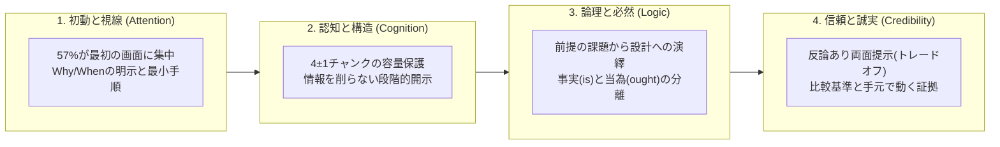

# 良いドキュメントとは何か：論理学・認知科学・広告工学の交差点から紐解く技術文書設計論仮説 (PAPER)

## 要旨 (Abstract)

生成AIの普及によって、流暢な文章を誰でも一瞬で生成できる時代になりました。しかしその一方で、ソフトウェアのREADMEや仕様書、設計解説書などの技術ドキュメントにおいて、「表層は綺麗だが根拠のない誇張表現（チープトーク）が混ざる」「情報を詰め込みすぎて読者が途中で読むのをやめてしまう」「客観的な仕様ではなく執筆者の主観的なお説教が書かれている」といった課題に直面する場面も増えています。

世の中には、日本語の「てにをは」や表面的な体裁を整えるツールやエージェントスキルは数多く存在しますが、「そもそも人間はどうドキュメントを認識し、どのような論理構造に納得し、何によって信頼を形成するのか」という情報工学・認知科学的な設計論はあまり見かけません。

本稿（`PAPER.md`）は、「嘘や誇張がなく、かつ読者の頭にスッと入ってくる『良いドキュメント』とは何か」を探るために行った個人的な自由研究の総括レポートです。
本研究では、 **①形式論理学・証明論、②論証モデル・説得工学、③信頼性・シグナリング理論、④認知負荷理論・可読性研究、⑤段階的開示・情報設計、⑥コピーライティング・LPの型、⑦CVR・視線誘導・離脱防止、⑧GitHub README・OSS大規模実証研究** の8分野・合計56件の一次資料（学術論文および実証データ）を横断的に調査しました。

そこから浮かび上がってきたのは、良いドキュメントとは「決まった穴埋めテンプレートに従った文書」ではなく、 **論理で嘘や飛躍を抑え、認知科学で作業記憶を保護し、広告と説得の工学で初動の摩擦と疑念を和らげる** という設計原則の組み合わせによって形作られるのではないか、という仮説です。本稿では、各分野の先行研究や実験データをヒントにしながら、READMEをはじめとする技術文書全般に応用できる可能性を持った「良いドキュメント論」の仮説モデルを提案します。

---

## 目次

- [第1章 序論：なぜ技術文書は「盛られ」たり「閉じられ」たりするのか](#第1章-序論なぜ技術文書は盛られたり閉じられたりするのか)
- [第2章 視線と初動の科学：最初の5秒で何が起きているか](#第2章-視線と初動の科学最初の5秒で何が起きているか)
- [第3章 認知負荷と情報深度の制御：情報を削らずに整理する技術](#第3章-認知負荷と情報深度の制御情報を削らずに整理する技術)
- [第4章 論理と必然性の骨格：ツッコミどころのない筋道をつくる](#第4章-論理と必然性の骨格ツッコミどころのない筋道をつくる)
- [第5章 信頼と説得の工学：疑念を払拭する誠実さの構造](#第5章-信頼と説得の工学疑念を払拭する誠実さの構造)
- [第6章 統合考察と文脈適応：「テンプレート」ではなく「思考のレンズ」として](#第6章-統合考察と文脈適応テンプレートではなく思考のレンズとして)
- [第7章 結語：未来へまく「種」として](#第7章-結語未来へまく種として)

---

## 第1章 序論：なぜ技術文書は「盛られ」たり「閉じられ」たりするのか

### 1.1 生成AI時代の「流暢なノイズ」と3つの摩擦
私たちが普段から生成AI（LLM）を使って文章やドキュメントを書かせていると、ある特有のクセにたびたび出くわします。それは、放っておくとすぐに「圧倒的に高速」「究極の柔軟性」「業界標準を凌駕する」といった大袈裟な言葉で文章を盛り始めたり、実際に動くかどうかの機械的な検証を省略したりする傾向です。

かといって、背景や文脈を削ぎ落とした無味乾燥な箇条書きを出力させると、今度は「なぜこのツールが存在するのか」「どういう場面で役に立つのか」が伝わりにくい味気ない文書になりがちです。

そもそも、技術ドキュメントの書き手（開発者・設計者）と読み手（利用者・評価者）の間には、以下の **3つの摩擦（Friction）** が生じやすいと考えられます。

1. **知覚と初動の摩擦（読まれずに閉じられる）**  
   どれほど正確で誠実な仕様を後半に書いていても、ページを開いた最初の数秒で「これは何で、自分にどう関係があるのか」が直感できなければ、読者はスクロールせずにページを閉じてしまう可能性があります。
2. **認知と記憶の摩擦（多すぎてパンクする vs 削りすぎて足りない）**  
   誠実であろうとして全機能・全オプション・全例外を1ページにズラッと並べると、初見の読者は情報の多さに疲れて離脱しやすくなります。逆に、読みやすくしようとして情報を要約・削除してしまうと、本格的に導入や実装を検討している読者から「必要な仕様が書かれていない」と判断されてしまいます。
3. **不信と論理の摩擦（ポジショントークへの警戒とお説教への反発）**  
   技術者は経験上、「どんなツールにも弱点やトレードオフがある」ことを知っています。良いことばかりが書かれた文書や、比較対象のない「高速・軽量」という宣伝文句、あるいは「開発者は〜すべきである」という書き手の主観的なお説教に出会ったとき、読者の側には警戒心（心理的リアクタンス）が生じやすくなります。

### 1.2 論法と広告の交差点としての「README」、そして技術文書全般へ
この3つの摩擦を和らげるにはどうすればいいのでしょうか。
そこで着想したのが、 **「演繹法や背理法を基本とした形式論理の枠組み」** と **「広告業界や認知心理学で磨かれてきた見せ方のノウハウ」** をハイブリッドに掛け合わせるアプローチです。

とりわけGitHubのREADME（リドミ）は、ソフトウェアの正確な仕様や使い方を伝える「技術文書」であると同時に、プロジェクトを訪れた人が最初に目にする「顔（看板・ランディングページ）」でもあります。論理の厳密さと広告の視線誘導が交差する、わかりやすい実例と言えます。
そして、この問いを深掘りして56件の先行研究を紐解いていくうちに、この考え方はREADMEだけにとどまらず、API仕様書、アーキテクチャ設計書、技術解説記事、さらにはプレーンテキストのメモに至るまで、 **「他者に技術や仕様を伝えるドキュメント全般」に応用できる情報設計の仮説** になり得ると気づきました。

次章からは、読者がドキュメントを開いてから内容を理解し、納得して行動に移すまでのプロセスに沿って、先行研究のデータとともにその設計アプローチを見ていきます。

---

## 第2章 視線と初動の科学：最初の5秒で何が起きているか

読者がドキュメントを開いた瞬間、論理的な精読が始まる前に、まず「視覚的な走査（Scanning）」と「初動の選別」が行われます。ここで生じる摩擦を減らすためのヒントを見ていきます。

### 2.1 アテンションの減衰と「57%の壁」
「良い内容が書いてあれば、読者は最後までスクロールして読んでくれるはずだ」というのは、書き手が陥りやすい錯覚のひとつです。
Jakob Nielsen（Nielsen Norman Group, 2018）が120名の被験者・数千サイトにおける130,000点以上の視線固着点（Eye Fixations）を解析したアイトラッキング研究では、人間の注意（アテンション）が画面のどこに集中するかについて、興味深い数値が報告されています。

> **(Original)**  
> *"In our most recent study, users spent about 57% of their page-viewing time above the fold. 74% of the viewing time was spent in the first two screenfuls, up to 2160px. ... Content above the fold receives by far the highest share of the viewing time. ... On general websites, more than 42% of the viewing time fell within the top 20% of the page, and more than 65% of the time was spent in the top 40% of the page."*  
> **(日本語訳)**  
> 「我々の最新の調査では、ユーザーはページ閲覧時間の約57%をファーストビュー（Above the Fold: スクロール前の最初の画面）で費やしていた。閲覧時間の74%は最初の2画面分（最大2160px）で費やされた。……ファーストビューのコンテンツは、閲覧時間において非常に大きなシェアを占める。一般的なWebサイトでは、閲覧時間の42%以上がページの上位20%領域に落ち、65%以上が上位40%領域で費やされていた。」  
> *(出所: Jakob Nielsen, 2018, `[REF-NIELSEN2018]`)*

さらに、Shanelle Mullin（CXL, 2023）が引用するGoogleの視認性データでも、折り目（Fold）の直上では視認率が **73%** であるのに対し、折り目の直下では **44%** へと低下し、ファーストビューの内外で情報の扱われ方に平均 **84%** の差が生じることが示されています（`[REF-MULLIN2023]`）。

また、ここで意識しておきたいのが **「騙しの床（False Floor）」** と呼ばれる現象です。

> **(Original)**  
> *"Users do scroll, but only if what’s above the fold is promising enough. What is visible on the page without requiring any action is what encourages us to scroll. ... When you have a false bottom, you don’t give visitors a reason to believe there is something below the fold. As a result, they will attempt to scroll less often."*  
> **(日本語訳)**  
> 「ユーザーはスクロールするが、それはファーストビューにある情報が十分に期待を持たせる（promising enough）場合だけである。何の操作も要さずに画面上で見えているものこそが、我々にスクロールを促す。……『騙しの底（false bottom / false floor）』があると、訪問者に折り目の下にまだ何かが存在すると信じる理由を与えられない。結果として、彼らがスクロールを試みる頻度は低下する。」  
> *(出所: Shanelle Mullin, 2023, `[REF-MULLIN2023]`)*

ドキュメントの冒頭直後に、大きな余白や孤立した水平線（`---`）を引いてしまうと、読者が「ここで情報がひと区切りついた（終わった）」と錯覚し、スクロールを止めてしまう要因になり得ます。初動の画面下端には、次のセクションの見出しや目次が自然に覗くような視覚的連続性を持たせることで、スクロールの停滞を防ぎやすくなると考えられます。

### 2.2 導入率の方程式と「字義通りの定義」
では、その最初の1画面（最初の5秒間）に何が書かれていれば、読者は「スクロールする価値がある」と感じやすいのでしょうか。
Julian Shapiro（2020）は、ランディングページにおける意思決定を次のような方程式で表現しています。

$$\text{Adoption Rate (導入率)} = \text{Desire / Utility (欲求・実効的効用)} - (\text{Labor (探索労力)} + \text{Confusion (混乱)})$$

> **(Original)**  
> *"Generally, the more you detour from the template, the more confused the average visitor becomes. Think of your landing page from the perspective of a visitor's likelihood to purchase: Purchase Rate = Desire - (Labor + Confusion). ... Decrease labor— Reduce the work your visitors have to perform so they don't get tired or annoyed. Be concise and ensure every word and element is of value. Decrease confusion— Don't confuse visitors with obscure or verbose messaging. Ensure every sentence can be easily understood."*  
> **(日本語訳)**  
> 「一般に、基本構造（テンプレート）から寄り道（detour）すればするほど、平均的な訪問者はより混乱するようになる。訪問者の購買可能性という観点からランディングページを考えてみよう。Purchase Rate = Desire - (Labor + Confusion) である。……労力（Labor）を減らすこと——訪問者が疲れや苛立ちを感じないよう、彼らが遂行しなければならない作業を減らせ。簡潔にし、すべての単語と要素に価値があるようにせよ。混乱（Confusion）を減らすこと——曖昧または冗長なメッセージで訪問者を混乱させるな。すべての文が容易に理解できるようにせよ。」  
> *(出所: Julian Shapiro, 2020, `[REF-SHAPIRO2020]`)*

この「1. これは何か？（What is it?）」を伝える際、作り手がついやってしまいがちなのが、「次世代のオーケストレーション・パラダイム」といった抽象的なメタファー（Jargon）や、「超高速・軽量」といった形容詞で飾ってしまうことです。
コピーライターの Harry Dry（2020）は、そうした抽象語を避け、 **「具体的な名詞と動詞（何を、どうするのか）」** で置き換えるアプローチを提案しています（`[REF-DRY2020]`）。

これはオープンソース（OSS）の実証研究とも重なります。Jazlyn Hellmanら（2023）がGitHubの385リポジトリの概要文を分析した調査では、開発者にとって理解しやすく好まれる説明文は、 **LSP（Language: 対象言語や環境、Software technology: ソフトウェア分類・技術、Purpose: 具体的な目的）** の要素を明確に含むものであることが示されました（一方で、実際に3要素を満たしていたリポジトリは全体の **8.3%** にとどまっていました、`[REF-HELLMAN2023]`）。  
このLSPの考え方は、全員が同じ文末の穴埋め構文を使うというよりは、「どの環境で動く、何の種類のツールで、どんな課題を解決するのか」という具体的事実を、抽象的なポエムではなく字義通りの言葉で冒頭に置くと、読者の「混乱（Confusion）」を減らす助けになる、というヒントとして捉えることができます。

### 2.3 OSS実証データが示す「Why / When」の欠落と「Level A構文」
さらに、ドキュメント全体を見渡したとき、書き手が「普段書いている情報」と、読み手が「判断のために求めている情報」の間にはギャップが見られます。
Gede Artha Azriadi Pranaら（2019）がGitHubの393リポジトリ・4,226セクションを手動アノテーションして分類した研究を見てみましょう。

> **(Original)**  
> *"We find that information discussing the ‘What’ and ‘How’ of a repository is very common, while many README files lack information regarding the purpose and status of a repository. ... Based on the consideration of files in our sample (fourth column of Table 3), 97% of the files contain at least one section describing the ‘What’ of the repository and 88.5% offer some ‘How’ content. Other categories, such as ‘Contribution’, ‘Why’, and ‘When’, were much less common."*  
> **(日本語訳)**  
> 「リポジトリの『What（何であるか）』と『How（使い方）』を論じる情報は非常に一般的である一方、多くのREADMEファイルはリポジトリの目的（Why）やステータス・適用時期（When）に関する情報を欠いていることが判明した。……サンプル内のファイルを分析した結果（Table 3の第4列）、97%のファイルがリポジトリの『What』を説明するセクションを少なくとも1つ含み、88.5%が何らかの『How』コンテンツを提供していた。一方、『Contribution』『Why』『When』といった他のカテゴリははるかに少なかった（Table 3の実測値において、『Why』はREADMEファイルの25.7%・全セクションの2.7%、『When』はファイルの21.4%・全セクションの4.3%にとどまる）。」  
> *(出所: Gede Artha Azriadi Prana et al., 2019, `[REF-PRANA2019]`)*

調査されたREADMEの約75%〜80%近くにおいて、 **「なぜ既存のやり方ではなくこのツールを作ったのか（Why）」** と **「どういう条件・規模なら適していて、どういう場合には向かないのか（When）」** が記載されていませんでした。これらを意識して補うことで、読者が自分の用途に合うかを判断しやすくなると期待できます。

また、「どうやって始めるのか（How / Quick Start）」のコード例にも興味深いデータがあります。Supavas Sitthithanasakulら（2023）がPyPIライブラリ1,620件のREADMEに含まれるコードスニペットを構文解析した結果です。

> **(Original)**  
> *"In an empirical study on 1,620 README files of PyPI libraries, we find that developers mainly present 92% of basic elements in code snippets. ... basic elements (Level 'A') are the most used in the README files (92%) while proficient elements (Level 'C') are the lowest (1%). ... The code snippets in README files should be easy to understand for newcomers without requiring advanced programming idioms."*  
> **(日本語訳)**  
> 「PyPIライブラリの1,620件のREADMEファイルに関する実証研究において、開発者はコードスニペット内で主に基本要素（92%）を提示していることが判明した。……基本要素（Level A: 単純代入 86.98%、属性参照 87.22%、基本import 65.06%）が最も多く使われ（92%）、熟練要素（Level C: 内包表記やメタプログラミング等の高度構文）は最も少なかった（1%）。README内のコードスニペットは、高度なプログラミングイディオムを要求することなく、初学者にとって理解しやすいものであることが望ましい。」  
> *(出所: Supavas Sitthithanasakul et al., 2023, `[REF-SITTHI2023]`)*

さらに、Unbounce（2022）のコンバージョン研究が指摘する **「決定麻痺（Decision Paralysis）」** も参考になります（`[REF-UNBOUNCE2022]`）。冒頭の導入手順で「Dockerを使う方法」「ソースからビルドする方法」「パッケージマネージャA・B・C・Dを使う方法」をいきなり並列に5つも6つも並べられると、読者は「どれを叩けばいいのか」で迷い、探索労力（Labor）が増えてしまいます。  
一番最初は「標準的な1つの導入手順と、基本構文（Level A）で動く最小のコード」を提示し、その他のインストール方法や高度なオプションは後ろ（または折りたたみ）へ配置することで、初動のつまずきを抑える効果が期待できます（なお、オンボーディング手順の整備が新規参入者の定着率向上やバグ混入率の低減と関連することも、Foundjem et al. `[REF-FOUNDJEM]` や Fronchetti et al. 2023 `[REF-FRONCH2023]`、Gaughan et al. 2025 `[REF-GAUGHAN2025]` の研究で報告されています）。

---

## 第3章 認知負荷と情報深度の制御：情報を削らずに整理する技術

初動の5秒を通過して読者が本文を読み始めたとき、次に関わってくるのが人間の脳のメモリ容量です。ここで「読みやすさ」と「情報の網羅性（深さ）」という一見相反する2つの要求をどう両立させるかを考えます。

### 3.1 ワーキングメモリの「4チャンク限界」と注意分割効果
よく「人間が一度に覚えられる数は $`7 \pm 2`$ 個である（Miller, 1956）」と言われますが、認知心理学者の Nelson Cowan（2001）は、数多くの実験を再検討し、 **事前の知識（スキーマ）を持たない初見の情報に対して人間が同時に注意を向けられる純粋な容量は、「$`4 \pm 1`$（平均4チャンク）」程度である** ことを示しました。

> **(Original)**  
> *"Miller (1956) summarized evidence that people can remember about seven chunks in short-term memory tasks ... However, when chunking is prevented or controlled, the capacity of the focus of attention is much smaller: about 4 chunks on average in healthy adults. ... The limit of 4 ± 1 chunks holds across a wide variety of circumstances when rehearsal and grouping strategies are disabled."*  
> **(日本語訳)**  
> 「ミラー（1956）は、人々が短期記憶課題において約7個のチャンクを保持できるという証拠をまとめた。……しかし、チャンキング（既知の知識による塊化）が防止または制御された場合、注意の焦点の容量ははるかに小さく、健常な成人では平均して約4チャンクである。リハーサルやグループ化の戦略が無効化された場合、$`4 \pm 1`$ チャンクという限界は多種多様な状況において成立する。」  
> *(出所: Nelson Cowan, 2001, `[REF-COWAN2001]`)*

初めて触れるツールや仕様書を読むとき、読者の頭の中にはまだそのツールに関する「塊（チャンク）」が形成されていません。その状態で、1つの見出しの下に10個も15個もフラットな箇条書きや設定フラグが並んでいると、読者のワーキングメモリに負荷がかかります。項目が多くなる場合は、意味のある3〜4個の上位グループに分ける（構造化する）ことで、認知的な負担を和らげることができます。

また、John Swellerら（2011）や Slava Kalyuga（2011）、Rodrigo Duranら（2022）が体系化した **認知負荷理論（Cognitive Load Theory: CLT）** では、脳の負荷を「対象そのものの難しさ（内包性認知負荷: ICL）」と「見せ方の不手際によって生じる負荷（外在性認知負荷: ECL）」に分けます（`[REF-SWEL2011]`, `[REF-KALYUGA2011]`, `[REF-DURAN2022]`）。  
ドキュメントにおいて外在性認知負荷（ECL）を増やす大きな要因が、 **「注意分割効果（Split-Attention Effect）」** です。

> **(Original)**  
> *"When learners process text and visuals that cannot be understood in isolation, the mental integration of verbal and pictorial representations is required. When text and pictures are not located close to each other or not synchronized in time, integrating these referring representations may increase cognitive load and decrease learning. ... physically integrated or embedded representations were demonstrated to be an effective alternative to 'split-source' instructional format (split-attention effect)."*  
> **(日本語訳)**  
> 「学習者が単独では理解できないテキストと視覚情報を処理する際、言語的表現と視覚的表現の脳内統合が要求される。テキストと図表が互いに近くに配置されていない、あるいは時間的に同期していない場合、これらの参照し合う表現を統合することは認知負荷を増大させ、学習を低下させ得る。……物理的に統合された、あるいは埋め込まれた表現は、『情報源が分離した（split-source）』提示形式に対する有効な代替手段であることが実証されている（注意分割効果：split-attention effect）。」  
> *(出所: Slava Kalyuga, 2011 / John Sweller et al., 2011, `[REF-SWEL2011]`, `[REF-KALYUGA2011]`)*

たとえば、長いコードブロックを貼ったあと、そこから何十行も離れた場所で「上のコードの3行目の引数は〜」と解説したり、コマンド例と実行結果の出力が別々のセクションに離れていたりする構成です。読者は画面を上下にスクロールして視線を往復させることになり、疲れやすくなります。  

相互に関係する情報（コードと注釈、コマンドと期待出力）を同じ視野内に空間的に近づけて配置すると、視線往復の負荷を減らす効果が期待できます（Sharon Oviatt 2006 の研究でも、認知的オーバーヘッドを抑えた構造化提示によりタスク決定的なエラーの最大86%、非流暢性の最大80%が削減された事例が報告されています、`[REF-DURAN2022]` / Oviatt 2006）。

### 3.2 「主観的な読みやすさ」の罠とトートロジーの抑制
ここで、もうひとつ興味深い実験データを紹介します。「文章を平易にしてコメントをたくさん書けば、理解しやすい良いドキュメントになるのか？」という問いに対する、Jürgen Börstler & Barbara Paech（2016）の104名の被験者を用いた実験結果です。

> **(Original)**  
> *"Regarding perceived readability, our results show statistically significant differences between comment variants ... Regarding comprehension, there are no significant differences between method chain or comment variants. ... Our results do not show any significant relationships between perceived readability and the other measures taken in the present study. Perceived readability might therefore be insufficient as the sole measure of software readability or comprehension."*  
> **(日本語訳)**  
> 「主観的可読性（読みやすいと感じるか）に関しては、コメントのバリエーション間で統計的に有意な差が認められた。……しかし実際の理解度（穴埋めテストの成績）に関しては、有意な差は認められなかった。本研究の結果は、主観的可読性と他の理解度測定値との間にいかなる有意な相関も示していない。したがって、主観的可読性はソフトウェアの可読性や理解度の唯一の尺度としては不十分である可能性がある。」  
> *(出所: Jürgen Börstler & Barbara Paech, 2016, `[REF-PAECH2016]`)*

被験者は、コードの字面をそのまま自然言語で繰り返しただけのコメント（例：`getUser() // ユーザーを取得する`、`timeout: 30 // タイムアウトを30秒にする`）がついていても、「コメントがある」ことで「読みやすい（主観的可読性が高い）」と感じる傾向がありました。しかし、実際に仕様を理解できているかを測るテストでは、成績の向上が見られませんでした。

このことから、関数名や設定キーを日本語に直訳しただけの **同義語反復（トートロジー）** は、読者に「読めたつもり」を生むだけで、実質的な理解にはつながりにくいと考えられます。字面の言い換えよりも、 **「どんな前提条件で呼べるのか」「どんな副作用があるのか」「失敗したときに何が起きるのか」** という、コードの字面からは読み取れない因果関係を記述するほうが、実用上の理解を助けると期待されます（Garousi et al. 2015 の産業界調査でも、コードとの対応や実質的情報が欠けたドキュメントは開発者から参照されなくなる傾向が示されています、`[REF-PAECH2016]` / Garousi 2015）。

### 3.3 情報深度（Information Depth）と「透明性の逆説」を解く段階的開示
では、認知負荷を下げるために、細かい仕様やエッジケースの説明は削ってしまえばいいのでしょうか？
先行研究のデータを見ると、単純に削るのは逆効果になる可能性が示唆されています。

Ariful Islam Anik & Andrea Bunt（2026）が32名の被験者を対象に「情報の深さ（Low Depth vs High Depth）」と「段階的開示（Progressive Disclosure の有無）」の影響を調べた実験では、次のような結果が出ています。

> **(Original)**  
> *"Findings from a study with 32 participants show advantages to providing users with comprehensive information on training datasets. Detailed explanations not only enhanced perceived trust, fairness, and understanding, but were also preferred by participants despite the increased cognitive load. While Progressive Disclosure did not effectively mitigate cognitive load, it improved users’ perception of learning. These findings suggest that effective transparency does not come from minimizing detail, but from embracing it, as participants consistently valued clarity and completeness over brevity, even at the cost of higher cognitive load."*  
> **(日本語訳)**  
> 「32名の参加者を対象とした調査の結果は、訓練データセットに関する包括的な情報をユーザーに提供することの利点を示している。詳細な説明は、知覚される信頼、公平性、および理解を高めただけでなく、認知負荷の増大にもかかわらず参加者から選好された。段階的開示（Progressive Disclosure）自体は認知負荷を直接軽減しなかったものの、ユーザーの『学習の知覚』を有意に向上させた（$`p < 0.05`$）。これらの知見は、有効な透明性とは詳細を最小化することから生まれるのではなく、詳細を受け入れることから生まれることを示唆している。参加者は、より高い認知負荷を代償にしてでも、簡潔さより明瞭さと完全性を一貫して重視したからである。」  
> *(出所: Ariful Islam Anik & Andrea Bunt, 2026, `[REF-ANIK2026]`)*

一方で、Aaron Springer & Steve Whittaker（2019, 2020）の4つの実証実験は、 **「透明性の逆説（Paradox of Transparency）」** という現象を報告しています。

> **(Original)**  
> *"We assess user reactions to transparency feedback in four studies of an emotional analytics system. In Study 1, users anticipated that a transparent system would perform better but unexpectedly retracted this evaluation after experience with the system. Study 2 offers an explanation for this paradox by showing that the benefits of transparency are context dependent. On the one hand, transparency can help users form a model of the underlying algorithm’s operation. On the other hand, positive accuracy perceptions may be undermined when transparency reveals algorithmic errors. ... Results again suggest that users may benefit from initially simplified feedback that hides potential system errors and assists users in building working heuristics about system operation."*  
> **(日本語訳)**  
> 「我々は感情分析システムに関する4つの研究において、透明性フィードバックに対するユーザーの反応を評価した。研究1では、ユーザーは透明性の高いシステムほど優れた性能を発揮すると期待していたが、実際にシステムを体験した後には予想外にもその評価を撤回した。研究2は、透明性の利点が文脈依存であることを示すことで、この逆説（paradox）に対する説明を提供する。一方で、透明性はユーザーが背後にあるアルゴリズムの動作モデルを形成するのを助けることができる。他方で、透明性がアルゴリズムの誤差を露呈させると、肯定的な精度知覚が損なわれる場合がある。……結果は、潜在的なシステム誤差を初期段階では隠し、システム動作に関する実用的なヒューリスティックの構築を支援する『最初は簡略化されたフィードバック（段階的開示）』からユーザーが恩恵を受け得ることを重ねて示唆している。」  
> *(出所: Aaron Springer & Steve Whittaker, 2020, `[REF-SPRING2020]`)*

さらに、Kalyuga（2011）が指摘する **「専門性逆転効果（Expertise Reversal Effect）」** （初心者向けの丁寧な基礎解説が、熟練者にとってはかえって邪魔になる現象、`[REF-KALYUGA2011]`）や、Ashraf Abdulmunim Abdulmajeed（2026）が717リポジトリの機械学習（CatBoost/SHAP）解析で示した「READMEの長さは短すぎても長すぎても新規参入者を遠ざけ、中程度の長さで魅力がピークに達する（静的要因中SHAP値第1位: 0.420）」（`[REF-ABDUL2024]`）というデータも、共通の方向性を示唆しています。

それは、 **「情報を安易に圧縮・削除するのではなく、かといってすべてを同じ平面（フラットな1枚の画面）に並べるのでもなく、階層を分けて配置する」** というアプローチです。

### 3.4 「グルーピング × 関心事の分離（SoC）」と情報採餌の道しるべ
この両立を可能にする仕組みが、Jakob Nielsen（2006, `[REF-NIELSEN2006]`）や Sarah Horton（2006, `[REF-HORTON2006]`）、Deepa Muralidharら（2025, `[REF-MURALI2025]`）が論じる **「段階的開示（Progressive Disclosure）」** です。

本研究では、段階的開示を単なる「Markdownの `
` タグという小技」としてではなく、 **「認知心理学のグルーピング（容量保護）」と「ソフトウェア工学の関心事の分離（Separation of Concerns: SoC）」のハイブリッド** として位置づけています。

たとえば、ドキュメント内の情報を読者のフェーズ（関心空間）に応じて3つの層に分けて整理します（Muralidhar et al. 2025 の 3-Tier 選択的透明性モデルを参考にした構成、`[REF-MURALI2025]`）：
- **第1層（最短動線 / Happy Path）**: 概要、なぜ使うのか、最小限のクイックスタート。
- **第2層（主要概念と境界）**: 代表的な機能・使い方、メンタルモデル（全体像）、および主要な制約事項。
- **第3層（深層リファレンス / Exhaustive Evidence）**: 全CLIフラグ一覧、網羅的な設定スキーマ、内部アルゴリズムの詳細、エッジケースのトラブルシューティング。

この第3層の情報を、媒体の特性に合わせて視覚的・構造的に切り離します。
- **Markdown / HTML環境**: `

...
` によるアコーディオン折りたたみ、または別ファイルへのリンク分離。
- **プレーンテキスト（.txt）やRFC等の環境**: 本文のメイン動線から切り離し、文書末尾の「付録（Appendix）」セクションや外部ファイルポインタへと分離。

そして、こうして構造化された文書内を、読者が迷わず移動できるようにするための道しるべ（Information Scent: 情報の手がかり）となるのが **目次（Table of Contents）と見出し階層** です。  

Moon Ting Suら（2012）がソフトウェアアーキテクチャ文書の読解行動を調査した情報採餌（Information Foraging）研究では、実務エンジニアは文書を頭から順番に読むのではなく、目次と見出しを起点に目的の情報パッチへとジャンプしながら探索する傾向が確認されています（`[REF-SU2012]`、Storey et al. 1997 `[REF-STOREY1997]`、Procter & Symonds 2001 `[REF-PROCTER2001]`、Mattyasovszky-Philipp & Molnár 2020 `[REF-MATTYAS2020]`）。  

Cowanの容量限界（4項目）を超える規模の文書（目安としてH2見出しが4個以上並ぶ文書）では、冒頭に構造的な目次を置くことで、読者が現在地を見失う「認知的迷子」を軽減できると考えられます。

---

## 第4章 論理と必然性の骨格：ツッコミどころのない筋道をつくる

視線誘導と認知負荷の整理によって「頭に入りやすい器」が整ったら、次はその器の中身である「文章の論理構造」です。AIが書きがちな大袈裟なポエムや論理の飛躍を抑え、筋の通った説明を作るための考え方を見ていきます。

### 4.1 必然性の連鎖（Chain of Necessity）：前提の不便から設計を導く
第2章で見たように、多くのドキュメントには「機能の一覧（What）」しか書かれておらず、「なぜその機能や構造にしたのか（Why）」が抜け落ちがちです。
ここで言う「なぜ作ったのか」を書くというのは、開発者の苦労話を長々と綴ることではなく、 **「読者と共有できる前提の課題（公理）」から出発し、「だからこの機能が必要になり」「それを実現するためにこの設計を選んだ」という演繹的な必然性の鎖（Chain of Necessity）を示すこと** です。

たとえば、日常使っている「トイレットペーパー」を説明する場面を想像してみてください。

単に「①パルプ製、②ロール型構造、③ミシン目入り」とスペックだけを箇条書きにされても、それを知らない人には何のための設計なのか伝わりにくいかもしれません。  
しかし、「排便後に衛生を保つため拭き取る紙が必要になる（前提の課題 A）。必要な紙の長さは人や状況によって毎回異なる（境界条件 B）。使う人自身が長さを自由に調整できるようにするため、1枚のシートではなく連続して引き出せるロール型を採用している（設計の理由 C）」と説明されると、機能と構造のつながりが一本の筋道として理解しやすくなります。

この「前提の不便への共感から解決策へ繋ぐ」構造は、マーケティングやコピーライティングの分野で語られている知見とも重なります。  
神田昌典（2016）が提唱した **「新・PASONAの法則」** では、旧来のマーケティングのように読者の恐怖や不安を煽り立てる（Agitation）のではなく、読者が現場で直面している課題への **「親近感・文脈の共感（Affinity）」** を示した上で、根本原因の解決策（Solution）を提示する構成が採られています（BtoBサイトにおいて課題解決型構成が平均の約2.8倍の転換率を示した事例が紹介されています、`[REF-KANDA2016]`、Joanna Wiebe 2015 `[REF-COPYHACKERS2015]`）。  
さらに、Userpilot（2026）が解説する **「FABモデル（Feature → Advantage → Benefit）」** は、機能説明の論理的な鎖を次のように定義しています。

> **(Original)**  
> *"Create a cohesive chain between feature (what the product does) to advantage (how it changes daily work) to benefit (its impact/outcomes) ... When a decision-maker reads a subsequent benefit claim, the foundational advantage is what makes it credible by explaining the mechanism rather than just asserting the outcome."*  
> **(日本語訳)**  
> 「機能（製品が何をするか）から優位性（日々の作業がどう変わるかという動作機序）、そして便益（その影響と成果）への結束力ある因果鎖を構築せよ。……意思決定者が便益の主張を読むとき、単に結果を断定するのではなくメカニズム（動作の仕組み）を説明する基盤となる優位性こそが、その主張に信憑性を与えるのである。」  
> *(出所: Userpilot, 2026, `[REF-USERPILOT2026]`)*

「どんな不便（前提）があり、どんな仕組み（Feature / Advantage）によって、どんな利点（Benefit）が生まれるのか」を順序立ててつなぐことで、煽り文句に頼らずとも納得感を持ってもらいやすくなると考えられます（Wilfried Sieg & John Byrnes 1998 が自然演繹の証明探索で示した「前提と結論のギャップを戦略的に架橋する Intercalation」の考え方とも通じるものがあります、`[REF-SIEG1998]`）。

### 4.2 背理法（RAA）と結果論証（トレードオフ）の峻別
自身の設計やツールの特徴を論理的に説明する際、「もしこの方式を採らなかったら（従来の方式のままだったら）、こういう矛盾や不都合が生じる。だからこの方式を採用している」という **背理法（Reductio ad Absurdum: RAA）** 的なアプローチは、設計意図を伝える上で役に立ちます（Dale Jacquette 2008, `[REF-JACQUETTE2008]`）。

ただ、技術文書でこの論法を使う際に気をつけたいポイントがあります。論理学者の Henrike Jansen（2007）は、本来の「背理法（RAA）」と、単なる「結果論証（Argument from Consequences）」の違いを次のように区別しています。

> **(Original)**  
> *"The difference between the Argument from Consequences and the RAA concerns the kind of consequences that are being appealed to: causally induced consequences in the Argument from Consequences and logically implied consequences in the RAA. ... First, this definition leaves room for types of arguments by which an appeal is made to undesirable consequences that are causally induced. ... Second, the definition covers arguments that appeal to a logical relationship between the attacked viewpoint and its supposed consequences ... creates an impossibility (a Reductio ad Absurdum)."*  
> **(日本語訳)**  
> 「結果論証（Argument from Consequences）と背理法（RAA）の相違は、訴求される帰結の性質に関するものである。すなわち、結果論証においては『因果的に引き起こされる（望ましくない）帰結』であり、背理法においては『論理的に含意される帰結（不可能性・矛盾）』である。」  
> *(出所: Henrike Jansen, 2007, `[REF-JANSEN2007]`)*

ソフトウェア工学における設計判断の多くは、「メモリを多く使う代わりに速度を上げる」「設定ファイルが増える代わりに型安全性を得る」といった **因果的なトレードオフ（結果論証）** です。

それにもかかわらず、自分のツールを良く見せようとして、他方式のトレードオフを「従来方式ではシステムが破綻する」「動作不可能になる」といった **論理的不可能性（背理法）であるかのように誇張して語る** と、論理的な飛躍（ツッコミどころ）が生まれてしまいます。論理的に矛盾すること（例：排他制御なしで共有メモリに同時書き込みすればデータ競合のリスクが生じる）と、単なるトレードオフ（例：メモリ消費量が増える）を混同せず、淡々と書き分ける姿勢が信頼につながると考えられます。

### 4.3 自然演繹の「迂回（Detour）除去」と構造的一致
また、文章の論理展開から回りくどさを減らす上で、証明論（Proof Theory）におけるゲオルク・ゲンツェン（Gerhard Gentzen）とダグ・プラヴィッツ（Dag Prawitz）の **「正規化定理（Normalization Theorem）」** がひとつのヒントになります（Dag Prawitz 2018 `[REF-PRAWITZ2018]`、Jan von Plato 2020 `[REF-VONPLATO2020]`）。

> **(Original)**  
> *"By this time, he had noticed that if an introduction, say a derivation of A & B from A and B separately, is followed by the corresponding elimination, say a derivation of A, the formula A & B constitutes a local maximum, a 'hillock', that can be eliminated. He also called such hillocks 'detours', and what is now called a detour conversion removes such unnecessary pairs of introduction-elimination steps. The result of the steps of 'normalization' is a derivation in 'normal form'."*  
> **(日本語訳)**  
> 「この時までに彼（ゲンツェン）は、例えば $`A`$ と $`B`$ から別個に $`A \land B`$ を導出する導入規則の後に、対応する除去規則（例えば $`A`$ の導出）が続く場合、論理式 $`A \land B`$ は除去可能な局所的極大、すなわち『小丘（hillock）』を構成することに気づいていた。彼はまたそのような小丘を『迂回（detours）』と呼び、現在デツアート変換と呼ばれる操作が、このような不必要な導入・除去ステップのペアを除去する。この『正規化』のステップの結果が、『正規形（normal form）』の導出である。」  
> *(出所: Jan von Plato, 2020, `[REF-VONPLATO2020]`)*

これをドキュメントの文章になぞらえると、次の2つの「読みにくさの要因」が見えてきます。
1. **不要な迂回（Detour）**: 本題の結論や手順に入る前に、その場限りの専門用語や概念をわざわざ定義（導入）しておきながら、直後の文でそれをただ言い換えて消費（除去）するだけの回りくどい前置き。これらを整理し、前提から結論へ素直につなぐことで、見通しの良い（「正規形」に近い）文章になると考えられます。
2. **未定義語彙の唐突な出現（部分論理式性質の破綻）**: 正規化された証明では、結論や前提に含まれない未知の概念が途中に突然現れないという性質（Subformula Property）があります。ドキュメントでも、冒頭や前提で説明していない独自の略語や内部用語が、手順の途中でいきなり説明なしに出てくると、読者が文脈を追いにくくなります。

さらに、NASAの形式手法研究で Xiang Yin & John Knight（2010）が提唱した **「構造的一致仮説（Structural Matching Hypothesis）」** が示唆するように、仕様書やドキュメントの見出し構造が、実際のソフトウェアのモジュール構造やディレクトリ構造と対応（相似：Isomorphic）していると、理解や保守の手間を減らす効果が期待できます（`[REF-KNIGHT2010]`、Dantas et al. 2023 `[REF-DANTAS2023]`）。

### 4.4 ヒュームのギロチン：事実（is）から当為（ought）を導かない
そして、本研究の論理構造において特に重視しているのが、哲学者デイヴィッド・ヒュームが『人間本性論』（1739年）で提示した **「ヒュームのギロチン（Hume's Guillotine / Is-Ought Problem）」** です。

> **(Original)**  
> *"In every system of morality, which I have hitherto met with, I have always remark'd, that the author proceeds for some time in the ordinary way of reasoning... when of a sudden I am surpriz'd to find, that instead of the usual copulations of propositions, is, and is not, I meet with no proposition that is not connected with an ought, or an ought not. This change is imperceptible; but is, however, of the last consequence. For as this ought, or ought not, expresses some new relation or affirmation, 'tis necessary that it shou'd be observ'd and explain'd; and at the same time that a reason should be given, for what seems altogether inconceivable, how this new relation can be a deduction from others, which are entirely different from it."*  
> **(日本語訳)**  
> 「これまでに私が出会ったあらゆる道徳体系において、著者はしばらくの間は通常の推論法で進めていく……しかし突如として、通常の『〜である（is）』『〜ではない（is not）』という命題の結合の代わりに、『〜すべきである（ought）』『〜すべきではない（ought not）』という結合ばかりが現れることに私は驚かされる。この変化は気づかれにくいが、重大な結果をもたらす。なぜなら、この『べきである』『べきではない』はある新しい関係や断定を表しているため、それが観察され説明される必要があり、同時に、それとは異なる他の命題からいかにしてこの新しい関係が演繹され得るのかという、考えにくい事柄に対する理由が与えられなければならないからである。」  
> *(出所: David Hume, 1739, `[REF-HUME1739]`)*

技術文書や設計書を読んでいると、「開発者は〇〇を設定すべきである」「本番環境では△△を使うべきだ」といった「べき論（ought）」がしばしば登場します。  
しかし、「こういう仕様になっている（is）」という事実単体から、「だからあなたはこう行動すべきである（ought）」という当為命題は、読者自身の目的や前提条件が定まらない限り、論理的に導き出すことはできません。それにもかかわらず書き手が「〜すべき」と述べてしまうと、読み手には「価値観の押し付け（お説教）」と受け取られ、反発を生むきっかけになり得ます。

ヒュームのギロチンを意識して、ドキュメントから「べきである（ought / should）」という表現を外してみると、文章は次のような **「客観的な仕様事実（is）」と「条件付き因果文（If-Then）」** に整理されます。

- **規範文の例**: 「データベースの接続プールサイズは10以上に設定すべきです。」
- **条件付き因果文の例**: 「デフォルトの接続プールサイズは5です（仕様事実）。秒間100リクエストを超えるバースト通信時に接続待ちタイムアウトの発生を抑えたい場合は、プールサイズを10以上に設定する方法があります（目的条件と因果関係）。」

「どの条件のときに、何をすると、どういう結果になりやすいか」という事実と因果関係だけを提示し、どう行動するかの選択は読者の自律性（Autonomy）に委ねる。この書き方を採ることで、お説教臭さと論理の飛躍を同時に抑えられるのではないかと考えられます。

---

## 第5章 信頼と説得の工学：疑念を払拭する誠実さの構造

第4章までのアプローチで、筋道が通っていて読みやすい構成が見えてきました。しかし、現代の情報空間にはもうひとつ課題があります。それは **「書いてあることが本当なのかどうか、読者が疑念を抱きやすい」** という点です。この疑念を和らげ、信頼を築くための知見を見ていきます。

### 5.1 レモン市場化する情報空間と「コスト高シグナル（Costly Signals）」
経済学者ジョージ・アカロフが提唱した「レモン市場（Market for Lemons：情報の非対称性によって粗悪品と良質品の区別がつかなくなり、市場全体の信頼が低下する現象）」は、ソフトウェアとドキュメントの世界でも議論されています。

Ranindya Paramitha, Christian Kästner, Laurie Williams（2026）は、252件の検索ソースと870件のRedditスレッドを調査したマルチボーカル・レビューにおいて、オープンソースにおける「安価な信頼シグナル（Cheap Trust Signals）」の揺らぎを次のように報告しています。

> **(Original)**  
> *"Practitioners evaluating open-source dependencies rely on cheap trust signals, e.g., stars, download counts, and contributor activity, as substitutes for direct code inspection ... we find that cheap trust signals collapse under three simultaneous forces: adversarial manipulation, gaming techniques indistinguishable from legitimate behavior, and non-adversarial AI-driven inflation ... The gap between known remedy and actual practice points toward a market for lemons: when faking signals costs less than earning them, good and bad dependencies become indistinguishable"*  
> **(日本語訳)**  
> 「オープンソースの依存関係を評価する実務者は、直接的なコード検査の代替として、スター数、ダウンロード数、コントリビューター活動といった安価な信頼シグナルに依存している。……我々は、安価な信頼シグナルが3つの同時的な力（敵対的操作、正規の行動と区別がつかないゲーミング技術、および非敵対的なAI主導のインフレ）によって崩壊していることを見出した。……シグナルを偽装するコストがそれを獲得するコストを下回るとき、良質なものと悪質なものは区別がつかなくなり、『レモン市場』へと向かう。」  
> *(出所: Ranindya Paramitha et al., 2026, `[REF-PARAM2026]`)*

生成AIの普及によって、「綺麗で流暢な褒め言葉」や「整った長文の解説」を作るコストは大きく下がりました。シグナリング理論（Asa & Nautwima 2026 `[REF-ASA2026]`、Tsoy & Staples `[REF-TSOY2012]`）が示唆するように、 **誰でも低コストで発信できる言葉（Cheap Talk：「超高速」「高品質」「エンタープライズ級の安全性」といった自称）だけでは、読み手の信頼を得ることが難しくなっています** 。

では、表面的な言葉の装飾だけでは模倣しにくい **「コスト高シグナル（Costly Signals：裏付けを作るのに相応のコストや実装が伴う証拠）」** にはどのようなものがあるでしょうか。技術ドキュメントにおいては、以下の3つが有効な候補になると考えられます（4Pの法則における「Proof（証拠）」の考え方とも重なります、`[REF-SALESCOPY2026]`）。

1. **比較対象（Baseline）と測定環境が明記されたデータ**  
   単に「高速に動作します」「処理時間を80%削減」とだけ書かれた数字は、文脈がなければ検証しにくいものです。「何（どのツールのどのバージョン）と比べての結果なのか」「どのCPU・OS・データセットで計測したのか」という前提条件と、環境によって変動する旨の但し書き（Caveats: John Rushby 2009 が Assurance Case で指摘した「過度な全称主張の限定と前提の明示」、`[REF-RUSHBY2009]`）を添えることで、数字の客観性が高まります[^naam]。
2. **読者の手元で追試できる「再現コマンドと証跡（Witness）」**  
   計算科学における再現性研究（Roger D. Peng 2011, Science誌 `[REF-PENG2011]`）およびソフトウェア形式検証における「証跡検証（Witness Validation）」（Daniel Baier, Dirk Beyer et al. 2024, CPAchecker 3.0 `[REF-BAIER2024]`）が示すように、強い説得力を持つのは「ローカル環境でこのコマンドを実行すれば、テストや計測を追試できる」という具体的な検証手順です。
3. **自らの「弱点・制約・できないこと」の具体的開示**  
   そして3つ目のコスト高シグナルが、次に紹介する「トゥールミンモデルに基づく例外の開示」と「反論あり両面提示」です。

### 5.2 トゥールミン論証モデルと「誠実さ（Integrity）」の知覚
「自分のツールの弱点や限界を書いたら、信用を失って使ってもらえなくなるのではないか？」と懸念する作り手は少なくありません。  
これに対し、Eran Rubin & Izak Benbasat（2023, ACM TMIS）がスティーヴン・トゥールミンの論証モデル（Claim: 主張、Data: データ、Warrant: 論拠、Backing: 裏付け、Qualifier: 限定、Rebuttal: 例外・反論）を用いて行った3つの実験研究は、示唆に富む結果を報告しています（`[REF-RUBIN2023]`、Reed & Rowe 2005 `[REF-REED2005]`、Amgoud / Rahwan & Simari 2009 `[REF-AMGOUD2009]`）。

> **(Original)**  
> *"Based on three experimental studies ... we show evidence for the different roles Toulmin's statement-types play in enhancing various trusting-beliefs ... (1) Warrants enhance competence beliefs (t = 2.36, p < 0.05). (2) Backings are associated with higher levels of both competence and benevolence beliefs, supporting H2 (t = 4.86, p < 0.01) and H3 (t = 4.03, p < 0.01), respectively. (3) Rebuttals are associated with higher levels of integrity belief supporting H4 (t = 1.99, p < 0.05). Integrity does not imply benevolence or competence ... (4) Data enhances competence, integrity, and benevolence beliefs."*  
> **(日本語訳)**  
> 「3つの実験研究に基づき、我々はトゥールミンの命題タイプが多様な信頼信念を高める上で果たす異なる役割の証拠を示す。  
> (1)  **論拠（Warrants：なぜそう言えるのかの仕組み）** は、能力への信頼を有意に高める（$`t = 2.36, p < 0.05`$）。  
> (2)  **裏付け（Backings：理論や実証の背景）** は、能力への信頼（$`t = 4.86, p < 0.01`$）と好意性・誠意への信頼（$`t = 4.03, p < 0.01`$）の両方を高める。  
> (3)  **反論・例外（Rebuttals：どういう場合には成り立たないか）** は、 **誠実さへの信頼（Integrity belief）** を有意に高める（$`t = 1.99, p < 0.05`$）。  
> (4)  **データ（Data：客観的事実・数値）** は、能力・誠実さ・好意性のすべての信頼を高める。」    
> *(出所: Eran Rubin & Izak Benbasat, 2023, `[REF-RUBIN2023]`)*

読者がシステムや情報発信者に寄せる「信頼」は単一ではなく、 **「能力（Competence：性能や技術力があるか）」「好意性（Benevolence：利用者の利益を考えているか）」「誠実さ（Integrity：嘘や隠し事をしていないか）」** の3つの側面に分けて分析されます。

データ（Data）や仕組み（Warrant）を示すことで「能力への信頼」は高まりますが、それだけでは「都合のいいことだけ言っているのではないか？」という疑念が残る場合があります。Chris Reed & Glenn Rowe（2005）が整理したように、トゥールミンモデルにおける Rebuttal（「〜でない限り：unless」という例外条件）は、主張そのものを否定するのではなく、「その推論が成立する境界線を明確にする（Pollockの Undercutter）」働きをします（`[REF-REED2005]`）。

あらかじめ「この条件では動きません」「この規模を超えると処理時間が伸びます」という境界線（Rebuttal）を開示しておくことで、読者からの「誠実さ（Integrity）への信頼」が高まる効果が期待できます。

また、説得システム設計（PSD）の実証研究である Sharon Nabwireら（2026a, 2026b）のPLS-SEM分析でも、 **「透明性（Transparency）」が信頼性支援の分散の 57.8%（$`R^2 = 0.578`$）を説明し、控えめさ（Unobtrusiveness：押し付けがましさの抑制）と合わせて知覚された説得力の 65.6%〜69.9% を説明する** という結果が示されています（`[REF-NABWIRE2026A]`, `[REF-NABWIRE2026B]`）。  
Parinda Rahman（2024, 2025）や Dennis Bennerら（2022）、Deniz Cemiloglu & Raian Ali（2021）の研究でも、人気Webサイトの95%に見られるようなダークパターン（強引な誘導）を避け、透明な説明とユーザーの自律性（Autonomy）を保つことが信頼形成において重視されています（`[REF-RAHMAN2024]`, `[REF-RAHMAN2025]`, `[REF-BENNER2022]`, `[REF-CEMILOGLU2021]`）。

### 5.3 反論あり両面提示（Refutational Two-Sided Message）の知見
さらに、弱点や制約を開示する方法について、コミュニケーション学の大規模メタ分析（Mike Allen 1991: 被験者 $`N = 7,547`$ 名 `[REF-ALLEN1991]`、および Daniel J. O'Keefe 1999: 107研究・被験者 $`N = 20,111`$ 名 `[REF-OKEFE1999]`）から非常に重要な知見が得られています。それが **「反論あり両面提示 vs 反論なし両面提示」** の違いです。

> **(Original)**  
> *"The results demonstrate that a two-sided message with refutation is more persuasive than a one-sided message while a one-sided message is more persuasive than a two-sided message without refutation. ... The difference between the correlations observed here (-.060 or .076), improved the effectiveness of the message by about 20%."*  
> **(日本語訳)**  
> 「結果は、 **反論（Refutation）を伴う両面提示メッセージは片面提示メッセージよりも説得力がある（$`r = .076`$）一方で、反論を伴わない両面提示メッセージ（$`r = -.060`$）よりも片面提示メッセージのほうが説得力がある** ことを実証している。ここで観察された相関の差（$`-.060`$ 対 $`.076`$）は、メッセージの有効性を約20%向上させた。」  
> *(出所: Mike Allen, 1991, `[REF-ALLEN1991]`)*

> **(Original)**  
> *"Compared with one-sided messages, refutational two-sided messages on nonadvertising topics enjoy significantly greater credibility and persuasiveness, nonrefutational two-sided messages on nonadvertising topics are not significantly different in credibility and are significantly less persuasive"*  
> **(日本語訳)**  
> 「片面提示メッセージと比較して、非広告トピックにおける反論あり両面提示メッセージ（refutational two-sided messages）は有意に高い信頼性（credibility: 平均 $`r = .117`$）と説得力（persuasiveness: 非広告分野 $`r = .081`$ / 全体 $`r = .08`$）を享受する一方、非広告トピックにおける反論なし両面提示メッセージ（nonrefutational two-sided messages）は信頼性において有意差がなく、説得力は有意に低い（非広告分野 $`r = -.069`$ / 全体 $`r = -.05`$）。」  
> *(出所: Daniel J. O'Keefe, 1999, `[REF-OKEFE1999]`)*

このメタ分析の結果を技術ドキュメントに当てはめてみると、なぜ単なる「制限事項の箇条書き」がうまくいかないのかが見えてきます。
ドキュメントにただ「・Windowsには対応していません」「・10万件以上のデータではメモリ不足になります」とだけ弱点を並べること（ **反論なし両面提示：Non-refutational** ）は、読者に不採用の理由だけを渡すことになり、良いことしか書かない場合（片面提示）よりもかえって説得力を下げてしまうリスクがあります。

これに対し、信頼性と説得力の双方を高める効果が報告されている **「反論あり両面提示（Refutational Two-Sided）」** を技術文書で応用する場合、弱点（事実）を単体で置くのではなく、以下の3つの要素を組み合わせて記述するアプローチが考えられます。

1. **制約事実（What-Not / Fact）**: 何ができないのか、どの境界条件で限界に達するのか（なお Kamins et al. 1989 `[REF-KAMINS1989]` の実験では、ツールの核となる価値そのものを否定する致命的欠陥ではなく、「対象規模の特化」や「対応環境の限定」といった中程度の制限を開示した際に、信頼性と利用意図が有意に高まることが示されています：$`t = 3.27, p < .005`$）。
2. **設計上の理由（Why / Trade-off Rationale）**: なぜその仕様（トレードオフ）を選んだのかという背景（例：「単一プロセスでの起動速度を優先するため、分散ロック機構を省いています」）。
3. **代替手段・回避策（Workaround / Alternative）**: その制限に該当する場合に読者が採り得る選択肢（例：「WSL経由で実行するか、大規模分散環境では〇〇などのツールが適しています」）。

「できないこと」に「なぜそう設計したのか（何を優先した結果なのか）」と「どう代替・回避できるのか」が添えられることで、読者は安心して導入の適否を判断できるようになると期待されます。

---

## 第6章 統合考察と文脈適応：「テンプレート」ではなく「思考のレンズ」として

ここまで、全8分野・56文献から得られた知見を、初動の視線科学、認知負荷と段階的開示、論理と必然性、信頼と両面提示という角度から整理してきました。

ここで、この自由研究の仮説を実際の文書作成に応用する上での重要な論点について考察します。

### 6.1 なぜ「画一的な穴埋めテンプレート」はうまく機能しないのか
こうした設計原則を整理すると、つい採りたくなるのが「『①1行定義、②Quick Start、③目次、④背景、⑤機能（4個まで）、⑥制約（事実・理由・回避策の箇条書き）、⑦テストコマンド』という固定のMarkdownテンプレートを作り、あらゆるドキュメントをこの型通りに書かせよう」というアプローチです。  
実際、本研究の試行錯誤の過程でも、AIエージェントがそのような固定テンプレート（雛形）を作って機械的に当てはめようとしたことがありました。しかし、そのやり方には大きな弊害がありました。

固定のテンプレートを基準にしてしまうと、 **「そのテンプレート通りの見出しや順番になっていないドキュメントはすべてダメである」という画一的な押し付け（金太郎飴化）に陥り、ドキュメント本来の目的や魅力を損ねてしまうため** です。

ドキュメントには、それぞれ異なる目的、異なる読者、異なる文脈（Context）があります。
- **実用的なCLIツールやライブラリ**: 最短で動かせるコマンド例や、パフォーマンスの比較基準、境界条件（両面提示）の明示が役に立ちやすい領域です。
- **エンタメ系のジョークアプリや個人のおもちゃ**: たとえば「画面のJPEGをボタンひとつでガビガビにするWebトイ」のREADMEに、堅苦しい学術的な設計思想（Why）やベンチマーク表、3段構えの制約リストを長々と並べるとどうなるでしょうか。かえって認知負荷が増し、そのプロジェクトが持つ気軽さや楽しさが失われてしまいます。そうしたプロジェクトでは、小難しい理屈よりも「デモサイトのURL」や「作ったきっかけの記事へのリンク」が最初に置いてある構成のほうが、読者の摩擦を減らす上で適していると考えられます。
- **内部アーキテクチャ設計書やRFC**: 1行のインストールコマンド（Quick Start）などは存在しないことがほとんどです。その代わり、「なぜ他の設計案ではなくこの構造を選んだのか（背理法と結果論証の整理）」や「見出し構造とモジュール構造の対応（構造的一致仮説）」が中心的な役割を果たします。
- **プレーンテキスト（.txt）やコード内コメント**: `
` タグのようなHTMLギミックは使えません。しかし、「要点や結論を先に置き、細かい補足は末尾の付録（Appendix）に分ける」という「グルーピング × 関心事の分離（SoC）」の考え方自体は、プレーンテキストでも応用が可能です。

つまり、本研究で整理した原則は、書き手を縛る「穴埋めフォーム」としてではなく、 **対象となるドキュメントの性質に合わせて「どこで読者がつまずき、どこで疑念を抱きやすいか」を見直すための『思考のレンズ（引き出し）』** として位置づけることで、文脈を壊さずに読みやすさと誠実さを高める助けになると期待されます。

### 6.2 本仮説モデルの境界条件とトレードオフ（反論あり両面提示の自己適用）
第5章で「制約とトレードオフを反論あり両面提示で開示する」という知見を紹介しました。それにならい、本稿で提案した「良いドキュメント論」自体についても、どのような限界やトレードオフがあるのかを明記しておきます。

1. **異分野統合モデルとしての未検証性（仮説段階であること）**
   - **事実（境界条件）**: 本稿で引用した56件の文献（アイトラッキング、作業記憶容量、両面提示のメタ分析、OSS調査など）にはそれぞれの領域での実証データが存在しますが、 **「それら異分野の知見をこのように統合して技術文書に適用したとき、実際の読解効率や信頼度がどれだけ向上するか」という統合モデル全体としての実証実験はまだ行われていません** 。
   - **理由（トレードオフ）**: 本研究は個人の素朴な疑問から出発した自由研究であり、厳密な統制実験を行うよりもまず「既存の学術知見を横断的に繋ぎ合わせて、実務やAIスキルで試せる仮説モデルを構築すること」を優先しているためです。
   - **今後の展望 / 代替策**: したがって、本稿の内容は「証明済みの確定した法則」ではなく **「先行研究から演繹されたひとつの仮説モデル」** です。今後、エージェントスキル（`doc-refine`）などを通じた実践と観測を重ねながら、さらなる検証と調整を続けていく対象となります。
2. **情緒的エッセイ・物語・純粋なセールスコピーへの非適合**
   - **事実（境界条件）**: 本稿で整理したアプローチは、小説、ポエム、個人の感情を綴るエッセイ、あるいは感情的な高揚感によって購買を促す消費者向けセールスレターの執筆には向いていません。
   - **理由（トレードオフ）**: 本モデルは、技術領域において「認知負荷の軽減」「論理的な筋道」「検証可能性による信頼形成」を図るために、あえて主観的な装飾や感情的煽り（Agitation）を控える設計を採っているためです。
   - **代替アプローチ**: 読者の感情を揺さぶることやストーリー自体の余韻を楽しんでもらうことが目的の文章では、事実と因果への整理は行わず、レトリックや物語論の技法を優先するほうが目的に合致します。
3. **初期執筆コストと検証コストの増加**
   - **事実（境界条件）**: 「高速です」と一言書くのに比べ、比較ベースラインを確認し、制約のトレードオフ理由と回避策を整理し、情報を階層化して記述するには、書き手（およびAI）に相応の検証作業と構成整理の手間が発生します。
   - **理由（トレードオフ）**: 書き手がその手間を省いて「安価な言葉（Cheap Talk）」で済ませた場合、読み手側での「探索労力（Labor）と混乱（Confusion）、あるいは導入後のトラブル」が増えやすいため、本モデルでは書き手側でそのコストを引き受けるトレードオフを選択しています。
   - **代替アプローチ / 解決策**: 人間がゼロからすべてを検証・整理する負担を減らすため、人間は「なぜ作ったか・何を作ったか」の核（種）を渡し、構造化や誇張表現の整理、コマンド確認といった作業をAIエージェントに補助させる仕組み（本研究の副産物であるエージェントスキル `doc-refine`）を組み合わせるアプローチを試みています。

---

## 第7章 結語：未来へまく「種」として

「Geminiってすぐ文章を盛るし、機械検証もサボるよな。演繹法や背理法の考え方と、広告の見せ方を組み合わせれば、嘘がなくてスッと頭に入るリドミが作れるんじゃないか？」

そんな日常の素朴な疑問と「これ面白そうだな！」という好奇心から始まったこの個人的な自由研究は、56件の先行研究という先人たちの知見を手がかりにすることで、ひとつの「良いドキュメント論（仮説モデル）」として輪郭を描くことができました。

- **視線と初動**: 最初の1画面（閲覧時間の約57%が集まる領域）で、「何であり、なぜ必要で、どう動かすか」の迷いを減らす工夫。
- **認知と構造**: 人間の作業記憶（$`4 \pm 1`$ チャンク）に配慮し、情報を削るのではなく「グルーピング × 関心事の分離（SoC）」によって段階的に開示する工夫。
- **論理と必然**: 前提となる課題から機能・設計へのつながりを示し、「〜すべき」という説教を控えて事実と因果関係で語る工夫。
- **信頼と誠実**: 美辞麗句（チープトーク）に頼らず、比較基準、手元で動く再現コマンド、そして「制約＋設計理由＋回避策」の反論あり両面提示によって判断材料を揃える工夫。
- **文脈への適応**: これらを画一的なテンプレートとして当てはめるのではなく、ドキュメントの目的と読者に合わせて柔軟に引き出す工夫。

このドキュメント論は、何か唯一の正解を主張するためのものではありません。
日々コードやドキュメントを書き、あるいはAIと一緒にものづくりをする誰かが、「どう書けば相手に誠実に、わかりやすく伝わるだろう？」と考えたときに、ヒントとして使えるひとつの「種」になれば嬉しく思います。

---

## 関連ドキュメントへの案内

- **[`PHILOSOPHY.md`](./PHILOSOPHY.md)**: **【なぜ作ったか】** この自由研究を始めたきっかけと背景のストーリー。
- **[`CITATIONS.md`](./CITATIONS.md)**: **【参考元】** 本稿で引用した全56文献の書誌情報（DOI・原典）とトレーサビリティ一覧。
- **[`ARCHITECTURE.md`](./ARCHITECTURE.md)**: **【どう作ったか】** 本稿の仮説モデルをAIエージェント向けスキル `doc-refine` に落とし込むための設計解説。
- **[`README.md`](./README.md)**: **【これは何か】** リポジトリ全体の案内板とスキルの導入方法。

[^naam]: 数字単体を結論（入口）にするのではなく、「事実 → 合理性 → 環境条件 → 制約 → 普及条件」という因果構造を確認した上で数字を検証（Validation）し、他者の再現可能性（Replicability）まで問うという視点については、筆者が別途noteで公開している思考フレームワーク「[NaaM（Numbers are a Mirage）](https://note.com/dandy_viper3242/n/na5ceff82ae2e)」もベースになっています。
