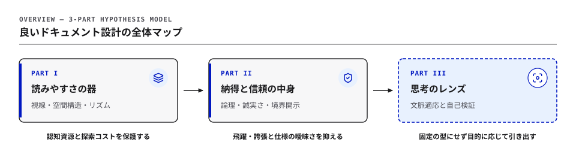
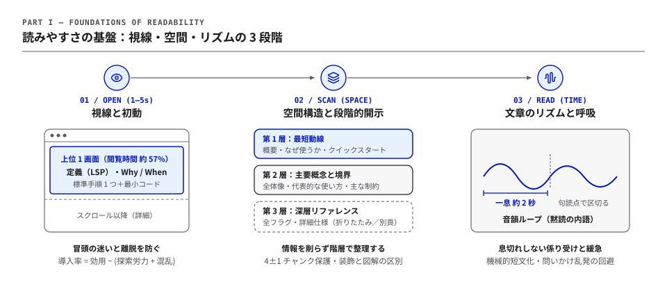
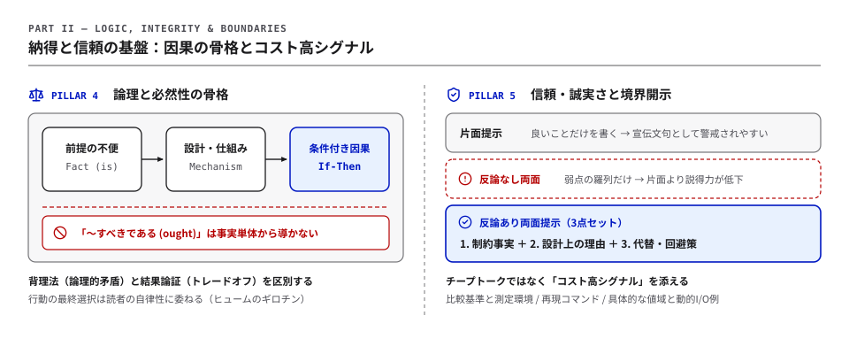
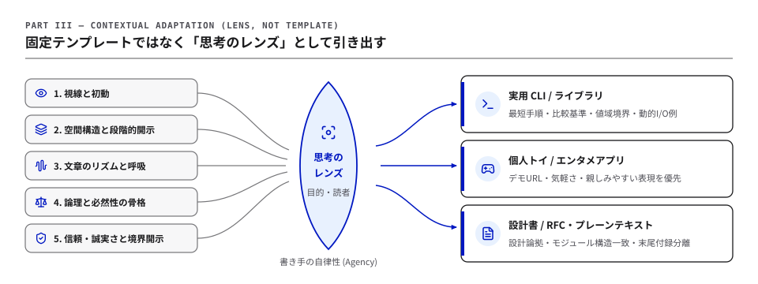

# 良いドキュメントとは何か（ダイジェスト版）：論理学・認知科学・広告工学・言語心理学から紐解く技術文書設計のヒント

## 要旨

生成AIの普及により、流暢な文章を誰でも一瞬で書ける時代になりました。しかしソフトウェアのREADMEや仕様書、技術解説記事などでは、「表層は綺麗だが根拠のない誇張表現が混ざる」「情報を詰め込みすぎて読む前に閉じられる」「客観的な仕様ではなく書き手の主観的なお説教が書かれている」といった課題がかえって目立つようになっています。

本稿は、「嘘や誇張がなく、読者の頭にスッと入ってくる『良いドキュメント』とは何か」を探る個人的な自由研究の総括レポート（[`PAPER.md`](https://github.com/DovahkiinYuzuko/explorations-in-documentation/blob/banana/PAPER.md)）から、核となる考え方と具体例だけを抜き出したダイジェスト版です。原典の英文引用や詳細な統計データ、各研究の限界条件まで確認したい場合は、フル版の `PAPER.md` と参考文献一覧 `REFERENCES.md` を参照してください。

---

## 1. なぜ技術文書は「盛られ」たり「閉じられ」たりするのか

生成AIにドキュメントを書かせると、「圧倒的に高速」「究極の柔軟性」といった大袈裟な言葉を足したり、見出しや箇条書きに装飾的な絵文字を自動で差し込んだり、実際に動くかの検証を省略したりするクセがしばしば現れます。逆に、背景を削ぎ落とした無味乾燥な箇条書きにすると、「なぜこのツールが存在し、どんな場面で役に立つのか」が伝わらなくなります。

書き手と読み手の間では、大きく分けて次の **3つの摩擦** が起きやすくなります。

1. **知覚と初動の摩擦（読まれずに閉じられる）**  
   どれだけ誠実な仕様を後半に書いていても、開いた最初の数秒で「これは何で、自分にどう関係があるのか」が直感できなければ、読者はスクロールせずにページを閉じてしまいます。
2. **認知と記憶の摩擦（詰め込みすぎ vs 削りすぎ）**  
   全機能や全例外を1ページにフラットに並べたり、1文に修飾節を詰め込みすぎたりすると、読者の記憶容量が溢れて離脱しやすくなります。逆に、短くしようとして文脈や制約を削ると、必要な仕様が足りず導入判断ができません。
3. **不信と仕様曖昧さの摩擦（宣伝文句への警戒とお説教への反発）**  
   技術者は経験上、どんなツールにもトレードオフがあることを知っています。良いことばかり並べた宣伝文句や「開発者は〜すべきである」というお説教、あるいは「invalidな値はエラー」といった曖昧な仕様表記に出会うと、警戒心や再調査の手間が増えます。

これらの摩擦を和らげる手がかりとして、論理学・認知科学・広告工学・言語心理学の先行研究を横断的に整理した結果、**「3部・5本柱」** から成る仮説モデルが見えてきました。

<picture>
  <source media="(prefers-color-scheme: dark)" srcset="./assets/mini-0-overview-dark.svg">
  <source media="(prefers-color-scheme: light)" srcset="./assets/mini-0-overview-light.svg">
  
</picture>

以下では、このモデルを「Part I（読みやすさの基盤）」「Part II（納得と信頼の基盤）」「Part III（文脈適応と限界）」の順に噛み砕いて紹介します。

---

## 2. Part I：読みやすさの基盤（視線・空間・リズム）

<picture>
  <source media="(prefers-color-scheme: dark)" srcset="./assets/mini-1-part1-dark.svg">
  <source media="(prefers-color-scheme: light)" srcset="./assets/mini-1-part1-light.svg">
  
</picture>

### 柱1：視線と初動――最初の1〜5秒と「Why / When」の欠落

読者がページを開いた瞬間、精読が始まる前に「この文書を読む価値があるか」の選別が行われます。Nielsen（2018）のアイトラッキング研究では、ユーザーは閲覧時間の **約57%** をスクロール前の最初の1画面（ファーストビュー）で費やし、**74%** を最初の2画面で費やしていました。また、島田・北島（2008）の読解2段階モデルが示すように、開いて最初の1〜2秒ではタイトルや数単語、レイアウトの印象といった断片情報から「自分の役に立ちそうか」という動機づけが判断されます。

ランディングページ設計の式を技術文書に読み替えると、次の関係として整理できます。

```text
導入率 (Adoption Rate) = 効用 (Utility) - (探索労力 (Labor) + 混乱 (Confusion))
```

ここで混乱を減らす手がかりになるのが、**「具体的な名詞と動詞で定義すること」** です。GitHubの385リポジトリを分析した Hellman ら（2023）は、対象言語・環境（Language）、ソフトウェア分類（Software technology）、具体的な目的（Purpose）の3要素（LSP）を含む概要文が理解されやすい一方で、3要素をすべて満たしていたリポジトリは **8.3%** にとどまったと報告しています。

さらに GitHub の393リポジトリを分類した Prana ら（2019）の調査では、README の **97%** に「What（何であるか）」、**88.5%** に「How（使い方）」が書かれていたのに対し、**「Why（なぜ作ったか）」は 25.7%**、**「When（どんな条件・規模に向いているか）」は 21.4%** にしか含まれていませんでした。また、PyPI 1,620件のREADMEを調べた Sitthithanasakul ら（2023）では、コード例の **92%** が単純代入や基本importなどの基本構文（Level A）で構成されていました。

冒頭では「抽象的なキャッチコピー」や「5通りのインストール方法の並列」を避け、**具体的な定義（LSP）・なぜ使うのか（Why / When）・標準的な1つの導入手順と最小コード** を置くことで、初動の迷いを減らしやすくなります。

### 柱2：空間構造と形式――情報を削らずに整理する

初動を通過した読者が次に直面するのが、ワーキングメモリの容量限界です。よく「7±2個」と言われますが、Cowan（2001）が再検討した結果、事前の知識（スキーマ）を持たない初見の情報に同時に注意を向けられる容量は **4±1 チャンク** 程度とされています。1つの見出しの下に15個の設定フラグがフラットに並んでいると、それだけで処理が重くなります。

かといって、認知負荷を下げるために細かい仕様を削り落とすと、今度は信頼性や実用性が損なわれます（Anik & Bunt, 2026）。そこで有効になるのが、情報を削除せず階層を分ける **「段階的開示（Progressive Disclosure）」** です。

- **第1層（最短動線）**：概要、なぜ使うのか、最小限のクイックスタート
- **第2層（主要概念と境界）**：代表的な使い方、全体像、主要な制約事項
- **第3層（深層リファレンス）**：全CLIフラグ一覧、設定スキーマ、エッジケース詳細（Markdownの折りたたみ、別ファイル、あるいは文書末尾の付録へ分離）

あわせて注意したいのが、**「主観的な読みやすさ（好感度）」と「実際の理解度」は一致しない** という点です。

- Börstler & Paech（2016）の実験では、コードの字面をそのまま言い換えただけのコメント（例：`timeout: 30 // タイムアウトを30秒にする`）は「読みやすい」という主観評価を上げたものの、理解度テストの成績向上にはつながりませんでした。
- Sung & Mayer（2012）の実験では、構造や関係を示す **説明的グラフィックス** は想起成績を大きく向上させた（効果量 d = 0.79）のに対し、見栄えのための **装飾的・魅惑的グラフィックス** は満足度（好感度）だけを上げ、理解には貢献しないか低下傾向を示しました。しかもその悪影響は、背景知識の少ない初学者などワーキングメモリ容量に余裕がない読者ほど受けやすいと報告されています（Sanchez & Wiley, 2006）。
- テキストに差し込む装飾的な絵文字も、視覚探索の速度を落とす「結合探索」を引き起こす可能性に加え、スクリーンリーダー利用者の環境では Unicode 記述子がそのまま単語列として読み上げられ、アクセシビリティ障壁になり得ます（Tigwell et al., 2020）。

また、箇条書きは視線の安定に役立つ反面、すべての項目を同じ重みに平坦化して因果関係を隠しやすい弱点があります（Alley & Neeley, 2005）。並列的項目は箇条書き、比較対照は表、関係や全体像は説明的図解、と役割で使い分ける視点が役立ちます。

### 柱3：文章のリズムと呼吸――約2秒の時間制約と短文化の罠

人は黙読しているときも、頭の中の声（内語）を使って音韻ループに一時保持しながら文を処理しています。Baddeley（1984）や田淵・湯舟（2010）の研究が示すように、この保持時間には **約2秒**（日本語の呼気段落で平均1.6秒、英語で平均2.1秒）という短い制約があります。句読点の区切りなしに修飾句が長く続く文や、主語と述語が離れすぎた文は、頭の中で息切れを起こして読み直しを増やします。

ただし、だからといって「1文を40字以内に機械的に短くする」という単純な数値ルールには落とし穴があります。Xia Fang（2023）の比較研究では、1句あたりの語数制限を厳格に守ろうとして論理をつなぐ接続詞や機能語を削った結果、実詞ばかりが密集（語彙密度 94%）してかえって難解になった事例が報告されています。Java の公式APIドキュメントを調査した Khan ら（2021）も、「短く保とうとするあまり説明力が落ち、字面をなぞるだけの怠惰な記述（Lazy スメル）が増えている」と指摘しています。

さらに、読者の注意を引くために使われがちな「本文途中の問いかけ（なぜこうなるのでしょうか？）」も万能ではありません。Sun ら（2024）や Li ら（2024）の実験では、挿入質問の正の効果は物語文における why 質問に限られ、説明文に高頻度（約100語ごと）で質問を挟むと思考の流れが中断され、文章全体の構造理解が低下したことが報告されています。

文字数のマジックナンバーを追うのではなく、**1文の述語数を増やしすぎず係り受けの距離を近づけること、論理をつなぐ接続語を不用意に削らないこと、文長に緩急を持たせること** が、読みやすいリズムの鍵になります。

---

## 3. Part II：納得と信頼の基盤（論理・誠実さ・境界開示）

<picture>
  <source media="(prefers-color-scheme: dark)" srcset="./assets/mini-2-part2-dark.svg">
  <source media="(prefers-color-scheme: light)" srcset="./assets/mini-2-part2-light.svg">
  
</picture>

### 柱4：論理と必然性の骨格――お説教を外して因果で語る

機能一覧（What）だけを箇条書きにしても、初めて見る読者には「なぜその設計なのか」がピンときません。たとえばトイレットペーパーを説明するとき、「1. パルプ製、2. ロール型、3. ミシン目入り」と並べるよりも、「拭くための紙が必要で（前提の課題）、必要な長さは毎回異なる（境界条件）。だから使う人が長さを自由に調整できるロール型になっている（設計理由）」とつなぐと、機能と構造の必然性が一本の筋道として理解しやすくなります。

この論理の骨格を整えるうえで、特に意識したいポイントが2つあります。

1. **背理法（論理的矛盾）と結果論証（トレードオフ）を混ぜない**  
   Jansen（2007）が区別したように、「共有メモリを排他制御なしで同時書込するとデータ競合が起きる」という論理的な不可能性と、「メモリ消費が増える代わりに速度を上げる」という因果的なトレードオフは別物です。他方式のトレードオフを「従来方式は破綻する」と誇張すると、技術者からの信頼を損ねやすくなります。
2. **ヒュームのギロチン：事実（is）から当為（ought）を導かない**  
   哲学者ヒューム（1739）が指摘した通り、「〜である（仕様事実）」だけから「だからあなたは〜すべきである（当為）」は論理的に導けません。技術文書から「〜すべき」を外し、**客観的な仕様事実と条件付き因果（If-Then）** に書き換えると、お説教臭さと曖昧さが同時に消えます。

- **規範文の例**：「データベースの接続プールサイズは10以上に設定すべきです。」
- **条件付き因果文の例**：「デフォルトの接続プールサイズは5です（仕様事実）。秒間100リクエストを超えるバースト通信時に接続待ちタイムアウトを抑えたい場合は、プールサイズを10以上に設定する方法があります（目的条件と因果関係）。」

### 柱5：信頼・誠実さと境界開示――チープトークを超えて

生成AIによって、綺麗な褒め言葉や整ったフォーマット（太字・リスト・絵文字）を量産するコストは限りなくゼロに近づきました（Paramitha et al., 2026; Zhang et al., 2025）。誰でも低コストで作れる言葉（チープトーク）だけでは信頼が形成されにくくなっている現在、効きやすいのは裏付けに相応の手間がかかる **「コスト高シグナル（Costly Signals）」** です。

1. **比較対象と測定環境が明記されたデータ**：「高速」「80%削減」ではなく、何のバージョンとどの環境で比べた結果なのかを添える。
2. **手元で追試できる再現コマンド**：読者がローカル環境で検証できる手順を示す。
3. **弱点・制約の「反論あり両面提示」**：トゥールミン論証モデルの実験（Rubin & Benbasat, 2023）では、例外や制約の開示（Rebuttal）が「誠実さ（Integrity）」の信頼を高めることが示されています。ただし、大規模メタ分析（Allen, 1991; O'Keefe, 1999）によれば、**「Windows非対応」「10万件でメモリ不足」と弱点だけを並べる（反論なし両面提示）と、良いことしか書かない場合よりもかえって説得力が下がります**。弱点を開示する際は、次の3点セットで書くと判断材料として機能します。
   - **制約事実**：何ができないのか、どこで限界に達するのか
   - **設計上の理由**：何を優先したトレードオフの結果なのか
   - **代替手段・回避策**：該当する場合に読者が採り得る選択肢

さらにAPI仕様やツールの説明では、「`invalid` な値はエラー」「〜は避けるべき（`should not`）」といった曖昧な表現が利用者の混乱と不要な防御的コードを生むことが実証されています（Monperrus et al., 2012; Zhou et al., 2018）。「`0` 以上 `65535` 以下の整数を受け取り、`0` 未満では `ValueError` を送出する」といった **具体的な値域境界** と、「この具体値を渡すとこの出力になる」という **動的I/O具体例**（Jiang et al., 2017/2018）を添えることで、外部サイトで使い方を探す手間を減らせます。

---

## 4. Part III：テンプレートではなく「思考のレンズ」として

<picture>
  <source media="(prefers-color-scheme: dark)" srcset="./assets/mini-3-part3-dark.svg">
  <source media="(prefers-color-scheme: light)" srcset="./assets/mini-3-part3-light.svg">
  
</picture>

ここまで5本柱を整理しましたが、本モデルの最も大事な結論は、**「これらを画一的な穴埋めテンプレートや一律の禁止ルール（絵文字全面NG、1文50字縛りなど）として押し付けないこと」** です。

GitHub README の点検ツールを研究した Mynampaty ら（2026）も、良いドキュメントの基準はプロジェクトや読者コミュニティによって異なり、書き手の自律性（Authorial Agency）を奪わずに点検を支援することが重要だと指摘しています。

- **実用的なCLIツールやライブラリ**：最短コマンド、比較基準、値域境界、動的I/O例が活きやすい。課題解決が目的のため、無関連な装飾を抑えて探索速度とアクセシビリティを保つほうが噛み合いやすい。
- **エンタメ系のジョークアプリや個人のおもちゃ**：たとえば「画像をボタンひとつでガビガビにするWebトイ」のREADMEに、堅苦しい設計思想やベンチマーク表を並べると、かえって気軽さと楽しさが失われる。デモURLや親しみやすい語り口、視覚的な楽しさが目的に合致する。
- **設計書やRFC、プレーンテキスト**：クイックスタートの代わりに、設計判断の論拠、モジュール構造との一致、末尾の付録への情報分離が中心になる。

5本柱は「必ず埋めるフォーム」ではなく、**「今書いているこの文書で、読者はどこでつまずきやすいか」を見直すための思考のレンズ（引き出し）** として使い分ける位置づけになります。

### この仮説モデル自体の限界とトレードオフ

第6章の「反論あり両面提示」を本モデル自身にも当てはめておきます。

1. **統合モデル全体としての未検証性**：引用した各研究にはそれぞれの分野での実証データがある一方、異分野（学習教材・医療表・小説・L2読解など）の知見を技術文書向けに統合したモデル全体での比較実験はまだ行われていません。あくまで先行研究から組み立てた仮説モデルです。
2. **情緒的エッセイや物語への非適合**：感情を揺さぶるエッセイや物語、第一印象の華やかさを優先したい文章では、事実と因果への整理や装飾の抑制が逆効果になり得ます。
3. **書き手の検証・維持コストの増加**：「高速です」と一言書くのに比べ、比較基準や値域境界、動的I/O例を揃えて最新に保ち続けるには手間がかかります。読み手の探索コストを書き手側が引き受けるトレードオフであり、その負担を減らす試みとしてAIエージェント向けスキル `doc-refine` への落とし込みを並行して進めています。

---

## おわりに・関連ドキュメントへの案内

「AIはすぐ文章を盛るし検証もサボる。論理学と広告の見せ方を掛け合わせれば、嘘がなくてスッと頭に入るリドミが作れるのでは？」という素朴な疑問から始まったこの自由研究は、まだ検証の途上にある未完成の仮説です。日々ドキュメントを書く誰かにとって、構成や表現を見直すときのひとつのヒントになれば嬉しく思います。

原典の引用、詳細な統計データ、参考文献一覧、および実践用スキルについては、GitHub リポジトリ内の各ドキュメントを参照してください。

- **フル版レポート（原典・英文引用・統計データ完全版）**: [`PAPER.md`](https://github.com/DovahkiinYuzuko/explorations-in-documentation/blob/banana/PAPER.md)
- **参考文献とトレーサビリティ一覧**: [`REFERENCES.md`](https://github.com/DovahkiinYuzuko/explorations-in-documentation/blob/banana/REFERENCES.md)
- **この自由研究を始めたきっかけと背景**: [`PHILOSOPHY.md`](https://github.com/DovahkiinYuzuko/explorations-in-documentation/blob/banana/PHILOSOPHY.md)
- **エージェントスキル `doc-refine` への設計解説**: [`ARCHITECTURE.md`](https://github.com/DovahkiinYuzuko/explorations-in-documentation/blob/banana/ARCHITECTURE.md)
- **リポジトリ全体の案内板**: [`README.md`](https://github.com/DovahkiinYuzuko/explorations-in-documentation/blob/banana/README.md)
