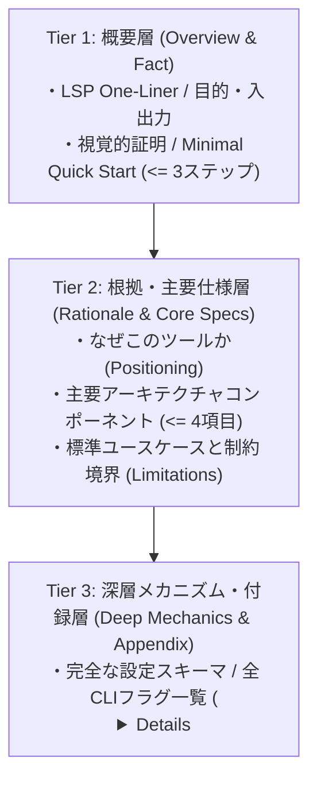

# doc-refine Layer 2 詳細監査基準リファレンス
## 構成・段階的開示・認知負荷・情報構造の定量的評価仕様

本リファレンスは、`doc-refine` スキルにおいてドキュメントの構成骨格、段階的開示（Progressive Disclosure）、および認知負荷制御（Layer 2: Structure & Progressive Disclosure）を客観的・論理的に監査・リライトするための詳細判定基準である。
外的環境に依存する物理的行数ではなく、**ドキュメントの構造的複雑さ（見出し階層、並列項目数、情報の関心事境界）** に基づいて判定を行う。

---

## 1. Layer 2 監査判定基準マトリクス

| 監査項目 | 判定ルール | 違反時の判定 |
| :--- | :--- | :---: |
| **① 情報の3層アーキテクチャ** | ドキュメントが Tier 1（概要層）$\rightarrow$ Tier 2（根拠・主要仕様層）$\rightarrow$ Tier 3（深層メカニズム・付録層）の順で分離されているか。<br>※Tier 1直後にTier 3の詳細（長大なJSON、全CLIフラグ一覧、内部実装）が展開されている場合は違反。 | **早期詳細展開: L2 FAIL**<br>層の境界曖昧: L2 WARN |
| **② ワーキングメモリ容量（4±1チャンク）** | 単一の見出し（H2/H3）直下に並列提示される箇条書き項目、パラメータ一覧、主要機能数が **4個以下（最大5個）** に収まっているか。<br>※5個以上の並列項目はクラスタリング（2階層化）または折りたたみ・付録分離を適用。 | **並列 $\ge$ 5項目: L2 WARN**<br>並列 $\ge$ 8項目: L2 FAIL |
| **③ 構造的・意味論的情報隔離（SoC）** | 一次的な利用フロー（ハッピーパス）に直接必要のない「網羅的CLIフラグ一覧、全環境変数マトリクス、補助設定スキーマ、高度なエッジケース」が、環境に応じた隔離手法（`<details>`、末尾付録、別ファイル）へ退避されているか。 | **付録仕様の平坦露出: L2 WARN**<br>主文脈を圧迫する露出: L2 FAIL |
| **④ 認知アラーム（不安喚起）隔離** | 初期のメンタルモデル構築に不要な「破壊的操作、高度な設定変更、詳細なトラブルシューティング」が Tier 1 / Tier 2 に混在せず、最終セクションまたは付録に隔離されているか。 | **冒頭警告過多: L2 WARN** |
| **⑤ 構造的目次（TOC）網羅** | ドキュメント内に **H2見出しが4個以上** 存在する場合、Tier 1直下にアンカーリンク付き目次（TOC）が存在し、見出し名と完全一致しているか。 | **見出し4個以上でTOC欠落: L2 WARN**<br>TOCリンク破損: L2 FAIL |
| **⑥ 空間的一体化（注意分割排除）** | コードブロック内で使用されている変数・オプションの解説が、無関係な段落や別見出しを跨いで分離記述されていないか。 | **文脈を跨ぐ解説分離: L2 WARN** |
| **⑦ 多言語ドキュメント分離規範** | 完全な翻訳文言（日本語・英語等）が単一ファイル内に縦積みされ、ファイル長が肥大化・スクロール離脱（False Floor）を招いていないか。<br>※`README.md` と `README.ja.md` など別ファイルへ分離し、先頭にスイッチャーリンクを設置。 | **多言語縦積み露出: L2 WARN** |

---

## 2. 情報の3層アーキテクチャ（3-Tier Architecture）仕様

すべての詳細を初手から開示することはユーザーの作業記憶を飽和させる。ドキュメントは以下の3層で厳格に階層化する。



### 2.1 各階層の配置規約
1. **Tier 1（概要層）**:
   - ファーストビュー（スクロールなしで読める範囲）に限定。
   - ツールのカテゴリ、主要入力、主要出力、およびコピペ実行可能な最小コマンド（$\le$ 3行）のみを配置する。
2. **Tier 2（根拠・主要仕様層）**:
   - 既存ツールとの差別化根拠、主要な動作原理、および代表的な利用フローを記述する。
   - 並列要素は容量制約（$\le 4$ 項目）に従い、構造化する。
3. **Tier 3（深層メカニズム・付録層）**:
   - 初見の評価段階では不要な「完全なAPI仕様、全フラグ一覧、環境変数一覧、例外系トラブルシューティング」を配置する。
   - 原則として環境に応じた情報隔離（マークアップでは `<details>`、プレーンテキスト等では末尾付録または別ファイル）で開示する。

---

## 3. ワーキングメモリ容量遵守構文（4±1 チャンキング）

未知の情報に対する作業記憶容量（注意の焦点）は **中央値 4 個** である。
単一のセクション内で並列項目が5個以上存在する場合、以下のように意味的な上位カテゴリを設けて「1階層あたり最大3〜4項目」に再編する。

#### 具体例 (Good vs Bad)
- ❌ **Bad (並列8項目で容量超過 / L2 WARN)**:
  ```markdown
  ### Supported Output Formats
  - JSON format
  - YAML format
  - TOML format
  - XML format
  - CSV format
  - TSV format
  - Parquet format
  - Arrow IPC format
  ```
- ⭕ **Good (上位カテゴリによる2階層化 / L2 PASS)**:
  ```markdown
  ### Supported Output Formats
  - **Structured Text**: JSON, YAML, TOML
  - **Tabular Data**: CSV, TSV
  - **Columnar Binary**: Parquet, Arrow IPC
  ```

---

## 4. グルーピングとSoC（関心事の分離）による情報隔離・段階的開示仕様

情報の折りたたみや隔離は、単なる見た目のギミックではなく、**「認知心理学のグルーピング（容量保護）」と「ソフトウェア工学の関心事分離（SoC）」を融合させた情報整流アーキテクチャ**である。
初見ユーザーのハッピーパスを阻害する深層仕様を主文脈から隔離しつつ、能動的な探索感（Information Scent）を付与する。

### 4.1 隔離トリガー条件（意味論的・構造的判定）
以下の性質を持つ情報は、本文の主文脈に平坦展開してはならず、隔離措置を適用する：
1. **網羅的一覧トリガー**: 全CLIフラグ一覧、全環境変数マトリクス、全エラーコード対応表など、リファレンス用途の網羅的リスト。
2. **分岐・代替手順トリガー**: 特定のレガシーOS向け手順、Docker代替構成、高度なトラブルシューティングなど、主たるハッピーパスから分岐する手順。
3. **詳細構造定義トリガー**: 完全なJSON/YAML設定スキーマ、型定義ファイル、内部状態遷移テーブルなど、深層データ。

### 4.2 ドキュメント形式別の具象化マッピング
本規範はMarkdown専用ではなく、対象ドキュメントの表現形式に応じて以下のように具象化する：

| 対象ドキュメント形式 | 隔離手法（具象化） | 実装方法 |
| :--- | :--- | :--- |
| **Markdown / GFM / HTML** | **対話的折りたたみ** | `<details><summary>...</summary>...</details>` タグによるインライン隠蔽 |
| **プレーンテキスト (.txt) / RFC** | **末尾付録（Appendix）分離** | 本文には要約ポインタ（`[See Appendix A for full flag list]`）のみを置き、文書末尾へ隔離 |
| **仕様書・複数ファイル構成** | **外部ファイルポインタ分離** | 本文からリンク形式（`docs/flags.md` や `reference/`）で独立ファイルへ退避 |

#### Markdown環境における推奨テンプレート
`<summary>` には、折りたたまれている内容の「データ種別」「対象ユースケース」を明記する。

```markdown
<details>
<summary><strong>詳細設定スキーマと全CLIフラグ一覧 (クリックで展開)</strong></summary>

```bash
# 全フラグ詳細
--config <path>       設定ファイルのパス (デフォルト: ./doc-refine.json)
--strict              厳格モードを有効化 (警告をすべてエラーとして扱う)
...
```
</details>
```

#### プレーンテキスト (txt) 環境における推奨パターン
```text
4. Quick Start
Run the basic command:
    $ mytool process input.txt

[Note: For the exhaustive list of all 24 CLI flags and advanced daemon options,
 refer to APPENDIX A: CLI REFERENCE at the end of this document.]
```

---

## 5. 空間的一体化による注意分割（Split-Attention）の排除

相互依存する情報（例：実行コードと各行の引数解説）が離れた場所に配置されている場合、読者は視線を行き来して照合する必要が生じ、認知負荷が増大する。

### 5.1 空間的一体化の適用ルール
コードブロック内の設定項目やCLI引数を説明する際は、コードブロックから離れた独立セクションで後置するのではなく、以下のいずれかの方法で空間的一体化を図る：
1. **インラインコメント**: コードブロックの該当行の右側または直上に注釈を記述する。
2. **直近マッピングテーブル**: コードブロックの直下に、使用されたキー・引数のみを絞り込んだ対比表（最大4行）を配置する。

#### 具体例 (Good vs Bad)
- ❌ **Bad (別見出しや無関係な段落を跨ぐ解説分離 / L2 WARN)**:
  ```markdown
  ```bash
  doc-refine audit --target ./README.md --level strict --output json
  ```
  ## アーキテクチャ概要
  本ツールはRustで記述されており... (中間に無関係なセクションが挟まる) ...

  ## オプションの補足
  前述のコマンドで使用されている `--level strict` は警告をエラー扱いにする設定です。
  ```
- ⭕ **Good (空間的一体化 / L2 PASS)**:
  ```markdown
  ```bash
  # --level strict: 警告をエラーとして扱いCIをブロック
  # --output json:  機械検証用の構造化レポートを出力
  doc-refine audit --target ./README.md --level strict --output json
  ```
  ```
