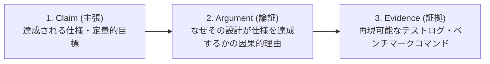

# doc-refine Layer 4 詳細監査基準リファレンス
## 論理構造・形式証明・事実規範分離・アシュアランス構造の定量的評価仕様

本リファレンスは、`doc-refine` スキルにおいてドキュメントの演繹的健全性、論理的一貫性、事実命題と価値命題の分離、および証明構造（Layer 4: Logical Architecture & Proof）を客観的・論理的に監査・リライトするための詳細判定基準である。

---

## 1. Layer 4 監査判定基準マトリクス

| 監査項目 | 判定ルール | 違反時の判定 |
| :--- | :--- | :---: |
| **① 部分論理式性質（Subformula Property）** | 各セクションの結論部や手順部に、それ以前の前提部（Context / Inputs）や初期要件で未定義の「唐突な新規用語・未定義概念」が出現していないか。<br>※未定義概念の出現は「論理的飛躍（Non Sequitur）」として判定。 | **未定義語彙の飛躍: L4 FAIL**<br>軽微な用語揺らぎ: L4 WARN |
| **② 事実・規範分離（Is-Ought Filter）** | 事実命題（〜である）から導出規則なしに規範命題（〜すべきである、〜が推奨される）へ不当に飛躍していないか。<br>※検出時は客観的条件付き因果文へ機械的に正規化。 | **規範的説教の検出: L4 FAIL**<br>主観的推奨語: L4 WARN |
| **③ 背理法と実用論証の峻別** | 競合技術や代替案の棄却において、不都合な結果（パフォーマンス低下、学習負荷等のトレードオフ）を、あたかも「論理的矛盾・絶対的不可能事」であるかのように偽装していないか。 | **トレードオフ偽装: L4 WARN**<br>虚偽の不可能主張: L4 FAIL |
| **④ 隠れた前提（Enthymeme）の開示** | 「$A$ である。したがって $B$ である」という推論において、$A$ と $B$ を接続する媒介命題や前提条件が省略されていないか。 | **媒介命題欠落: L4 WARN** |
| **⑤ Assurance Case 3層分離** | システムの信頼性・性能に関する主張が、**Claim（主張）**、**Argument（論証）**、**Evidence（証拠）** の3層に明確に分離されているか。<br>※証拠を欠く主張、または論証を欠く生データの貼り付けは違反。 | **根拠なき主張: L4 FAIL**<br>論証なきログ添付: L4 WARN |
| **⑥ 偽の可読性・トートロジー排除** | 関数名や構文をそのまま自然言語で反復しているだけの、新しい情報量を持たない同語反復（トートロジー的説明文）が存在しないか。 | **無意味な反復文: L4 WARN** |

---

## 2. 部分論理式性質に基づく論理的飛躍（Non Sequitur）の機械的検知

推論の連鎖において、結論部に現れるすべての概念・語彙は、前提命題において既に定義されていなければならない。

### 2.1 監査仕様
ドキュメントの各セクションにおいて、前提部（Prerequisites, Input, Context）に定義されておらず、かつ目標（Goal, Output）にも含まれていない外部語彙・外部制約が、結論部や手順の途中に突如出現した場合、それは**「隠れた前提の隠蔽」または「論理的飛躍（Non Sequitur）」**として判定する。

#### 具体例 (Good vs Bad)
- ❌ **Bad (部分論理式性質違反 / L4 FAIL)**:
  ```markdown
  ### クエリ実行手順
  本ライブラリはローカルのSQLiteファイルから直接SQLを実行します。
  以下のコマンドを実行してください。
  ```bash
  mytool query "SELECT * FROM users"
  ```
  ※なお、本コマンドを実行するには事前にRedisサーバーがポート6379で稼働している必要があります。
  ```
- ⭕ **Good (前提の完全開示 / L4 PASS)**:
  ```markdown
  ### クエリ実行手順
  #### 前提条件
  - ローカルの SQLite データベースファイル
  - クエリキャッシュ用の Redis サーバー（localhost:6379 でリッスンしていること）

  #### 実行
  ```bash
  mytool query "SELECT * FROM users"
  ```
  ```

---

## 3. 事実・規範分離（条件付き因果文への機械的正規化）

事実命題（〜である）から、客観的な導出根拠なしに規範命題（〜すべきである、〜を推奨する）を導出することは論理的一貫性を損なう。技術ドキュメントにおける説教的・規範的記述は、ツールの客観的境界を曖昧にする。

### 3.1 変換プロトコル
以下の規範的語彙を検出し、客観的な条件付き因果文へ書き換える。

- **検出対象語彙**: 「〜すべきである」「〜するべきだ」「〜しなければならない（文脈上の説教）」「〜が推奨される」「推奨する」
- **書き換え公式**:
  $$\text{「［達成したい目的・境界条件］がある場合、［機能・手段］を適用することで［客観的結果］が担保される」}$$

#### 具体例 (Good vs Bad)
- ❌ **Bad (規範的説教 / L4 FAIL)**:
  ```markdown
  本フレームワークは非同期I/Oを採用しているため、開発者は同期ブロック処理を絶対に書くべきではない。常にすべてのハンドラをasyncで宣言すべきである。
  ```
- ⭕ **Good (客観的条件付き因果文への正規化 / L4 PASS)**:
  ```markdown
  本フレームワークのイベントループはシングルスレッド上で非同期I/Oを処理します。
  同期ブロック処理を実行した場合、イベントループ全体が停止し、同一プロセス内の全接続のリクエストレイテンシが増大します。
  スループットの低下を防ぐ要件がある場合は、ハンドラを `async` で宣言するか、重い計算処理を別スレッドプール（Worker Pool）へ委譲する構成とします。
  ```

---

## 4. 背理法と実用論証（トレードオフ）の峻別仕様

競合ツールや代替案を退ける際に、単なる性能劣化や学習コストといった「実用的トレードオフ」を、あたかも「原理的に不可能である」と絶対視して記述することは論理的誤謬である。

### 4.1 判定ルール
- 代替案の批判において「〜は不可能である」「〜は成立しない」「誤りである」という絶対的否定を使用している場合、それが形式論理的な矛盾に基づくものかを検証する。
- リソース制約や実装上の選択に起因する不利益である場合は、「条件付きトレードオフ」として書き換えを要求する。

#### 具体例 (Good vs Bad)
- ❌ **Bad (トレードオフを論理的不可能事と偽装 / L4 WARN)**:
  ```markdown
  DOMを直接操作する古いアプローチは完全に誤りであり、現代のWebアプリケーション構築では動作させることができません。
  ```
- ⭕ **Good (客観的トレードオフとしての記述 / L4 PASS)**:
  ```markdown
  状態変化に伴うDOMの直接書き換えは、要素数が数千件規模に達した場合にブラウザのリフローと再描画コストが増大し、フレームレートが60fpsを下回る原因となります。
  頻繁な画面更新を伴う大規模アプリケーションにおいてリフローコストを最小化する目的で、本ライブラリは仮想DOMによるバッチ更新を採用しています。
  ```

---

## 5. Assurance Case 3層分離仕様

性能・耐障害性・セキュリティに関する主張は、以下の3要素を明示的に分離して記述する。



1. **Claim（主張）**: 何が達成されるのか（例: 「99.9thパーセンタイルレイテンシが10ms未満」）。
2. **Argument（論証）**: なぜそれが達成できるのかというメカニズムの解説（例: 「ロックフリーキューによるスレッド間競合の排除とゼロコピーデシリアライズ」）。
3. **Evidence（証拠）**: 読者が手元で客観的に検証可能なエビデンス（例: ベンチマークコードへのリンク、実行コマンド、環境諸元）。

---

## 6. 偽の可読性・トートロジー排除仕様

見出しやコードのシグネチャをそのまま反復しているだけで、**「Why（なぜその引数が必要か）」「Precondition（呼び出し前提）」「Side Effects（副作用）」** を一切追加していない説明文を検出した場合、削除または有用な仕様情報の追加を要求する。

#### 具体例 (Good vs Bad)
- ❌ **Bad (トートロジー的説明文 / L4 WARN)**:
  ```markdown
  ### `fetchUserProfile(userId: string)`
  ユーザーIDを受け取ってユーザープロフィールを取得します。
  ```
- ⭕ **Good (前提・副作用・例外を含む客観仕様 / L4 PASS)**:
  ```markdown
  ### `fetchUserProfile(userId: string)`
  認証済みセッションの Bearer トークンを用いて `/api/v1/users/{userId}` から公開プロフィールを返します。
  - **前提条件**: `initializeAuth()` が完了していること。
  - **エラー**: 対象ユーザーが存在しない場合は `UserNotFoundError (HTTP 404)` をスローします。
  ```
